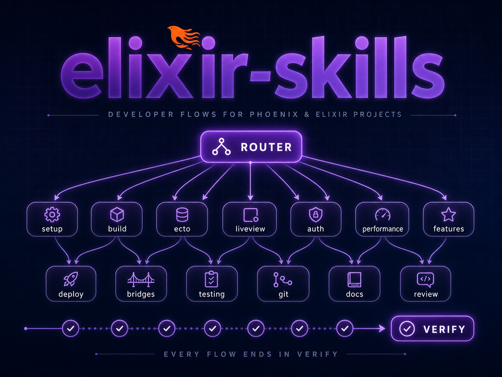
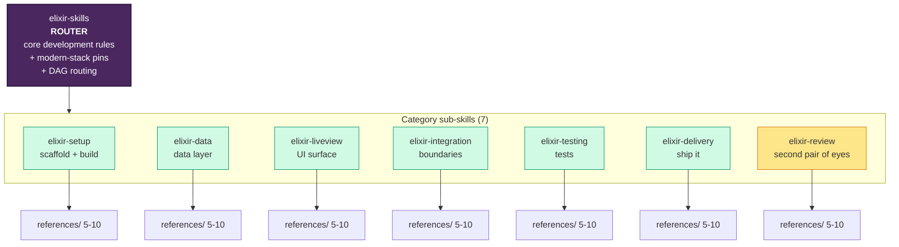

<div align="center">

# ⚡ elixir-skills

### Elixir/Phoenix Development Framework

One router skill. **Seven** category sub-skills. Every path a DAG, every flow ends in **VERIFY**.

Built to grow — add a reference, register it in its category, done.

[](LICENSE)
[](https://elixir-lang.org)
[](https://www.phoenixframework.org)



</div>

---

## Architecture



## The seven categories

| # | Category | Territory | Typical triggers |
|---|---|---|---|
| 1 | **elixir-setup** | scaffold + build | new umbrella/app, local env, mix/deps failures, compile warnings, runtime.exs, Tailwind v4/daisyUI assets, UUID keys, hex publish |
| 2 | **elixir-data** | data layer | Ecto queries/migrations, JSONB filters, FK & cascade policy, partitioned tables, N+1, slow queries, EXPLAIN, perf audits |
| 3 | **elixir-liveview** | UI surface | LiveView debugging, streams vs assigns, hooks, HEEx, forms, search pickers, client-DOM vs morphdom, ETS-fed tables, dashboards, i18n |
| 4 | **elixir-integration** | boundaries | auth/OAuth, security audits, REST APIs, MCP servers/proxies, LLM gateways, agent↔Elixir bridges, pgvector, prompt-injection defence |
| 5 | **elixir-testing** | tests | ExUnit conventions + foot-guns, flaky/async isolation, sandbox modes, LiveViewTest traps, SSR widget tests |
| 6 | **elixir-delivery** | ship it | commit waves, precommit gates (format/sobelow/test), failure triage, structure.sql drift, git hygiene, release/deploy, READMEs, screenshots |
| 7 | **elixir-review** | second pair of eyes | diff/PR review rulebook, plan review, architecture specs, redundancy/Phoenix audits, adversarial posture |

## Structure

```
elixir-skills/
├── SKILL.md              ← router: core rules + modern-stack pins + DAG routing + Quick Nav
├── README.md
├── LICENSE               ← MIT
├── assets/
│   └── elixir-skills-header.png
├── scripts/
│   └── validate.py       ← structural validator (Python stdlib only)
└── skills/
    ├── elixir-setup/         SKILL.md (meta/DAG) + references/
    ├── elixir-data/          SKILL.md (meta/DAG) + references/
    ├── elixir-liveview/      SKILL.md (meta/DAG) + references/
    ├── elixir-integration/   SKILL.md (meta/DAG) + references/
    ├── elixir-testing/       SKILL.md (meta/DAG) + references/
    ├── elixir-delivery/      SKILL.md (meta/DAG) + references/
    └── elixir-review/        SKILL.md (meta/DAG) + references/
```

Each category's `SKILL.md` is its **meta-skill**: a decision DAG ("what task →
which section → which reference"), the distilled rules of the territory, a
`## VERIFY` section with the concrete done-gates, and a `## References` index
saying when to load each depth file. You never read a category blind and you
never load all its references — the meta-skill tells you the one you need.

## SOUL system prompt

Paste this block into the agent's SOUL / system prompt so it knows the
taxonomy exists and which category to load before touching Elixir work:

```text
## Elixir/Phoenix work — skill taxonomy (elixir-skills framework)

Before any Elixir/Phoenix task, load the router skill `elixir-skills`; it
routes to ONE of seven category sub-skills. Each category SKILL.md is a
meta-skill: decision DAG + distilled rules + VERIFY gates + an index of its
references/ depth files. Load a category, then only the references its index
says you need.

1. elixir-setup — scaffold + build: new app/umbrella bootstrap, local env,
   mix/deps troubleshooting, compile failures and warnings-as-errors
   discipline, runtime.exs vs test.exs overrides, Tailwind v4/daisyUI assets,
   UUID primary keys, hex publishing.
2. elixir-data — data layer: Ecto query pitfalls (fragments, bindings,
   JSONB @> param failure), migrations and rename rules, structure.sql
   freshness, FK on_delete cost at scale, cascade design, partitioned-table
   maintenance (ATTACH/backfill/covering indexes), N+1 cookbook, EXPLAIN
   tracing, read-only performance audits.
3. elixir-liveview — UI surface: LiveView debugging, streams vs assigns,
   hooks, HEEx design systems, forms/wizards, search pickers/comboboxes,
   client-DOM state vs morphdom patches (dialogs, canvas/DAG, tabs),
   ETS-fed tables (two-table rows/full design), analytics rollups,
   i18n/gettext, consolidating near-identical LiveViews, browser E2E for
   client-only state.
4. elixir-integration — boundaries: auth/OAuth/social login/impersonation,
   security-audit method, REST API patterns, MCP server development,
   LLM proxy gateways (circuit breakers, retries, OTLP), agent↔Elixir dev
   bridges, prompt-injection defence, pgvector/embeddings, new-app
   integration checklist.
5. elixir-testing — tests: ExUnit + pure-module conventions and foot-guns,
   flaky/async isolation ladder, sandbox modes and test-DB seed dependency,
   LiveViewTest traps (select validation, has_element?, exact flash strings),
   SSR testing of pure-React widgets.
6. elixir-delivery — ship it: precommit gates in order (compile → format →
   deps.audit → sobelow → test) and the .sobelow-conf fix for the constant
   Config.CSP false positive, multi-wave partitioned commits (git reset +
   explicit file lists + coverage check), three-way test-failure triage
   (environmental / stale-expectation / product-decision), flake confirmation
   loop, structure.sql drift, adversarial review gate before commit, API e2e
   smoke, git hunks/history/signing, release & deploy (mix release, PaaS,
   Docker, SSL/CSRF), README authoring and UI screenshots.
7. elixir-review — second pair of eyes: diff-review idiom rulebook
   (nil-safety, exhaustiveness, perf/DB, security, i18n), implementation-plan
   review (drift classes), architecture specs from existing codebases,
   Phoenix/redundancy audits, adversarial posture (who writes does not
   self-approve), bulk-edit safety.

Routing heuristics: a feature wave usually spans liveview + data while
building and delivery when committing; review is loaded BY the delivering
agent as a gate, not instead of one. Version-sensitive claims are pinned in
the router's "Modern stack" block (Elixir 1.20 / OTP 28-29 / Phoenix 1.8 /
LiveView 1.2 / Ecto 3.14) — re-verify before trusting them on other versions.
```

## Core Development Rules

Every category inherits these from the router — they apply to **all** Elixir work:

1. **Investigate before concluding.** If you don't know something, say so and research it.
2. **Codebase first.** Never assume — verify against the actual repo.
3. **Validate the project.** Confirm which repo you are in before acting.
4. **Analysis first, changes after.** Read and understand before writing.
5. **Reusable code, not dogmatic "clean code".** Pragmatism over purity.
6. **Admit and correct.** Never hide mistakes or fabricate results.
7. **Ask when ambiguous.** Do not guess.
8. **Verify before done.** Compile, tests, runtime checks — real tool output only.

## Installation

### 1. Clone

```bash
git clone git@github.com:alvarolizama/elixir-skills.git
```

### 2. Install into Hermes

```bash
REPO=/path/to/elixir-skills
mkdir -p ~/.hermes/skills/software-development
cp -R "$REPO/skills/"* ~/.hermes/skills/software-development/
mkdir -p ~/.hermes/skills/software-development/elixir-skills
cp "$REPO/SKILL.md" ~/.hermes/skills/software-development/elixir-skills/SKILL.md
```

Or use symlinks to stay on the repo's bleeding edge:

```bash
for s in "$REPO/skills/"*/; do
  ln -sfn "$s" ~/.hermes/skills/software-development/$(basename "$s")
done
ln -sfn "$REPO" ~/.hermes/skills/software-development/elixir-skills
```

### 3. Verify

```bash
ls ~/.hermes/skills/software-development/ | grep elixir-
```

The router (`elixir-skills`) is the entry point. It routes to the category
sub-skills based on the task. Optionally paste the SOUL block above into the
agent's system prompt so the taxonomy is known before the router is loaded.

## Usage

Load the router skill first: `elixir-skills`. It contains:

1. **Core Development Rules** — investigation-before-conclusion, codebase
   first, reuse over rewrite, verify before done.
2. **Workflow Rules** — shaping, planning (DAG phases ending in VERIFY),
   codebase review, reuse.
3. **Modern stack pins** — the exact versions the framework is written against.
4. **Router DAG** — routes the task to the right category sub-skill.
5. **Quick Navigation** — one row per category.

Each category then handles its own territory: its SKILL.md is the meta-skill
(DAG + rules + VERIFY + reference index), backed by 5–10 `references/` depth
files.

## How to Grow This Framework

The point is that it keeps growing cleanly:

1. **New topic fits an existing category** → add a section to that category's
   `SKILL.md` (and a reference file if it has depth).
2. **New category** → create `skills/<name>/SKILL.md` with frontmatter + DAG +
   VERIFY, add `references/`, register one row in the router's Quick Navigation
   and update the SOUL block above.
3. **New depth on an existing pattern** → add a file under that category's
   `references/` and link it from its SKILL.md's References index.

Rules for contributions:

- **English only.** All SKILL.md files, DAGs, and references are in English.
- **Generic, no project/brand references.** Skills must be reusable across
  projects. Real project names (product names, org names, brand names) do not
  belong in a class-level skill — use `MyApp` as the placeholder.
- **Every category SKILL.md has a DAG** routing "what task → which section →
  which reference", and a `## VERIFY` section with real done-gates.
- **Every flow ends in VERIFY.** No phase is done until it is verified with
  real tool output.
- **References are pattern documents, not session logs**: symptom → mechanism
  → fix → verification. 60–250 lines each; keep 5–10 per category.

## Validate

Structural hygiene (frontmatter keys, DAG presence, exact `## VERIFY` heading,
reference index completeness/counts/lengths, relative Markdown link
resolution) is enforced by a stdlib-only Python validator. Run it from the
repo root before committing:

```bash
python3 scripts/validate.py
```

It prints one line per failure (`file:line — problem`) and exits non-zero when
anything is broken, so it can gate commits or CI.

## License

MIT — see [`LICENSE`](LICENSE).
