<div align="center">

# ⚡ elixir-skills

### Elixir/Phoenix Development Framework

One router skill. Thirteen category sub-skills. Every path a DAG, every flow ends in **VERIFY**.

Built to grow — add a sub-skill, register it in the router, done.

[](LICENSE)
[](https://elixir-lang.org)
[](https://www.phoenixframework.org)


</div>

---

## Architecture

```mermaid
flowchart TD
    R["elixir-skills<br/><b>ROUTER</b><br/>core development rules<br/>+ DAG routing"] --> CATS

    subgraph CATS["Category sub-skills (13)"]
        SETUP["elixir-setup"]
        BUILD["elixir-build"]
        ECTO["elixir-ecto"]
        LV["elixir-liveview"]
        AUTH["elixir-auth-security"]
        PERF["elixir-performance"]
        FEAT["elixir-features"]
        DEPLOY["elixir-deploy"]
        BRIDGES["elixir-bridges"]
        TEST["elixir-testing"]
        GIT["elixir-git"]
        DOCS["elixir-docs"]
        REVIEW["elixir-review"]
    end

    SETUP --> SETUPR["references/"]
    BUILD --> BUILDR["references/"]
    ECTO --> ECTOR["references/"]
    LV --> LVR["references/"]
    AUTH --> AUTHR["references/"]
    PERF --> PERFR["references/"]
    FEAT --> FEATR["references/"]
    DEPLOY --> DEPLOYR["references/"]
    BRIDGES --> BRIDGESR["references/"]
    TEST --> TESTR["references/"]
    GIT --> GITR["references/"]
    DOCS --> DOCSR["references/"]
    REVIEW --> REVIEWR["references/"]

    style R fill:#4B275F,color:#fff,stroke:#2d1740,stroke-width:2px
    style SETUP fill:#d1fae5,stroke:#059669
    style BUILD fill:#d1fae5,stroke:#059669
    style ECTO fill:#d1fae5,stroke:#059669
    style LV fill:#d1fae5,stroke:#059669
    style AUTH fill:#d1fae5,stroke:#059669
    style PERF fill:#d1fae5,stroke:#059669
    style FEAT fill:#d1fae5,stroke:#059669
    style DEPLOY fill:#d1fae5,stroke:#059669
    style BRIDGES fill:#d1fae5,stroke:#059669
    style TEST fill:#d1fae5,stroke:#059669
    style GIT fill:#d1fae5,stroke:#059669
    style DOCS fill:#d1fae5,stroke:#059669
    style REVIEW fill:#fde68a,stroke:#d97706
```



## Structure

```
elixir-skills/
├── SKILL.md              ← router: core development rules + DAG routing + Quick Nav
├── README.md
└── skills/
    ├── elixir-setup/         umbrella scaffold, local bootstrap, multi-domain SaaS
    ├── elixir-build/         build troubleshooting, mix/deps, hex publishing
    ├── elixir-ecto/          query pitfalls, JSONB, cascades, tracing, data models
    ├── elixir-liveview/      LiveView debugging, HEEx design, forms, analytics, i18n
    ├── elixir-auth-security/ OAuth/social login, impersonation, security audit
    ├── elixir-performance/   read-only perf audits, redundancy audits
    ├── elixir-features/      end-to-end feature build, feature removal, runtime config
    ├── elixir-deploy/        mix release, PaaS/Docker, SSL/CSRF edge cases
    ├── elixir-bridges/       agent↔Elixir bridges, MCP servers/proxies, LLM gateways
    ├── elixir-testing/       pure Elixir + ExUnit, flaky tests, SSR components
    ├── elixir-git/           commit hygiene, history surgery, signing
    ├── elixir-docs/          READMEs, user docs, UI screenshots
    └── elixir-review/        architecture specs, plan review, redundancy audit
```

Each sub-skill has its own `SKILL.md` (DAG + consolidated patterns) and a
`references/` directory (absorbed originals + detail).

## Core Development Rules

Every sub-skill inherits these from the router — they apply to **all** Elixir work:

1. **Investigate before concluding.** If you don't know something, say so and research it.
2. **Codebase first.** Never assume — verify against the actual repo.
3. **Validate the project.** Confirm which repo you are in before acting.
4. **Analysis first, changes after.** Read and understand before writing.
5. **Reusable code, not dogmatic "clean code".** Pragmatism over purity.
6. **Admit and correct.** Never hide mistakes or fabricate results.
7. **Ask when ambiguous.** Do not guess.
8. **Verify before done.** Compile, tests, runtime checks — real tool output only.

## Installation

### 1. Clone

```bash
git clone git@github.com:alvarolizama/elixir-skills.git
```

### 2. Install into Hermes

```bash
REPO=/path/to/elixir-skills
mkdir -p ~/.hermes/skills/software-development
cp -R "$REPO/skills/"* ~/.hermes/skills/software-development/
cp "$REPO/SKILL.md" ~/.hermes/skills/software-development/elixir-skills/SKILL.md
```

Or use symlinks to stay on the repo's bleeding edge:

```bash
for s in "$REPO/skills/"*/; do
  ln -sfn "$s" ~/.hermes/skills/software-development/$(basename "$s")
done
ln -sfn "$REPO" ~/.hermes/skills/software-development/elixir-skills
```

### 3. Verify

```bash
ls ~/.hermes/skills/software-development/ | grep elixir-
```

The router (`elixir-skills`) is the entry point. It routes to the category
sub-skills based on the task.

## Usage

Load the router skill first: `elixir-skills`. It contains:

1. **Core Development Rules** — investigation-before-conclusion, codebase
   first, reuse over rewrite, verify before done.
2. **Workflow Rules** — shaping, planning (DAG phases ending in VERIFY),
   codebase review, reuse.
3. **Router DAG** — routes the task to the right category sub-skill.
4. **Quick Navigation** — one-row-per-sub-skill table.

Each sub-skill then handles its own territory with a DAG and consolidated
patterns, backed by `references/` for depth.

## How to Grow This Framework

The point is that it keeps growing cleanly:

1. **New topic fits an existing category** → add a section to that category's
   `SKILL.md` (and a reference file if it has depth).
2. **New category** → create `skills/<name>/SKILL.md` with frontmatter + DAG,
   add `references/`, and register one row in the router's Quick Navigation
   table.
3. **New depth on an existing pattern** → add a file under that category's
   `references/` and link it from its `SKILL.md`.

Rules for contributions:

- **English only.** All SKILL.md files, DAGs, and references are in English.
- **Generic, no project/brand references.** Skills must be reusable across
  projects. Real project names (product names, org names, brand names) do not
  belong in a class-level skill — use `MyApp` as the placeholder.
- **Every skill has a DAG.** The mermaid flow at the top of each `SKILL.md`
  routes "what task → which section".
- **Every flow ends in VERIFY.** No phase is done until it is verified with
  real tool output.

## License

MIT.