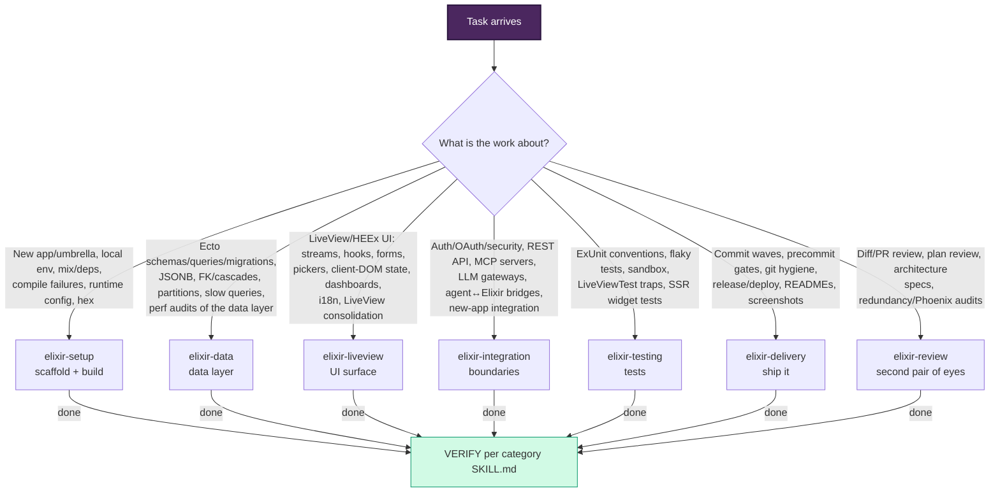

# Elixir Skills — Development Framework

This is the **router** of the Elixir development framework. Load it first: it
defines the core development rules, pins the verified modern stack, and routes
the task to ONE of seven category sub-skills. Each category's own `SKILL.md`
is the meta-skill for its territory: it carries the decision DAG, the distilled
rules, and the index telling you which of its `references/` files to load.

## Core Development Rules

These apply to **every** task, in every category. Never skip them.

1. **Investigate before concluding.** If you don't know something, say so and
   research it (docs, web, codebase) before speaking.
2. **Codebase first.** Before drawing conclusions about a project, read its
   configs and code. Never assume — verify against the actual repo.
3. **Validate the project.** Confirm which repo/project you are in before
   acting. Do not assume every task is the same repo.
4. **Analysis first, changes after.** Before writing a line, read and
   understand the existing code. Never rewrite wholesale.
5. **Reusable code, not dogmatic "clean code".** Pragmatism over purity.
   If something exists, reuse it. If it's broken, fix it. No code religions.
6. **Admit and correct.** If wrong, correct yourself and learn. Never hide
   mistakes or fabricate results.
7. **Ask when ambiguous.** If there is ambiguity, ask. Do not guess.
8. **Verify before done.** A task is not done until it is verified with real
   tool output: compile, tests, runtime checks. Never report unverified work
   as done.

## Development Workflow Rules

### Shaping

- Turn a vague idea into a concrete, bounded deliverable before writing code.
- Identify what exists already (reuse) vs what must be built.
- Define the blast radius: modules, schemas, routes, LiveViews, tests, docs.

### Planning

- Break work into phases with clear deliverables and verification gates.
- Express phases as a DAG (READ → EDIT/CREATE → RUN → VERIFY) — every flow
  ends in VERIFY nodes before Done.
- Group changes into logical commits; never mix pre-existing WIP with feature
  commits. If files are shared, split hunks.

### Codebase review

- Read before concluding: configs, schemas, contexts, routes, LiveViews,
  tests, migrations.
- Grep for the real call sites, not the ones you remember.

### Reuse

- If a helper, component, or context function already exists, use it.
- A second implementation of an existing mechanism is a bug waiting to drift.

## Modern stack (verified 2026-09-05)

Version pins this framework is written against — re-verify with `mix hex.info`
or hex.pm before trusting any version-sensitive claim:

| Layer | Version | Notes |
|---|---|---|
| Elixir | 1.20.x | Gradually typed language since 1.20; `mix compile --warnings-as-errors` stays the house gate |
| Erlang/OTP | 29 (28 supported) | Elixir 1.20 requires OTP 27+ |
| Phoenix | 1.8.x | Bandit is the default server; `<Layouts.app>` wrapping; `current_scope` auth assigns |
| LiveView | 1.2.x | `view.assigns` removed in tests — assert on `render(view)`; NO `stream_update/3` (proposal only, never shipped) |
| Ecto | 3.14.x | `rename/2` does not rename columns inside `alter table` — raw `ALTER TABLE ... RENAME COLUMN` |
| Postgres | 16+ | Partitioned tables, JSONB, pgvector recipes verified here |
| Tailwind | v4 | No `tailwind.config.js`; `@import "tailwindcss" source(none)` + `@source` directives in app.css |
| Assets | app.js + app.css only | Vendor deps must be imported into the bundles; no external `<script src>` in layouts |

Stack-agnostic rules (sobelow, mix aliases, git waves, E2E tooling) work on any
Phoenix ≥ 1.7 app; version-sensitive rows above name the exact release where
the behavior was verified.

## Router DAG

Multi-category tasks (the norm for feature waves): load the router, pick the
primary category, and pull a second one only when the task crosses into it —
e.g. a feature wave is `elixir-liveview` + `elixir-data` while building and
`elixir-delivery` when committing. The category `SKILL.md` files cross-link
via `related_skills`.

## Quick Navigation

| Category | Load when… | Owns |
|---|---|---|
| `elixir-setup` | scaffolding, env, build/deps break | umbrella bootstrap, local env, multi-domain SaaS, mix/deps troubleshooting, compile warnings, runtime-config overrides, Tailwind/daisyUI assets, UUID primary keys, hex publishing |
| `elixir-data` | the data layer bites | Ecto query pitfalls, JSONB fragments, EXPLAIN/tracing, FK `on_delete` cost, cascade design, partitioned-table maintenance, N+1 cookbook, read-only perf audits, migration/rename rules |
| `elixir-liveview` | the UI surface misbehaves | LiveView debugging, streams vs assigns, hooks, HEEx design system, forms/wizards, search pickers, client-DOM vs morphdom, ETS-fed tables, analytics rollups, i18n, LiveView consolidation, browser E2E for client state |
| `elixir-integration` | boundaries and APIs | auth/OAuth/impersonation, security audits, REST API patterns, MCP servers/proxies, LLM proxy gateways, agent↔Elixir dev bridges, prompt-injection defence, pgvector, new-app integration checklist |
| `elixir-testing` | proving it works | ExUnit conventions + foot-guns, flaky/async isolation ladder, sandbox modes + seed dependency, LiveViewTest traps, SSR component testing for pure-React widgets |
| `elixir-delivery` | shipping | precommit gates (format/sobelow/test), partitioned commit waves, test-failure triage, structure.sql drift, adversarial gate, API e2e smoke, git hunks/history/signing, release & deploy (PaaS/Docker/SSL), READMEs + screenshots |
| `elixir-review` | judging work (yours or others') | diff-review idiom rulebook, implementation-plan review, architecture specs, Phoenix/redundancy audits, adversarial-review posture, bulk-edit safety |

## Installation

See README.md — clone, then copy or symlink `SKILL.md` + `skills/*` into your
Hermes skills directory. The router is the entry point; categories load on
demand.

## How to Grow This Framework

1. **New topic fits an existing category** → add a section to that category's
   `SKILL.md` (and a reference file if it has depth).
2. **New category** → create `skills/<name>/SKILL.md` with frontmatter + DAG,
   add `references/`, and register one row in the router's Quick Navigation.
3. **New depth on an existing pattern** → add a file under that category's
   `references/` and link it from its `SKILL.md`.

Contribution rules:

- **English only** in all SKILL.md files and references.
- **Generic, no project/brand references** — `MyApp` placeholders only.
- **Every category SKILL.md has a decision DAG** and a `## VERIFY` section.
- **Every flow ends in VERIFY** — real tool output, never self-assessment.
