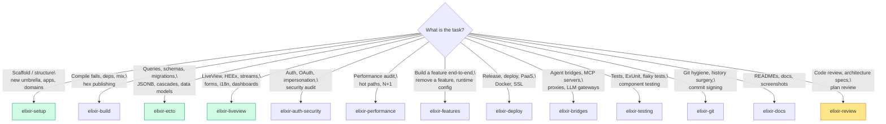

# Elixir Skills — Development Framework

This is the **router** of the Elixir development framework. Load it first: it
defines the core development rules and routes you to the right category
sub-skill based on the task.

## Core Development Rules

These rules come from the operating principles for all Elixir work. They apply
to **every** task, in every sub-skill. Never skip them.

1. **Investigate before concluding.** If you don't know something, say so and
   research it (docs, web, codebase) before speaking.
2. **Codebase first.** Before drawing conclusions about a project, read its
   configs and code. Never assume — verify against the actual repo.
3. **Validate the project.** Confirm which repo/project you are in before
   acting. Do not assume every task is the same repo.
4. **Analysis first, changes after.** Before writing a line, read and
   understand the existing code. Never rewrite wholesale.
5. **Reusable code, not dogmatic "clean code".** Pragmatism over purity.
   If something exists, reuse it. If it's broken, fix it. No code religions.
6. **Admit and correct.** If wrong, correct yourself and learn. Never hide
   mistakes or fabricate results.
7. **Ask when ambiguous.** If there is ambiguity, ask. Do not guess.
8. **Verify before done.** A task is not done until it is verified with real
   tool output: compile, tests, runtime checks. Never report unverified work
   as done.

## Development Workflow Rules

### Shaping

- Turn a vague idea into a concrete, bounded deliverable before writing code.
- Identify what exists already (reuse) vs what must be built.
- Define the blast radius: modules, schemas, routes, LiveViews, tests, docs.

### Planning

- Break work into phases with clear deliverables and verification gates.
- Express phases as a DAG (READ → EDIT/CREATE → RUN → VERIFY) — every flow
  ends in VERIFY nodes before Done.
- Group changes into logical commits; never mix pre-existing WIP with feature
  commits. If files are shared, split hunks.

### Codebase review

- Read before concluding: configs, schemas, contexts, routes, LiveViews,
  tests, migrations.
- Check for N+1, missing preloads, unbounded lists, payload bloat, and
  unguarded handlers.
- Verify claims against the actual code — never trust memory or self-reports.

### Reuse

- If a module, helper, pattern, or dependency already exists, reuse it.
- Prefer extending existing functions over adding parallel ones.
- Before adding a dependency, confirm the standard library or existing deps
  cover it.

## Router

Run ONLY the section you landed on. If the diagram sends you to another
sub-skill, **stop here** and hand off — don't absorb that work.

## Quick Navigation

| Sub-skill | When to load it |
| --- | --- |
| `elixir-setup` | Scaffold a new umbrella/app, local bootstrap, multi-domain SaaS architecture |
| `elixir-build` | Build failures, mix/deps issues, hex package publishing |
| `elixir-ecto` | Ecto query pitfalls, JSONB, cascades, query tracing, data models |
| `elixir-liveview` | LiveView debugging, HEEx design systems, forms, analytics, i18n, large-data performance |
| `elixir-auth-security` | OAuth/social login, admin impersonation, security audits |
| `elixir-performance` | Read-only performance audits, hot paths, redundancy audits |
| `elixir-features` | End-to-end feature builds in umbrellas, feature removal, runtime config overrides |
| `elixir-deploy` | `mix release` deploys, PaaS, Docker, SSL/CSRF edge cases |
| `elixir-bridges` | Agent↔Elixir bridges, MCP servers/proxies, LLM gateways, dev tooling |
| `elixir-testing` | Pure Elixir + ExUnit, flaky test isolation, SSR component testing |
| `elixir-git` | Commit hygiene for parallel work, history surgery, commit signing |
| `elixir-docs` | READMEs and user-facing docs, UI screenshot capture |
| `elixir-review` | Codebase architecture specs, implementation plan review, redundancy audits |

## How This Framework Grows

- Each **category sub-skill** lives in `skills/<name>/` with its own
  `SKILL.md` (DAG + consolidated patterns) and `references/` (absorbed
  originals + detail).
- To **add a new topic**: create a new sub-skill directory (or extend an
  existing one), write its `SKILL.md` with a DAG, add references, and register
  one row in the Quick Navigation table above.
- The router never changes shape — it only grows its table.