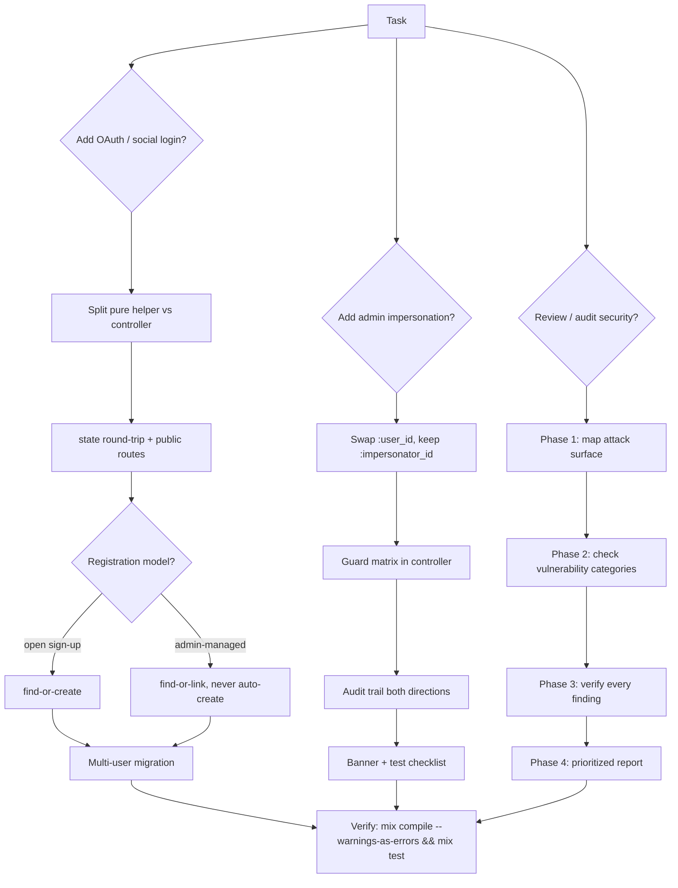

# Elixir Auth Security

Consolidated patterns for three related Phoenix/Elixir workflows: adding OAuth/social
login, adding admin impersonation, and running a read-only security audit. All three
share the same trust model: **never trust the client, verify on the server, fail closed.**

## Decision Routing



---

## 1. OAuth / Social Login

### Split helper vs controller

Keep HTTP + URL logic in a pure module (e.g. `MyAppWeb.OAuth.Google`) and session/redirect
logic in a controller (`MyAppWeb.OAuthController`). The helper has no `conn` dependency,
so it is unit-testable without a request.

- `configured?/0` — true only when `client_id` and `client_secret` are set. This gates
  BOTH the controller branch and the login-UI button.
- `authorize_url(state)` / `exchange_code(code)` / `fetch_userinfo(token)`.
- `redirect_uri/0` — default derived from `MyAppWeb.Endpoint.url()`; allow an env override.

Use `Req` for HTTP. Form POST to the token endpoint, GET with a `Bearer` header to
userinfo, and always branch on `req.status`:

```elixir
req = Req.post!(@token_url, form: %{...})
case req.status do
  200 -> {:ok, req.body["access_token"]}
  _   -> {:error, :token_exchange_failed}
end
```

### Controller + routes

Two GET actions, in the PUBLIC `:browser` scope BEFORE any auth-required routes
(the pre-login request must reach them):

```elixir
get "/auth/google", OAuthController, :request
get "/auth/google/callback", OAuthController, :callback
```

- `request/2` — if not configured, flash error + redirect to login. Else mint a random
  `state`, store it in the session, redirect externally to authorize.
- `callback/2` — verify `state` against the session BEFORE exchanging. Use
  `Plug.Crypto.secure_compare/2`, not `!=` (timing attack). Delete the stored state on
  success and on mismatch. Two clauses: one matches `%{"code" => code, "state" => state}`,
  a catch-all redirects to login with a flash.
- `with` chain for the exchange: `exchange_code` → `fetch_userinfo` → user resolution,
  with a catch-all `_ ->` redirecting to login.

State generation — the OAuth dance is GET-initiated, so the `/session` CSRF token does
NOT cover it:

```elixir
state = :crypto.strong_rand_bytes(32) |> Base.url_encode64(padding: false)
conn = put_session(conn, :oauth_state, state)
```

### User resolution: find-or-create vs find-or-link

Shared steps 1–2; they differ at step 3:

1. by `google_id` → return.
2. else by `email` → attach `google_id`/name/avatar to the existing user.
3. else → **self-service (open registration)**: `create_user(...)`;
   **admin-managed / invite-only**: return `{:error, :unauthorized}` — DO NOT create.

**Security warning:** auto-provisioning on OAuth login (`find_or_create_from_google`) is
a hole in any app where accounts are meant to be admin-created. Anyone with a Google
account walks in and gets a row + a valid token. Never auto-create unless the product
explicitly offers open sign-up. When hardening an existing flow from find-or-create to
find-or-link, rename the resolver too — no stale call sites compile against the old
auto-provisioning name — and replace the old "creates a new user" test with a rejection
test asserting `{:error, :unauthorized}` AND `Repo.aggregate(User, :count, :id) == 0`.
Otherwise CI stays green while the hole is open.

Admin promotion is idempotent and re-run on EVERY login: if the logged-in email matches
`MY_APP_ADMIN_EMAIL` and the user isn't already admin, set `is_admin: true`. Never trust
the client to self-admin; gate on the server-side env value.

### Multi-user migration (adding OAuth to an existing single-user app)

Additive, not destructive:

1. **Keep the old `Auth` module working** — rename its `@moduledoc` to "Deprecated
   legacy…" but keep every function operational. Do NOT use `@deprecated` annotations:
   each call site emits a deprecation warning and dozens of them break
   `mix compile --warnings-as-errors` (`@compile {:nowarn_deprecated}` was removed in
   Elixir 1.20). Use plain `@doc` comments with `# @deprecated Use MyApp.Accounts…`.
2. **New `Accounts` context** — user CRUD, a Google resolver (find-or-create or
   find-or-link per the resolution policy), `valid_token?/1`, and context-membership
   functions.
3. **Auth-gated routes** — `/settings` moves behind an `:admin` pipeline. Existing tests
   will fail with `{:error, {:redirect, ...}}` because the test session has no DB user.
   Fix the SETUP: insert a real user whose email matches the session value with
   `is_admin: true`, using idempotent create-or-fetch to avoid `unique_constraint`
   violations.
4. **Legacy admin fallback in auth plugs** — when the old single-user env-var login
   coexists, the session user may have no `users` row. A naive `require_admin` doing
   `get_user_by_email` gets `nil` and halts with "Admin access required". Treat a missing
   DB user as full admin (legacy session), matching the layout's own resolution — the
   router plug must match the layout or the sidebar shows Settings but the route 403s.

### Login UI button

Render the provider button only when configured, as an `<a href={~p"/auth/google"}>`
(GET = no CSRF worry) after a divider:

```heex
<%= if MyAppWeb.OAuth.Google.configured?() do %>
  <div class="divider my-4">OR</div>
  <a href={~p"/auth/google"}>Sign in with Google</a>
<% end %>
```

### Pitfalls

- OAuth `state` is NOT covered by the standard `/session` CSRF token — always implement
  the `:oauth_state` session round-trip; never trust the callback `state` alone.
- Store the exact `redirect_uri` used for authorize at exchange time — providers reject a
  mismatch; derive both from the same `redirect_uri/0`.
- Don't put the OAuth `callback` behind an auth-required plug (chicken-and-egg).
- No `is_`-prefixed predicate names: `configured?/0`, per Elixir style.
- `redirect(to:)` only accepts local paths — parse a `referer` header with `URI.parse`
  and extract path+query before redirecting to it.
- Never write a user-supplied slug/context to the session without validating the resource
  exists AND the user has access — validate before `put_session`.

---

## 2. Admin Impersonation ("View as")

Add a "view dashboard as this user" capability WITHOUT touching downstream auth code.
Session-swap pattern with guards, persistent banner, and audit trail.

### Core pattern: swap `:user_id`, keep `:impersonator_id`

The session's `:user_id` ALWAYS holds the *effective* user — plugs, LiveView `on_mount`
hooks, Presence trackers, and every existing assign keep working with zero changes. The
original admin's id lives in a second session key:

- Start: `put_session(:impersonator_id, admin.id) |> put_session(:user_id, target.id)`
- Stop: `delete_session(:impersonator_id) |> put_session(:user_id, impersonator_id)`

Do NOT invent a parallel "effective user" assign that every LiveView must learn about —
that forks the auth model and rots immediately.

### Controller actions + routes

Two actions on the session controller, in the plain `:browser` pipeline (NOT behind a
`require_admin` plug):

- `POST /impersonate/:user_id` — starts impersonation.
- `DELETE /impersonate` — stops it. Runs while the session points at the impersonated
  (non-admin) user, so NO admin plug can guard it — put ALL guards inside the actions.

### Guard matrix (start action, evaluated in order)

1. Unauthenticated → redirect to login.
2. `get_session(:impersonator_id)` present → refuse (no nesting).
3. `current_user.global_role != "admin"` → refuse.
4. Target not found → redirect with error flash.
5. Target == self → refuse.
6. Target is the root/bootstrap admin (env email) → refuse.

Every refusal leaves the session untouched — assert that in tests.

### Audit trail

Write audit entries for BOTH directions, always with the REAL admin as actor:
`impersonate.start` on start (actor = admin, entity = target) and `impersonate.stop` on
stop (actor = impersonator_id from session, entity = current effective user).

### Surfacing state: assigns + banner

- Auth plug: `assign(:impersonator, ...)` from `get_session(:impersonator_id)` (nil otherwise).
- `on_mount` hooks (default / require_authenticated / require_admin):
  `assign_new(:impersonator, ...)`. LiveView sessions use STRING keys
  (`session["impersonator_id"]`), plugs use atoms — read both.
- Layout component: render a warning banner above the topbar when `@impersonator` is
  present: "Viewing as {effective email} — session of {impersonator email}" plus a
  `method="delete"` link back to the admin account.
- Update EVERY layout call site to pass `impersonator={@impersonator}` — grep for the
  exact call text and batch it; don't forget the `@doc` example inside the layout module.
- Users list: per-row `<.link method="post" href={~p"/impersonate/#{user.id}"}>`, hidden
  for self and root admin. Session changes need a REAL HTTP request — a `phx-click`
  LiveView event cannot touch the session.

### Test checklist (TDD red first)

Controller: happy path (session keys swapped + audit row), banner visible on a subsequent
GET, non-admin refused, unauthenticated → login, self refused, nesting refused (session
still points at first target), unknown id refused, stop restores original user + audit
row, stop-when-not-impersonating is a no-op with flash. LiveView: impersonate link present
for other users, absent for self and root admin.

Gotcha: the root admin email usually ALREADY EXISTS in the test DB (seeds run in test env
too) — fetch it with `get_user_by_email/1` instead of registering a duplicate (unique
constraint failure).

### Pitfalls

- `mix precommit` (compile --warnings-as-errors) flags unused vars in guard clauses
  (e.g. `_admin` for the nil-target clause).
- If the layout file carries unrelated uncommitted WIP, split hunks with `git add -p` —
  never sweep it into the impersonation commit.

---

## 3. Read-Only Security Audit

**Core principle: read every file, verify every finding against the real code, never
report what you haven't confirmed.** A false positive in a security report erodes trust
in every real finding. When in doubt, read the context function, check the schema, trace
the data flow — then report. This is a read-only audit: no edits, no commits, just a report.

### Workflow

**Phase 1 — Map the attack surface.** Read in order:
1. `router.ex` — pipelines, which routes sit behind which, `live_session` blocks and
   their `on_mount` hooks.
2. Plugs (`plugs/*.ex`) — `fetch_current_user`, `require_authenticated`,
   `require_admin`, API key auth.
3. `user_auth.ex` (or equivalent) — the LiveView analogue of the plugs.
4. Controllers — session, OAuth, any non-LiveView controllers.
5. All LiveViews — mount, handle_event, handle_info, handle_params.
6. Runtime/deploy config when in scope — `mix deps.audit`, Dockerfile + entrypoint for
   hardcoded seed credentials, `config/runtime.exs` for SSL/TLS verification modes and
   env-var fallbacks.

**Phase 2 — Check each vulnerability category.** For each finding note: file, line number,
severity, category, description, suggested fix.

**Phase 3 — Verify and cross-reference.** Before reporting anything: read the context
function the code calls (check preloads and scope), check if the vulnerability is
mitigated elsewhere (e.g. a router guard that protects the route anyway), and verify the
data flow actually reaches the dangerous operation.

**Phase 4 — Report.** Structured and prioritized: severity levels (critical/high/medium/
low), per-finding format (ID, severity, file:line, category, description, fix), a summary
table by category and severity, a prioritized remediation list, and an explicit statement
that no files were edited.

### Key vulnerability categories and patterns

#### Authorization holes (the highest-value pass)

- **`handle_event` without permission check** — the #1 LiveView finding. Templates hide
  destructive buttons with `<%= if @is_admin do %>`, but the handler behind them may not
  check; a malicious client fires the event directly over the WebSocket. Fast triage:
  count `attach_hook` vs `handle_event` per LiveView. `hook > 0` = whole-LiveView guard
  present. `hook = 0` with inline checks = verify each destructive handler. `hook = 0`
  AND mount-only check = **the gap** — a mounted socket keeps firing events with nothing
  re-validating. Also grep for hardcoded `assign(:is_admin, true)` (unconditional = mount
  never reads the role); don't flag the benign variant inside the `else` branch of an
  explicit mount role check. Preferred fix for admin-only pages — a single `attach_hook`
  in mount halts EVERY event for non-admins and covers future handlers:

  ```elixir
  def mount(_params, _session, socket) do
    user = socket.assigns[:current_user]   # only set if a live_session on_mount assigns it
    socket =
      socket
      |> assign(:is_admin, user && user.global_role == "admin")
      |> attach_hook(:require_admin, :handle_event, fn _event, _params, socket ->
        if socket.assigns[:is_admin], do: {:cont, socket},
        else: {:halt, put_flash(socket, :error, "Not authorized.")}
      end)
    {:ok, socket}
  end
  ```

- **IDOR — resource IDs from client without scope validation.** Controllers accepting
  `team_id`/`model_id`/`id` params and LiveViews assigning them in `handle_params` must
  validate against the user's managed scope before querying. Compare against the
  equivalent controller/export guard — if the controller has one and the LiveView
  doesn't, that's the finding (the LiveView is the unguarded back door). Fix fail-closed:
  unvalidated id → empty result, never cross-scope data.

- **Fail-open identity defaults.** A check whose "record not found" branch grants MORE
  privilege — `nil -> true` / `nil -> :all` when `get_user_by_email` returns nil (deleted
  user, legacy session). Deleting a user row while their session is alive ESCALATES the
  session to admin. Fix: fail closed (`nil -> false`) or force logout
  (`configure_session(drop: true)` + redirect). Grep: `grep -rn 'nil -> true\|nil -> :all' lib/`.

- **Scoping helper that never restricts.** A `scope_for/1` whose every clause returns
  `team_id: nil` makes every downstream query org-wide. Verify at least one clause
  returns a restrictive value and every consumer query applies it. Fix: centralize in the
  context (`scope_member_ids(user)` → `nil` for admin, member ids otherwise) threaded via
  a `maybe_` filter where `nil` = no filter and `[]` = matches nothing (fail-closed).

- **Suspend that never reaches the data plane.** Trace what "suspend" writes (often only
  `users.status`), then audit EVERY non-session auth path (API-key plug, bearer, WS) for
  a re-check of the USER's status, not just the credential's. Fix: cascade on suspend AND
  check `member.user.status` in the credential guard — revocation can race.

- **Session identity not renewed on privilege change.** Every identity change (login,
  OAuth callback, impersonation start/stop, switch account) must call
  `configure_session(conn, renew: true)` — otherwise the pre-login session id survives
  (session fixation). Grep `put_session` across all of `lib/` (not just controllers) and
  check each identity-changing call sits next to `configure_session`.

- **Rate limiting absence.** `grep -rni 'hammer\|plug_attack\|throttle\|rate.limit' lib/ mix.exs`
  — zero hits = flag ALL public endpoints, not just login. Don't be fooled by a
  `LoginRateLimit` plug: check the proxy/API pipeline separately — auth plugs are not
  throttles.

- **Mass assignment.** Diff the controller's param filtering (blacklists like
  `Map.drop(params, [...])`) against the changeset's `cast` list — the remainder is
  client-settable. Whitelist at the controller boundary or use a dedicated API changeset.

#### Secrets

- **Plaintext secrets in DB.** Three-step verification for `*_encrypted` fields: read the
  moduledoc, grep for `encrypt|decrypt|Cloak` in `lib/`, check the migration column type.
  Also check app-issued tokens stored raw next to a hashed sibling table (the coexistence
  is the tell). Fix with `cloak_ecto` or `:crypto.crypto_one_time_aead/6`.
- **Secrets in the DOM.** `type="password"` inputs still ship the value on EDIT forms
  (`normalize_value` renders it) — blank the field (`put_change(cs, :secret, nil)`) before
  `to_form/1`. Never put full secrets in `data-*` attributes or unmasked assigns — even a
  "mask last 4" helper is useless if the LiveView preloads the full column into the socket
  process. Project the masked value at the Repo boundary instead.
- **Secrets in logs.** Scrub upstream error messages before persisting (providers echo
  partial keys in 401/403 bodies). Configure `:filter_parameters` for
  `password|secret|token|api_key|client_secret|authorization`. Never `inspect(reason)` in
  client-facing error bodies — log server-side, return a generic message.
- **Shared-secret defaults.** `Application.get_env(..., "literal-fallback")` or
  `System.get_env(...) || "fallback"` in production code is a public default. Use
  `fetch_env!/2` / `fetch_env!/1` or raise in the prod block of `runtime.exs` for
  `SECRET_KEY_BASE`, session salts, and the LiveView `signing_salt`.

#### Performance-adjacent (availability)

- **N+1** — per-item queries in mount, loaders, batch jobs (one UPDATE per row), and
  search/excerpt builders. Fix: preloads, single `UPDATE ... CASE`/CTE or chunked
  `Repo.update_all`, compute excerpts in the main query's `select`.
- **Unbounded everything** — `list_*`/`Repo.all` without limits, append-only log tables
  with no retention feeding full-scan views, `Task.Supervisor.start_child` fan-out per
  item (use `Task.async_stream(..., max_concurrency: N)`).
- **PubSub storms** — DB queries on every broadcast; coalesce with `Process.send_after/3`
  and a `reload_scheduled` flag (each reload trigger needs its own flag + timer).
- **Crash-on-input** — `Decimal.new/1`, `String.to_integer/1`, bang lookups on unknown
  ids kill the LiveView; use parse-in-`with`-chain, `Ecto.UUID.cast/1` for binary_id
  params, non-bang `get_` + nil→flash.

#### Session hardening (defense in depth)

`@session_options`: `secure: true`, `http_only: true`, `same_site: "Lax"`, `max_age:`
bound, and `encryption_salt:` (distinct from `signing_salt`) whenever the session holds
more than a UUID — sessions are signed but not encrypted by default.

#### OAuth audit items

- Empty allowlist treated as "allow all": `nil`/`[]` must disable auto-registration, not
  enable it (fail-closed).
- State comparison must be timing-safe (`Plug.Crypto.secure_compare/2`).

#### Infra

- DB SSL: `verify: :verify_none` is a MITM hole — distribute the CA and verify peer.
- `Plug.Parsers` with no `length:`/`read_length:` = unauthenticated memory-exhaustion DoS.
- `force_ssl` `exclude: [hosts: ["localhost"]]` silently bypasses TLS if `PHX_HOST` is
  misconfigured in prod.

### Remediation mode (when the user asks to fix, not just report)

1. Fix findings in priority order (authorization/IDOR first, then secrets, then
   performance) — one focused change per finding, no drive-by refactors.
2. Prefer SQL-level scoping over in-Elixir post-filtering.
3. Delete helpers that become unused after the fix (compiler warnings fail
   `--warnings-as-errors`).
4. Verify with the project's own gate (`mix precommit` or `mix compile --warnings-as-errors`
   + full `mix test`) before claiming done.
5. Commit only the files the fixes touched; separate any pre-existing WIP.
6. In the report, split "fixed" from "found but not fixed".
7. **Expect existing tests to assert the vulnerable behavior.** When the gate fails on
   exactly the assertion your fix was supposed to change, update the test to assert the
   NEW behavior (plus the security invariant, e.g. `refute get_session(conn, :user_id)`
   after a rejected login) — don't revert the fix.

---

## Verification

```bash
mix compile --warnings-as-errors && mix test
```

Run the project's `mix precommit` alias if one exists (usually compile + deps.unlock
--unused + format + test) and `mix format --check-formatted`. Write well-formatted code so
the format step is a no-op — a dirty tree after a clean commit attempt means format
rewrote your files.
