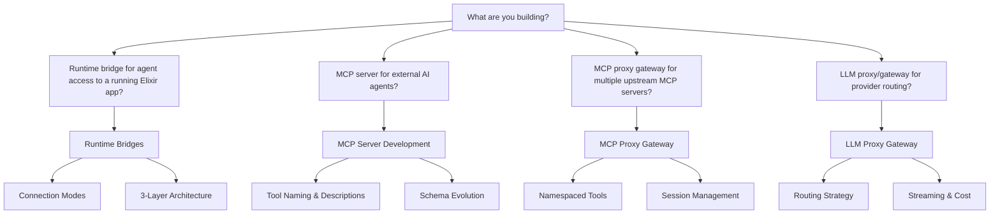

# Elixir Bridges

Build and operate bridges between AI agents (Hermes, Claude Code, Cursor, etc.) and Elixir applications. Covers runtime access, MCP server development, MCP proxy gateways, and LLM proxy/gateway design.

## Decision Routing



## 1. Runtime Bridges

Build a tool that gives an AI agent access to a running Elixir app's runtime—evaluating code, querying the database, reading logs, inspecting processes, and more.

### Core Insight: Same BEAM = Same State

An MCP server living as a Plug inside the same BEAM as your app has access to everything—GenServers, ETS, Ecto Repo, Logger, processes, in-memory state. It's not an external process talking by API; it's code running in the same runtime.

### 3-Layer Tool Architecture

A complete dev bridge has three layers:

1. **Layer 1: Mix/Project** (build, test, deps, lint) — always available via `mix` CLI, no app running needed.
2. **Layer 2: BEAM Runtime** (project_eval, get_logs, execute_sql, process_info) — needs connection to running BEAM (remsh or MCP HTTP).
3. **Layer 3: Filesystem/Git** (git blame, git diff, module graph) — only a Hermes plugin can do this (lives in filesystem, not BEAM).

### 3 Connection Modes

| Mode | Speed | State | When to Use |
|------|-------|-------|-------------|
| **Static** (`mix run -e`) | ~0.5s | Empty | Introspection, one-shot queries without runtime state |
| **remsh** (Erlang distribution) | ~100ms | Full | Fast access, requires app started with `--sname` |
| **MCP HTTP** (hex package) | ~50ms | Full | Best for Phoenix/Plug apps, no `--sname` needed |

**Key pitfalls:**
- `mix phx.server` starts without distribution (`nonode@nohost`). Use `iex --sname myapp -S mix phx.server` for remsh.
- Static mode has no runtime state—GenServers aren't running, ETS empty.
- Side effects in `project_eval`/`elixir_eval` affect the real app when connected via remsh or MCP HTTP.
- Bandit as optional dep for non-Phoenix apps; mark `optional: true`.
- Umbrella projects: hex package goes in the app with the Phoenix endpoint, not umbrella root.
- Tool descriptions must match across plugin and hex package.
- Functional project names over clever/mythological names.
- Parse output markers BEFORE truncating to avoid missing end markers.
- hermes_mcp delivers tool arguments with ATOM keys—normalize to string keys.
- `{:reply, response, frame}` must return `%Frame{}` as third element.
- Never probe `Supervisor.which_children/1` on arbitrary pids—use child spec's `type` field.
- Integration-test MCP endpoint over real HTTP, not just direct `execute/2` calls.

## 2. MCP Server Development

Build and evolve MCP servers consumed by external AI agents: tool naming, description design, schema evolution, and live schema verification.

### Tool Naming & Descriptions

- **Prefix all tools with server name** (e.g., `myapp_search`, not `search`). Agents run many MCP servers; prefixes avoid collision.
- **A rename is a BREAKING change**—no deprecation mechanism. Grep every consumer before renaming.
- **Tool descriptions are the agent's routing logic**. Answer "when to use" and "when NOT to use". Document merge-vs-replace semantics for meta/params.

### Schema Evolution

When domain model changes:
1. **Description first, schema second, handler third**—in that order.
2. **Every inputSchema listing page types needs new type added**—search all enums.
3. **Every filter described must be wired in the handler**—grep for param name.
4. **Verify backend supports param before wiring**—read function head.
5. **Meta-merge handlers need new meta key in both create and update paths**.

### Audit Pattern: inputSchema vs handler

1. Read Ecto schema `changeset/2` → list of `cast` fields.
2. Read `inputSchema.properties` → what agents can send.
3. Read `execute_tool` → `Map.take(args, [...])` or `Map.put` calls.
4. Cross-check: schema fields NOT in `Map.take` = silently dropped.

### Multi-Surface Registration

When MCP tool dispatches to multiple backends, each surface (MCP, Web UI, Mix CLI, Scheduler) must be wired separately. Silent failures occur when backends are missing from a surface.

### Per-User Auth + Context Scoping

For multi-user MCP servers:
- Controller gate with `with` chain: authenticate → validate context access → process.
- Authenticate both legacy global admin token and user tokens.
- User's accessible contexts: admin map `:all` vs loaded `has_many` list.
- Pass user through: extend `process_message/1` to `process_message(msg, opts \\ [])`.
- Inject default context at `params["arguments"]["context"]`, NOT `params["context"]`.

### Live Schema Verification

Ship a smoke script that:
1. `initialize` via curl with Bearer auth; assert server name + protocol version.
2. `tools/list`; assert exact expected tool set.
3. Assert every tool carries required prefix.
4. Assert key enums match dispatcher.
5. Spot-check descriptions contain routing cues.

### Testing

- Call `execute_tool` directly with arg maps—assert on returned text/data.
- Exhaustive test file: happy path, error cases, edge cases per tool.
- Pattern-match crash pitfall: handler must pattern-match ALL backend return shapes, including `{:error, atom}`.

## 3. MCP Proxy Gateway

Build a gateway/multiplexer in front of multiple MCP servers: one client-facing endpoint that fans out to N upstreams.

### Core Architecture

```
MCP client ──Streamable HTTP──> Gateway ──Streamable HTTP──> Upstream MCP ×N
(one config, one key)            │
                                 ├─ auth (bearer → tenant, ETS-cached)
                                 ├─ grants (team ∪ member extras ∪ service)
                                 ├─ namespace ({slug}__{tool})
                                 ├─ upstream session registry (lazy, ETS)
                                 ├─ tools/list cache (TTL + serve-stale)
                                 └─ audit log (async, off hot path)
```

**Two endpoint shapes:**
- `POST /mcp` — aggregated: one `initialize`, merged `tools/list`, prefix-routed `tools/call`.
- `POST /mcp/:slug` — passthrough to one upstream.

### Key Design Decisions

1. **Namespace tools as `{slug}__{tool}`** — MCP tool names cap at 64 chars; decode by splitting on first `__` only.
2. **Upstream sessions are lazy, registered, reaped** — registry keyed `{api_key_id, server_id}`, lazy init on first call, idle reaper.
3. **Client-facing session is ceremonial** — issue `Mcp-Session-Id` but keep real authorization on per-request bearer.
4. **tools/list never fans out on hot path** — per-server ETS cache with TTL, serve-stale + async refresh.
5. **SSE can answer ANY POST** — parse incrementally, stop at matching JSON-RPC id.
6. **No JSON-RPC batching** — single messages only; reject arrays.
7. **Auth-swap, never forward** — client bearer never travels upstream; gateway injects stored credential.
8. **Mirror host app's existing RBAC** — don't invent new grant model.
9. **Tool surface area is model-side cost** — manage via grants as curation, per-grant `allowed_tools`, client narrowing.
10. **Protocol limitations** — no upstream→client notifications, resources/prompts empty lists in v1.

### Performance Pitfalls

- tools/list fan-out latency → cache + parallel cold fetch.
- Session explosion → lazy init + idle reaper.
- One slow upstream poisons aggregate → independent timeouts + per-server breaker.
- SSE CPU/latency → incremental parse, raw passthrough streaming.
- Post-restart stampede → health job pre-warms cache with jitter.

## 4. LLM Proxy/Gateway

Design and build an LLM proxy/gateway: OpenAI-compatible API passthrough, multi-provider routing, budgets, rate limiting, and OTLP observability.

### Core Architecture

```
Client (agent) ──OpenAI API──> Proxy ──OpenAI API──> Provider
                                 │
                                 ├─ auth (API key → team member)
                                 ├─ two-gate throttle (team limits + credential limits)
                                 ├─ routing (priority + sticky + circuit breaker)
                                 ├─ budgets (pre-check + post-record)
                                 └─ observability (OTLP webhooks, request logs, metrics)
```

### Request Lifecycle (Hot Path Discipline)

1. **Auth** — resolve API key → team member (ETS-cached).
2. **Team limits gate** — RPM + concurrency per API key (ETS/atomics only).
3. **Route** — alias → model_provider → credential. Priority sort + sticky + breaker availability filter.
4. **Budget pre-check** — has member exhausted monthly cap? (ETS spend counter.)
5. **Credential limits gate** — `max_rpm` / `max_concurrent` per credential (ETS).
6. **Execute** — forward payload verbatim to provider (Finch). Apply retry/fallback policy on failure.
7. **Post-record** — usage → cost → budget spend (ETS), request log + OTLP webhook via Oban (async).

**Hot path rule:** auth, limits, budgets, and routing read from ETS/atomics only. Postgres touched asynchronously via Oban.

### Three-Gate Throttling

1. **Team limits** — protects proxy from abusive users (client-side).
2. **Credential limits** — protects provider API key from upstream rate limits (provider-side).
3. **Per-user concurrency** — stops single heavy user from swallowing shared subscription slots.

### Provider Abstraction

Single `ProviderAdapter` behaviour with `OpenAIAdapter` covering every OpenAI-compatible endpoint. Thin transport layer: forward payload, classify errors into `failure_reason()` atoms.

### Routing Strategy

Tiered priority-based selection with sticky routing:
- Top tier: healthy subscription providers.
- Then healthy pay-per-token, degraded subscription, degraded pay-per-token.
- Within tier, priority ASC decides.
- Sticky routing: if `api_key_hash` present, look up sticky entry; if stuck provider available and not degraded, return it.

### Streaming

SSE passthrough with first-token fallback: nothing sent to client until provider's first chunk arrives. `first_token_timeout_ms` default 30s. On timeout, fall back immediately.

### Cost Accounting

Trust upstream to report usage via `usage.cost` / `usage.cost_usd`. Normalize provider-specific usage shapes, compute costs, inject into response.

### Key Stack Decisions

- **No Redis** — all state in BEAM primitives (ETS, atomics, gen_statem).
- **Oban for async writes** — request logs, webhook delivery, rollups.
- **Bandit mock for tests** — real HTTP provider plug for full fallback matrix testing.

## Cross-Cutting Pitfalls

1. **Atom keys in MCP tools** — normalize to string keys in every tool.
2. **Frame passthrough** — `{:reply, response, frame}` must return `%Frame{}`.
3. **Hot path discipline** — no DB queries on hot path; ETS/atomics only.
4. **Schema drift** — inputSchema, handler, and backend must agree.
5. **Testing over real HTTP** — integration-test MCP endpoints, not just direct calls.
6. **Functional naming** — prefer descriptive names over clever/mythological.
7. **Output parsing** — parse markers before truncating; handle both old and new formats.
8. **Side effects awareness** — static mode safe, remsh/MCP HTTP affect real app.

## References

Detailed patterns and gotchas in subdirectories:
- `references/elixir-dev-bridge/` — connection modes, tool catalog, hermes_mcp gotchas.
- `references/mcp-server-development/` — auth patterns, tool execution smoke tests.
- `references/mcp-proxy-gateway/` — streamable HTTP protocol.
- `references/llm-proxy-gateway/` — circuit breaker, provider dialects, OTLP patterns.
