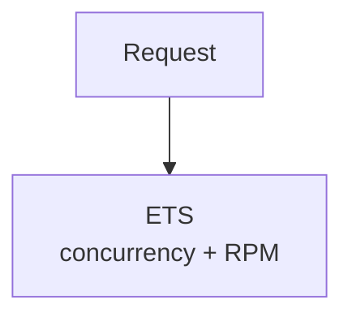
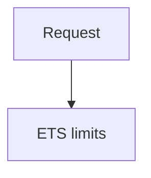
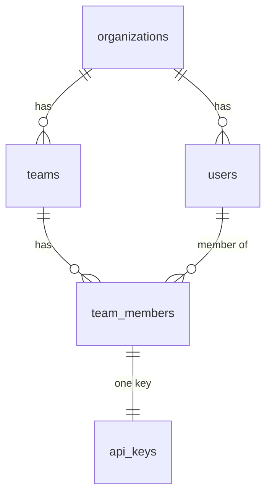
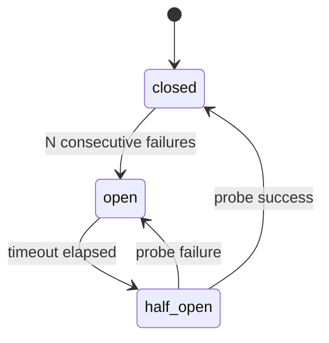

# my_app Mermaid Rendering Rules

my_app renders mermaid diagrams in page bodies, but the markdown processor is
fragile. These rules ensure diagrams render correctly instead of being
flattened to plain text.

## Rules

### 1. No `<br/>` in node labels

The `>` in `<br/>` gets interpreted as HTML, breaking the mermaid parser.

**Bad:**


**Good:**


### 2. All node labels in quotes

Use `["text"]` not `[text]`. This prevents special characters from breaking
the parser.

**Bad:** `B[concurrency + RPM]`
**Good:** `B["concurrency + RPM"]`

### 3. No `&` in mermaid

`&` gets HTML-encoded to `&amp;` which breaks mermaid syntax. Use `and` or
rephrase.

**Bad:** `Priority & Queuing`
**Good:** `Priority and Queuing`

### 4. Break large ER diagrams into 2-3 smaller ones

A single massive `erDiagram` with 15+ tables gets flattened to plain text by
the renderer. Split by domain area and list field details as bullet text
below each small diagram.

**Bad:** One giant ER with all 17 tables.

**Good:**


Then below it:
```
**organizations** — id, name, slug, cost_tracking_mode
**teams** — id, organization_id, name, default_daily_budget_usd, ...
**users** — id, email, name, password_hash, global_role
```

### 5. State diagrams — use `:` separator



### 6. Keep labels short

Long labels in sequence diagrams can cause rendering issues. Use short
participant names and brief message text.

## Summary

| Rule | Bad | Good |
|------|-----|------|
| Line breaks | `B[text<br/>more]` | `B["text more"]` (shorter) |
| Quotes | `B[text]` | `B["text"]` |
| Ampersand | `A & B` | `A and B` |
| ER size | 1 diagram, 17 tables | 3 diagrams, 5-6 tables each |
| State labels | `-->|label|` | `: label` |
