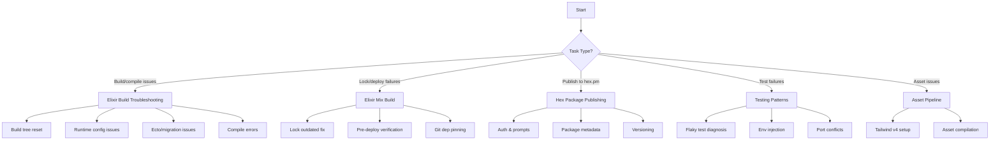

# Elixir Build

Build, test, troubleshoot, and publish Elixir/Phoenix applications. This skill consolidates Mix build management, runtime pitfalls, and hex.pm publishing into a single reference.

## Decision Routing



## Core Principles

1. **Never delete individual `_build` subdirectories** — Phoenix/Ecto syncs `priv` back to source; deleting under `_build` can wipe migrations, static assets, and gettext files.
2. **Always verify in `:prod` before deploy** — `:dev` is permissive; lock mismatches only fail in `:prod`.
3. **`mix precommit` is not a full substitute** — it runs in `:test`, not `:prod`. Add explicit `MIX_ENV=prod mix compile` for full verification.
4. **Commit `mix.exs` and `mix.lock` together** — they must stay in sync for reproducible builds.

## Elixir Build Troubleshooting

### When to Reset the Build Tree

Reset the entire `_build` directory when you see:

- Stale `.beam` files after dependency changes
- `UndefinedFunctionError` for modules that should exist
- `CaseClauseError` during compile after switching branches
- Asset or migration files reported missing despite existing in source

**Recovery:**

```bash
cd /path/to/umbrella
rm -rf _build deps
mix deps.get
mix compile
```

### When to Reset the Database

Use `MIX_ENV=test mix ecto.reset` (or `MIX_ENV=dev`) when:

- Migrations fail mid-flight, leaving schema in half-applied state
- You renamed or deleted migrations already recorded in `schema_migrations`
- You changed a migration file that was already executed
- Duplicate module errors like `migration name X is duplicated`

**Recovery:**

```bash
MIX_ENV=test mix ecto.reset  # runs ecto.drop, ecto.create, and ecto.migrate
```

### Editing Migrations That Failed in Production

**Safe to edit in-place when:** the migration was never recorded in `schema_migrations` (failed in transaction, rolled back).

**NOT safe when:** migration succeeded partially (MySQL, non-transactional DDL, or `execute` without transaction). Check with `psql` what exists before editing.

**Index renaming gotcha:** when renaming an index, explicitly drop the OLD index by name in `up`. The `down` direction drops the NEW name.

```elixir
# GOOD — drop old index explicitly
def up do
  drop_if_exists unique_index(:model_providers, [:credential_id],
                   name: :model_providers_credential_id_unique_index)
  create unique_index(:model_providers, [:credential_id, :model_alias_id],
           name: :model_providers_credential_model_alias_unique_index)
end

def down do
  drop_if_exists unique_index(:model_providers, [:credential_id, :model_alias_id],
                   name: :model_providers_credential_model_alias_unique_index)
end
```

**Verification pattern:**

```bash
mix ecto.rollback -n 1   # runs the edited `down`
mix ecto.migrate          # runs the edited `up`
psql -d <db> -c "\d <table>" | grep -i unique   # verify only correct index exists
```

### Migration Duplicate Name Errors

Error: `migrations can't be executed, migration name X is duplicated`

**Fix:** Rename the duplicated migration module to match its filename, or delete the redundant one. Module name should match file base minus timestamp: `20260629002000_create_widgets.exs` → `CreateWidgets`.

### Recovering Deleted Migrations

```bash
git checkout -- apps/<app>/priv/repo/migrations/
```

If untracked and lost, inspect DB schema with `\d` in psql, recreate files, then `mix ecto.reset`.

### Port Conflicts — `mix run` vs Dev Server

**Symptom:** `mix run -e '...'` fails with `:eaddrinuse` when `mix phx.server` is running.

**Fix:** Use `--no-start` and manually start DB dependencies:

```bash
mix run --no-start -e '
  Application.ensure_all_started(:postgrex)
  Application.ensure_all_started(:ecto_sql)
  {:ok, _} = MyApp.Repo.start_link()
  # now run your script
'
```

**Alternative when server must stay up:** Use `PORT=4077 mix test` — runtime.exs reads `System.get_env("PORT")`, so the test endpoint binds elsewhere.

### Flaky Tests — Different Test Fails Each Run

**Symptom:** `mix test` passes 100%, but `mix precommit` fails 1-2 tests — each run fails a DIFFERENT test. Failure is usually `DBConnection.ConnectionError: client #PID<...> exited`.

**Cause:** Running `mix phx.server` holds connections; under precommit's heavier load, the test sandbox loses checkout.

**Diagnosis:**

1. Run failing test alone: `mix test path/to/test.exs:LINE` — passes.
2. Kill dev server, run plain `mix test` — green.

If both pass, the flake is environmental. Kill the dev server before running precommit.

### Test-Count Drift Between `mix test` and `mix precommit`

**Cause:** Different seed order. A test depending on execution order or DB state from a previous test flips between runs.

**Fix:** Run with same seed as passing run:

```bash
mix test --seed <seed_from_passing_run>
PORT=4099 mix precommit   # compare
```

### Piped Verification Commands Mask Exit Code

**Symptom:** `mix precommit 2>&1 | tail -25` reports exit code 0 (from `tail`), masking mix's actual failure.

**Fix:**

```bash
mix precommit > /tmp/verify.log 2>&1; echo "EXIT: $?"
# or
set -o pipefail; mix precommit 2>&1 | tee /tmp/verify.log
```

### Docker Build OOM During Erlang/rebar3 Compilation

**Symptom:** `docker build` fails at `mix deps.compile` with exit code 255. Last successful step: `===> Compiling idna`.

**Cause:** Erlang VM uses one scheduler per CPU core; on tight memory (512 MB-1 GB), rebar3 deps OOM.

**Fix:**

```dockerfile
RUN mix deps.get --only prod
# Single scheduler for rebar3 deps only (~60-70% less memory)
RUN ERL_AFLAGS="+S 1:1 +MBas busy_wait" mix deps.compile idna telemetry telemetry_poller
RUN mix deps.compile
```

If still fails: add swap, increase Docker memory limit, or reduce deps.

### Runtime Credentials Stale — Compile-Time vs Runtime

**Symptom:** API endpoint keeps returning `invalid token` despite correct env var.

**Cause:** `System.get_env` inside a module attribute (`@attr`) is evaluated at compile time, not runtime.

**Fix:**

```elixir
# GOOD — read at runtime
def valid_token?(token) when is_binary(token),
  do: token == Application.get_env(:myapp, :api_token)

# config/runtime.exs
config :myapp, api_token: System.get_env("MYAPP_API_TOKEN", "default-token")
```

**Recompile with env var present:**

```bash
eval "$(mise env)"  # or: set -a; source .env; set +a
mix compile --force
mix phx.server
```

### Compile Hangs at 0% CPU — Beam Lock or Zombie Process

**Symptom:** `mix compile` never finishes, prints nothing, 0% CPU.

**Causes:**

1. A `mix phx.server` beam is running and holds file locks on `.beam` files.
2. A zombie `mix compile` from a timed-out subagent.

**Recovery:**

```bash
# 1. Kill zombie compile processes
kill -9 <compile_beam_pid> <compile_shell_pid>
# 2. Kill dev server
kill <phx_server_pid>
# 3. Compile clean
mix compile --force --warnings-as-errors
```

**Prevention:** Check `ps aux | grep phx.server` before running compile/test/precommit.

### `runtime.exs` Overrides `test.exs`

**Symptom:** `mix test` fails with `:eaddrinuse` on port 4000 (from runtime.exs), not 4002 (from test.exs).

**Cause:** `config/runtime.exs` runs in all environments; unguarded endpoint config overrides `test.exs`.

**Quick fix:** `PORT=4099 mix test`

**Proper fix:** Gate runtime config behind `config_env() == :prod`:

```elixir
# config/runtime.exs
if config_env() == :prod do
  config :myapp, MyAppWeb.Endpoint, server: true
  config :myapp, MyAppWeb.Endpoint, http: [port: String.to_integer(System.get_env("PORT", "4000"))]
end
```

### Ecto Query Pitfalls

- **`from(p in Module)` without body:** Always add `select: p` or a `where` clause. Bare `from` doesn't bind the variable.
- **`belongs_to` + explicit field:** Never add a raw `field :x_id` for a foreign key alongside `belongs_to :x` — they duplicate the field.
- **Mixed FK types:** When `belongs_to` associations reference tables with different PK types (`:id` vs `:binary_id`), declare the non-default FK as `field :x_id, :binary_id` and pass `define_field: false` to its `belongs_to`.

### Keyword List Ordering

**Rule:** In mixed lists (keyword pairs + bare atoms), keyword pairs must come LAST:

```elixir
# VALID
Repo.preload(request_log, [:provider, team_member: [:user, :team]])
```

### Common HEEx Pitfalls

- **`not @assign` crashes with `nil`:** Use `is_nil(@assign)` instead.
- **`phx-value-*` sends flat params:** Normalize with `Map.get(params, "target", params)` when handler receives both flat and nested shapes.

### GenServer/Task Exit vs Exception

`rescue` only catches exceptions; OTP exits (like `{:noproc, _}` from dead supervisors) propagate as signals.

**Fix:** Add `catch :exit, _ -> :ignored` alongside `rescue`.

### Partitioned Table Migrations

Postgres partitioned tables don't support transactional DDL. Use raw SQL with `@disable_ddl_transaction true` and `@disable_migration_lock true`.

## Elixir Mix Build

### The "Lock Outdated" Pitfall (Git-Based Deps)

**Symptom:** `MIX_ENV=prod mix compile` fails with `lock outdated: the lock is outdated compared to the options in your mix.exs`.

**Root cause:** Mix compares locked **commit SHA** against `mix.exs` options. If pinned by `tag:` but lock has a different SHA, Mix in `:prod` refuses to proceed.

**Fix:** Pin by `:ref` with exact commit SHA from `mix.lock`:

```elixir
# WRONG — tag is mutable, SHA may differ
{:heroicons,
 github: "tailwindlabs/heroicons",
 tag: "v2.2.0",
 sparse: "optimized"}

# RIGHT — pin to exact commit the lock has
{:heroicons,
 github: "tailwindlabs/heroicons",
 ref: "0435d4ca364a608cc75e2f8683d374e55abbae26",
 sparse: "optimized"}
```

Commit both `mix.exs` and `mix.lock` together.

### Pre-Deployment Verification

Always mirror the build environment locally:

```bash
# Nixpacks/Railpack sequence
MIX_ENV=prod mix deps.get --only prod
MIX_ENV=prod mix compile

# With warnings-as-errors
MIX_ENV=prod mix compile --warnings-as-errors

# Full check
mix precommit  # usually runs in :test, not :prod
```

### Git-Based Dep Pinning Patterns

| Pin style | When to use |
|-----------|-------------|
| `:tag, "v1.2.3"` | Hex packages. For git deps, only if you control the tag and it never moves. **Risky for prod** — tags are mutable. |
| `:ref, "<sha>"` | Git deps for stable, reproducible builds. **Prefer for prod.** |
| `:branch, "main"` | Almost never for prod — branch heads move. |

### When `mix deps.get` Itself Fails

Lock has SHA that no longer exists in remote (force-push, deleted branch):

```bash
mix deps.unlock --all
mix deps.get
```

Use sparingly — drops reproducibility for that dep.

### Manifest/Lock Alignment

If lock resolves newer version than `mix.exs` requires (e.g., `~> 0.5` but lock has `0.6.1`), align `mix.exs` to resolved version and re-run `mix deps.get`.

### Umbrella-Specific Gotchas

- **Elixir 1.20+ requires directory names to match OTP app names.** `apps/core/` fails — must be `apps/my_app_core/`.
- **Phoenix.PubSub in non-Phoenix app:** If core app starts `{Phoenix.PubSub, name: MyApp.PubSub}`, add `{:phoenix_pubsub, "~> 2.1"}` to its deps.
- **Ecto UUID autogeneration:** Use `@primary_key {:id, :binary_id, autogenerate: true}` — `autogenerate: false` doesn't pick up DB defaults, causing `nil` IDs.
- **Ecto Sandbox pool not applied:** When `Application.start/2` starts Repo with wrong pool, conditionally set pool in `Application.start/2` based on `Mix.env()`.

## Hex Package Publishing

### Pre-Publish Checklist

1. **Name availability:** `curl -s -o /dev/null -w "%{http_code}" https://hex.pm/packages/<name>` — `404` = available.
2. **`mix.exs` metadata:** Include `name`, `licenses`, `maintainers`, `files`, `links`.
3. **`files:` must list `LICENSE`** — in monorepo, copy LICENSE into package subdir.
4. **`elixir:` requirement** — set floor to what strictest dep requires.
5. **`ex_doc` for hexdocs:** `{:ex_doc, "~> 0.34", only: :dev, runtime: false}`.
6. **Verify:** `mix compile --warnings-as-errors` clean + `mix test` green + `mix hex.build` dry-run.
7. **GitHub link should exist** — push repo BEFORE publishing.

### Fresh-Project Compile Verification

Local `mix compile` is NOT proof — your dev env has every optional dep; downstream gets only non-optional ones.

**Smoke test before EVERY publish:**

```bash
cd /tmp && mix new smoke && cd smoke
# add ONLY {:pkg, path: "..."} — NOT optional deps
mix deps.get && mix compile     # MUST compile
# boot with documented config — MUST log clean error, not crash
# then add optional dep and test full feature path end-to-end
```

After publishing, repeat from registry (`{:pkg, "~> X.Y"}`) — path-dep testing masks failures.

### Interactive Prompt Trap (CRITICAL)

`mix hex.publish` asks up to **three** interactive questions:

1. **Owner selection** (first publish with org): `[1] Yourself [2] <org>`
2. **Proceed confirmation:** `Y`/`n`
3. **2FA code** (accounts with TOTP): Asked mid-publish, AFTER `Publishing package...`

**CRITICAL — get 2FA code BEFORE launching command.** OTPs expire in ~30s.

**Correct pipe sequence:**

```bash
printf 'Y\n<otp>\n' | mix hex.publish package
# or for first-publish:
printf '1\nY\n<otp>\n' | mix hex.publish package
```

- **`yes | mix hex.publish` HANGS FOREVER** — `yes` answers "Y" to owner prompt (invalid), causing infinite re-prompt.
- **No stdin at all:** Crashes with `FunctionClauseError` — stdin exhausted before all prompts answered.

### Auth and Key Permissions

- `mix hex.user auth` — interactive (requires password), generates full-permission key.
- `mix hex.user whoami` — **run as pre-flight check** before publish.
- **"key not authorized"** = stored key is read-only or org key without publish rights. Re-run `mix hex.user auth` or create key at https://hex.pm/dashboard/keys with API write permission.

### Token Expired → Device Flow Trap

When stored hex token expired, `mix hex.publish` enters device flow mid-run. Piped `Y` is consumed by first prompt ("Do you want to authenticate now?"), not "Proceed?".

**Recovery:**

1. Device flow completed (user authenticated in browser).
2. Verify with `mix hex.user whoami`.
3. Re-run publish with FRESH OTP.

**Pre-flight:** Run `mix hex.user whoami` before first publish attempt.

### Versioning

- Bump `version:` in package `mix.exs`, re-run checklist, publish again.
- **Also bump hardcoded versions in code** — Server/SDK modules carry version strings that don't follow mix.exs automatically. Grep for old version before republishing.
- Publish is **irreversible** — `mix hex.publish --revert` only works within 1 hour.

### Post-Publish Verification

```bash
curl -s https://hex.pm/packages/<name>  # should return 200
# Docs at https://hexdocs.pm/<name>
# Test actual install path — create fresh project, add dep from hex (not path), verify compile
```

### Plug Halt Gotcha

Any plug that calls `send_resp` (directly or via delegated plug) MUST call `Plug.Conn.halt/1` afterward. Without halt, next plug in pipeline gets conn and may raise.

```elixir
def call(%Plug.Conn{request_path: path} = conn, opts) do
  if path == @mcp_path do
    conn
    |> InnerPlug.call(opts)
    |> Plug.Conn.halt()   # ← CRITICAL
  else
    conn
  end
end
```

## Testing Patterns

### Flaky Test Diagnosis

**Two-probe rule:** Once a probe's answer is confirmed, next probe MUST be information-different — change layer (Ecto vs raw SQL), change interface (HTTP response vs DB), or change mechanism (LiveView test vs DB query).

### Env Injection — Inference Config in Tests

**Symptom:** 2-4 tests fail in full suite (different ones each run), but all pass in isolation.

**Cause:** `runtime.exs` loads inference config in all envs; async tasks race `Req.Test` stubs.

**Fix:** Delete inference config before creating pages in tests:

```elixir
test "E2E flow" do
  original = Application.get_env(:myapp, :inference)
  Application.delete_env(:myapp, :inference)
  # ... create pages ...
  Application.put_env(:myapp, :inference, base_url: "...", req_plug: {Req.Test, ...})
  on_exit(fn -> restore original end)
end
```

### Test Hangs Forever — External HTTP Calls

**Symptom:** `mix test` hangs forever. Individual tests pass quickly, but full suite never finishes.

**Cause:** Tests call functions that trigger async tasks pointing at non-existent servers; each call blocks for full retry timeout.

**Fix:** In test setup, disable the feature entirely:

```elixir
Application.put_env(:myapp, :inference, base_url: nil, schedule_async: false)
```

### LiveView Testing Gotchas

- `live_isolated` does NOT support `assign:` option — use `session:` instead.
- ConnCase needs `Sandbox.mode({:shared, self()})` for LiveView processes.
- Tests with `async: true` need unique slugs (`System.unique_integer`) to avoid constraint violations.
- HEEx `@variable` looks up assigns, not module attributes — copy module attrs to assigns before `~H`.
- `put_session` in plug crashes test conns — use `assign/2` instead.

### Ecto Test Gotchas

- **`==` on Decimal structs compares representation, not value.** Use `Decimal.equal?(actual, expected)`.
- **Composite `unique_constraint` reports error on FIRST field.** Pass user-visible field first.
- **`default:` on schema field silently defeats `validate_required`.** Decide consciously: required (remove default) or optional-with-default.

## Asset Pipeline

### Tailwind v4 Setup

When CSS doesn't load after Tailwind v3→v4 migration:

1. Migrate config to `@theme` in `app.css` (no more `tailwind.config.js`).
2. Add tailwind profiles to `config/config.exs`.
3. Add watchers to `config/dev.exs`.
4. Compile initial CSS with `mix tailwind <profile>`.
5. Use `type="module"` in layouts for ESM JS imports.

### Verifying CSS Independently

When `mix assets.build` fails due to unrelated Elixir error:

```bash
mix tailwind default  # runs only Tailwind compiler, writes to priv/static/assets/css/app.css
```

## Ecto/Postgres Gotchas

- **UUID defaults:** Use `gen_random_uuid()`, NOT `uuid_generate_v4()` (doesn't exist on current Postgres).
- **jsonb `:map` fields round-trip with STRING keys.** Use `&1["slug"]`, not `.slug` dot-access.
- **jsonb column default:** Use `default: fragment("'[]'::jsonb")`, not `default: "[]"`.
- **Descending ranges:** Use `15..6//-1` to avoid warnings under `--warnings-as-errors`.
- **`Task.async_stream` in tests:** Needs sandbox in shared mode (`async: false` on test module).

## Subagent Pitfalls

- **Subagent timeout:** Work is often already committed. Check `git log` before re-dispatching.
- **Commit bundling:** Subagent sweeps parent's uncommitted work with `git add -A`. Always check `git log --oneline -2` after subagent batch.
- **Gettext fuzzy pollution:** Existing msgstr corrupted by merge. After `mix gettext.extract --merge`, run `git diff` and scan for wrong msgstrs.
- **Dynamic msgids:** Add no-op extraction block: `if false do gettext("Note") end`.
- **Broken syntax after subagent batch:** `mix compile --warnings-as-errors` catches it. Fix manually, don't re-dispatch.

## Common Compile Errors

| Error | Fix |
|-------|-----|
| `DateTime.beginning_of_day/1` undefined | Use `DateTime.new!(Date.utc_today(), ~T[00:00:00], "Etc/UTC")` |
| `undefined variable "p"` in `from(p in Module)` | Add `select: p` or `where` clause |
| `field/association :X_id already exists` | Remove explicit `field :X_id` — let `belongs_to` create it |
| `defp foo/3 defines defaults multiple times` | Declare default once in headless clause, then clauses without default |
| `unexpected expression after keyword list` | Reorder: atoms first, keyword pairs last |
| `cond` does NOT support `<-` | Use `with` + helper function |

## Reference

See `references/` subdirectories for detailed case studies and reproduction recipes:

- `references/elixir-mix-build/` — Lock outdated, manifest alignment, LiveView testing, Phoenix 1.8 runtime, umbrella gotchas, Tailwind v4
- `references/elixir-build-troubleshooting/` — Ecto analytics, subagent parallel pitfalls, UI flow tracing, runtime.exs overrides, priv sync
- `references/` — All reference materials preserved as-is for deep dives