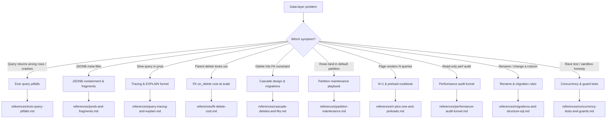

# Elixir Data Layer — Ecto / Postgres at Scale

Distilled patterns for the data layer of Phoenix applications: Ecto query
pitfalls, JSONB filtering, migrations, cascade/FK policy, partitioned-table
maintenance, query tracing, and read-only performance audits. Every rule here
survived a real incident; commands, SQL, and error signatures are verified on
Postgres 16 / Ecto 3.13-3.14 / Postgrex 0.22.
## Decision DAG

---
## 1. Ecto Query Pitfalls (the ones that actually bite)
- **JSONB containment `@>` with a parameter silently returns `false`** even
  when the row matches. Postgrex sends the JSON string as `text`, and `@>`
  over the casted param does not match. Verified: literal returns `true`,
  identical param returns `false`. Dead end — do not fight it. Preferred fix —
  per-key text comparison: `fragment(\"?->? = ?\", p.meta, ^key, ^value)`
  (see `jsonb-and-fragments.md`).
- **String keys inside fragments get mangled** — `fragment(\"?->'props' @> ?\", ...)` strips the quotes → `meta->props` → `ERROR 42703 (undefined_column)`; pass the key as a parameter: `fragment(\"?->? @> ?\", p.meta, \"props\", ^json)`. **`==` inside a fragment is Elixir, not SQL** — Postgres equality is `=`.
- **`^\"string\"` args in fragments** error with "misplaced operator". Inline
  safe constant literals or use `type(^value, :string)` for runtime values.
- **`fragment(^built_string)` is rejected at compile time** (SQL-injection
  guard): `(Ecto.Query.CompileError) ... fragment(...) does not allow strings
  to be interpolated`. Build one `dynamic/2` per condition, combine with
  `^acc or ^cond` / `^acc and ^cond`. Module-attribute reuse fails for
  `fragment(@attr <> \" >= ?\", ...)` — define one constant per variant.
- **Raw queries with UUID PKs need `Ecto.UUID.dump!/1`** —
  `(DBConnection.EncodeError) Postgrex expected a binary of 16 bytes, got
  \"845571d9-...\"`. UUID bind params must be `Ecto.UUID.dump!(id)`.
- **`timestamp` decodes as `NaiveDateTime`** in raw `Repo.query!` results — cast `::date` for `%Date{}`; `DateTime.to_date/1` on `~N[...]` raises `FunctionClauseError` unless wrapped in `type(fragment(...), :utc_datetime)`. **Untyped fragment datetime params fail silently** (`[]`): `type(^from, :utc_datetime), type(^to, :utc_datetime)` and cast the subquery column (`act.inserted_at::timestamptz`) so `COALESCE` mixes consistent types.
- **List params inside raw fragments: `= ANY(?)`, never `IN ?`** — Ecto
  renders `ARRAY['a','b']` for `IN ?` → `syntax error at or near \"ARRAY\"`.
  Type the param: `type(^list, {:array, :string})`.
- **`union_all(^q1, ^q2)` fails with misplaced `^`** — run two lean queries and merge in Elixir (`++` + `Enum.frequencies/1`). **Keyword lists must be the last argument** — bind the query to a variable before `Repo.aggregate(q, :count)`.
- **Nullable JSONB columns need nil guards** — `not is_nil(p.meta) and fragment(...)`.
- **Conditional filters**: build the base query, then conditionally append —
  `q = if types == [], do: q, else: from([r, s] in q, where: s.type not in ^types)`.
  Never `^list == [] or ...` inside `where:`.
- **`COALESCE(a.col, b.col)` in a `select` breaks `group_by`** (ERROR 42803) — select the primary column raw, apply the fallback in Elixir after `Repo.all`. **Mixing `as:` names with positional bindings silently binds wrong** — positional bindings resolve by JOIN ORDER and must enumerate EVERY preceding join; pick `as:` consistently or full positional order, never mix.
- **Composite `unique_constraint([:ctx_id, :slug])` reports the FIRST field** — match `opts[:constraint] == :unique`. **`utc_datetime` truncates to seconds** — backdate deterministically (`DateTime.add(old.inserted_at, -10, :second)`), never `Process.sleep/1`.
- **`put_change(cs, :amount, Decimal.round(d, 2))` is a no-op for scale-only changes** (`Ecto.Type.equal?/3` compares numerically) — use `force_change/3`. **JSONB map keys round-trip atoms → strings** — insert returns atom keys, the next read returns string keys; normalize after every DB read (`Map.get`), template dot syntax on atom-keyed maps crashes.
- **`Repo.update_all/3` needs a query, not `where:` kwargs** — `Repo.update_all(from(w in WorkItem, where: w.id == ^id), set: [...])`. **`fragment()` + `order_by` "undefined variable w"** — a fragment as the FIRST order element prevents binding inference; chain two `order_by` calls (fragment without binding, then fields with `[w]`).
- **OFFSET/LIMIT without a unique tiebreaker → pages overlap** — append
  `asc: w.id` as the last order key on every paginated query; prove with
  same-key fixtures + `MapSet.disjoint?` across pages.
- **Materialized views are invisible inside Ecto Sandbox tests** (DDL runs
  outside the sandbox transaction). Prefer a correlated scalar subquery inside
  `COALESCE(...)` — one query, works in tests.
- **Schema virtual fields cannot be `{:array, :atom}`** — `(ArgumentError) unknown type :atom`; use `{:array, :string}`. **A custom `select: %{...}` projection can't be preloaded in the same query** — select the struct, then `Repo.preload/3` in a second statement.
## 2. Jsonb & Fragments (concrete recipes)
- **Flat key/value filter (preferred, pagination-safe):** one `where` per pair
  with `fragment(\"?->? = ?\", p.meta, ^key, ^text_value)` (JSON-encode
  non-string values). AND semantics, keeps `limit`/`offset` correct, can hit
  partial expression indexes.
- **Post-query Elixir filter is the fallback ONLY for small non-paginated
  datasets** — it filters after `LIMIT`, breaking pagination.
- **GIN does NOT serve `meta->>'key' = value`** — GIN covers `@>` / `?`, not
  `->>` text equality on a specific key. Create a partial expression index per
  hot key, built concurrently:
  `create index(:pages, [\"((meta ->> 'kanban_status'))\"], name: :pages_meta_kanban_status_idx, where: \"meta ->> 'kanban_status' IS NOT NULL\", concurrently: true)`
  (requires `@disable_ddl_transaction true` + `@disable_migration_lock true`).
- **Probe before baking**: run a throwaway `mix run /tmp/probe.exs` inserting a
  real row and verifying the query; wrap in a sandbox owner
  (`Ecto.Adapters.SQL.Sandbox.start_owner!(Repo, shared: false)`) for zero residue.
- Full transcript with both failure modes: `references/jsonb-and-fragments.md`.
## 3. Tracing a Slow Query & the EXPLAIN Funnel
1. `EXPLAIN (ANALYZE, BUFFERS, FORMAT TEXT) <query-text>` against dev via `psql`.
2. **On small dev tables the planner prefers Seq Scan even with perfect
   indexes** — do NOT conclude the index is unused. Check index existence in
   `pg_indexes`, then force the probe:
   `SET enable_seqscan = off; EXPLAIN (ANALYZE) <query>; RESET enable_seqscan;`.
3. Expect Index/Index Only Scan + Append over per-partition nodes; a
   `HashAggregate over Seq Scan` means the index is missing.
4. Prefer `psql` over `mix run -e` (quoting gets eaten).

**Fingerprinting an observed SQL query to its Ecto call site:** ORDER BY (most
discriminating) → WHERE shape (`= ANY($n)` = `field in ^list`) → LIMIT/OFFSET
presence → selected columns. Quantify avg time × call count — frequency
problem → cache; volume problem → pagination/index.
## 4. FK on_delete Cost at Scale
- **Every FK `on_delete` action is unbounded write work at parent-delete
  time.** `SET NULL` visits and updates EVERY referencing row; `:delete_all`
  deletes them. No index fixes this — an index speeds the lookup, the cost is
  the per-row writes. The only fix that scales is not having the action at all.
- **Audit-trail columns want a plain id, not an FK** — bare historical data
  survives parent deletion AND makes the parent delete O(1). Per-column
  decision: a log table can keep a CASCADE FK on columns whose rows are
  meaningless without the parent, and be FK-less on attribution columns.
- **A `foreign_key_constraint/3` naming a `SET NULL` FK is dead code** — those
  FKs cannot raise a violation. If the UI must block deletion, check
  `Repo.exists?` explicitly before deleting.
- **"The front does nothing" usually means the LiveView crashed.** A DB timeout
  arrives as a raised `DBConnection.ConnectionError` (an exit, not an
  `{:error, changeset}`) — a `case` cannot catch it. Wrap the context call in
  `try/rescue DBConnection.ConnectionError` → user-facing flash +
  `Logger.warning` with the entity id.
- **Diagnostic** (one row PER PARTITION on partitioned tables — the
  multiplication is the cost you are removing):
  `SELECT tc.constraint_name, kcu.column_name, rc.delete_rule FROM information_schema.table_constraints tc JOIN ... referential_constraints rc ... WHERE tc.table_name = '<table>' AND tc.constraint_type = 'FOREIGN KEY';`
- **Drop is metadata-only**: parent-level `ALTER TABLE ... DROP CONSTRAINT IF EXISTS ...` propagates to all partitions instantly; use `@disable_ddl_transaction true` + `@disable_migration_lock true`; flip tests that asserted old SET NULL behavior to assert id preservation. **Anti-patterns**: "fixing" the timeout with an FK-column index (helps lookup only), or moving ETS cache invalidation before the `Repo.transaction` (mutates state for a delete that may roll back).
## 5. Cascade Deletes & FK Design
Three layers of a correct cascade — a robust fix touches all three:
(1) context function deletes dependents in `Repo.transaction` (or relies on
schema `on_delete`), (2) schema `on_delete: :delete_all` (or `:nilify_all`) on
`has_many`/`has_one`, (3) migration `references(..., on_delete: ...)` — the
ground truth. Schema-only `on_delete` works for `Repo.delete` but NOT for
`Repo.delete_all`, raw SQL, or direct DB operations.

| Child table type | `on_delete` | Why |
|---|---|---|
| Join tables (M:N) | `:delete_all` | Rows meaningless without both parents |
| Owned children | `:delete_all` | Entirely owned by parent |
| Append-only / audit | `:nilify_all` | Preserve row for history |
| Referential only | `:restrict` | Force explicit cleanup |

Workflow: stack trace → constraint name → search codebase → decide → regression
test (create child + dependents, assert parent delete) → migration FK → schema
assoc → `mix test && mix precommit`.

Pitfalls: schema-only `on_delete` passes tests, fails production raw deletes;
missing transaction orphans rows; `on_delete` goes on `has_many`/`has_one`, NOT
`belongs_to`; partitioned tables need raw two-argument `execute` (Ecto
`references` in `alter table` doesn't work); composite PKs break `Repo.get/2`
(use `get_by/2`); destructive cascades need a `<dialog>` modal listing exactly
what gets deleted + two-event handler (open/confirm), not `data-confirm`;
`Ecto.ConstraintError ... foreign_key_constraint` at delete = missing cascade
at one of the three layers.

**Discriminated subject types** — never overload one FK column to hold ids of
two tables: the second kind's inserts violate the FK, and via an async
worker with retries-then-drop the failure is SILENT (rows vanish, stats
show zero). Fix: one FK column per subject kind + `subject_type`
discriminator + nullable original id (original FK stays — NULL passes its
cascade); conditional `validate_required` per kind in the changeset;
consumers keying by one shared id space combine filters
(`owner_id == ^id or secondary_id == ^id`). Details:
`references/cascade-deletes-and-fks.md`.

**Mixed FK types (int parent + uuid parent) in one schema** need THREE
coordinated declarations: migration `references(:contexts, type: :binary_id, on_delete: :delete_all)`,
`field :context_id, :binary_id` in the join schema, and
`belongs_to :context, ..., define_field: false`. Forget any one: migration →
`ERROR 42804 (datatype_mismatch)`; schema → changeset
`{context_id: {\"is invalid\", [type: :id, validation: :cast]}}`.
## 6. Partitioned-Table Maintenance Playbook
RANGE-partitioned tables rot silently: declared `PARTITION BY RANGE` but
nothing creates daily partitions at runtime → every row lands in the default
partition and partition pruning is dead weight.

- **Backfill recipe** (move stranded rows out of the default), atomic as one
  `Repo.transaction` (Postgres DDL is transactional):
  1. `CREATE TABLE <name> (LIKE <default> INCLUDING ALL);` — copies PK + ALL
     indexes including INCLUDE columns.
  2. `WITH moved AS (DELETE FROM <default> WHERE inserted_at >= ? AND inserted_at < ? RETURNING *) INSERT INTO <name> SELECT * FROM moved;`
  3. `ALTER TABLE <parent> ATTACH PARTITION <name> FOR VALUES FROM (?) TO (?);`
  4. `ANALYZE <name>;`
- **ATTACH conflict** arrives as Postgrex `code: :check_violation`; an existing
  partition gives `:invalid_object_definition`; missing parent gives
  `:undefined_table`. Direct `CREATE TABLE x PARTITION OF ... FOR VALUES ...`
  while the default holds that range fails with "updated partition constraint
  for default partition ... would be violated by some row".
- **Writers racing the window land back in default and ATTACH fails again** —
  keep the worker idempotent, return a retryable status, never lose data. If
  the standalone table exists but isn't attached, `CREATE TABLE IF NOT EXISTS`
  and redo steps 2-3.
- **Retention clamp on backfill** — never create named partitions for days
  older than the retention cutoff: cleanup would immediately DROP TABLE them.
  Cap days per run (e.g. 2000).
- **Name-parse guard on cleanup** — parse `table_YYYY_MM_DD` names back to
  dates; anything unparseable (the default partition) is skipped → the default
  partition is NEVER dropped. Rescue `ArgumentError` from `String.to_integer`.
- **Two scheduling surfaces**: nightly Oban cron (ensure lookahead + backfill +
  cleanup) PLUS a one-shot boot-time ensure — a `:temporary` Task child in the
  supervision tree that must never raise (`nil` in `Supervisor.which_children`
  afterward is the expected steady state). Disable boot ensure in test env via
  app config — fixtures insert arbitrary historical dates that must stay in the
  default partition.
- **Covering index for index-only aggregates** — key `(scope_id, inserted_at)`
  + `INCLUDE` every SELECTed column, INCLUDING `id` when the query uses
  `count(id)` (missing it silently blocks the index-only scan). Propagates to
  partitions; supersedes the plain key-only index (drop it in the same migration).
- **`CREATE INDEX ... CONCURRENTLY` on a partitioned parent is a hard error** (`ERROR 0A000 feature_not_supported`, fires in `mix test` too) — plain `CREATE INDEX IF NOT EXISTS` on the parent. **Partial indexes are NOT auto-propagated** — create per partition, or use a non-partial composite on the parent.
- **Verification funnel**: `VACUUM ANALYZE <table>` → `SET enable_seqscan = off;`
  EXPLAIN ANALYZE the exact query shape → expect Index Only Scan +
  `Heap Fetches: 0` + Append over per-partition nodes; if not, check INCLUDE
  coverage then re-VACUUM.
- **Partition tests**: `async: false` (shared structure), far dates
  (`~D[2099-03-01]` / `~D[2020-06-15]`), sandbox DDL rollback means no cleanup.
- **Ops hygiene**: `mix ecto.dump` after migrations touching partitions; live
  check `pg_inherits` listing + `SELECT count(*) FROM <default>` ≈ 0.
## 7. N+1 & Preload Cookbook
Shapes to grep and fix (`references/n-plus-one-and-preloads.md`):

- **`Enum.map(list, fn x -> Context.helper(x) end)` where the helper
  re-preloads** — make the helper a pure function over data it doesn't own
  (pass the loaded assoc), or guard
  `Ecto.assoc_loaded?(...) || Repo.preload(...)`.
- **Per-item aggregate in a loop** — replace with one batched query
  `WHERE id IN (^ids)` grouped by id → map lookup.
- **Per-parent child query in a loop** — one preload on the parent query
  (nested for multi-level chains).
- **`Repo.all` + post-processing with `Repo.get` per row** — preload or join.
- **Context helper called per item that re-preloads or re-queries** — make
  it a pure function over data it doesn't own (pass the already-loaded
  assoc instead of the struct), or guard with `Ecto.assoc_loaded?/2`.
- **`Repo.preload(struct, [:team], force: true)` issues a new SELECT every call, ignoring loaded data** — highest-severity hot-path finding; drop `force: true` or guard with `Ecto.assoc_loaded?/2`. **False positive**: WITHOUT `force: true`, `Repo.preload/3` is a no-op when already loaded — trace the outer query before reporting an N+1. Template accesses `item.user.email` with no matching preload = missing preload (medium unless hot path).
## 8. Performance Audit Funnel (read-only)
Methodology for finding hot spots by reading code (no slow query in hand):

1. Map the query surface — `def list_*` and `Repo.all` in contexts.
2. Map preloads vs their consumers (templates touching `item.user.email` without preload).
3. Trace the hot-path plug chain — auth plugs usually preload `[team, user, api_key]`;
   any downstream `force: true` re-preload is critical.
4. Read LiveView `mount/3` for `Enum.map` cascades and unbounded `Repo.all`.
5. Read `handle_info` for PubSub handlers: a DB query per message = storm
   candidate; unguarded `Process.send_after/1` schedules one timer per message
   (self-DoS).
6. Read hot-path controllers: helpers called twice with the same args,
   lazy-load helpers (`load_from_db`) hitting Postgres per period.
7. Check migrations for indexes on every GROUP BY / ORDER BY column;
   partitioned tables need indexes on the parent; partial indexes per partition.
8. Check partition lifecycle — `PARTITION BY RANGE` without a creation cron =
   everything in default (critical).
9. Bug patterns grep: `assigns[:period || \"today\"]` (atom always truthy),
   `String.to_integer/1` on user input.
10. Falsify moduledoc architecture claims — grep for the mechanism the doc names.
11. Confirm EVERY finding by reading the function body — a finding without a
    cited line is noise.

Severity: **critical** = DB call in every-request hot path; **high** = N+1 per
PubSub message, unbounded list on a growing table, missing GROUP BY index;
**medium** = mount/loader N+1, small-catalog cap missing; **low** = admin-only
cascade; **informational** = pattern verified absent (report "not present").

Cardinal rule for read-only audits: no file writes, no patches, no state
mutating commands; deliver the report inline, end with
`git status --porcelain` empty and "No files were edited during this audit."
## 9. Migrations & Rename Rules
- **`rename/2` does NOT rename columns in Ecto ≥3.14** — `rename :old, to: :new`
  inside `alter table` raises `FunctionClauseError` (the table/index arity is
  what matches). Fix: raw two-argument
  `execute(\"ALTER TABLE t RENAME COLUMN a TO b\", \"ALTER TABLE t RENAME COLUMN b TO a\")`
  — keeps `change/0` reversible.
- **`ALTER TABLE ... RENAME CONSTRAINT` uses the NEW name** — the old name
  raises `42P01 relation does not exist`.
- **Postgres does NOT accept multiple `RENAME CONSTRAINT` in one ALTER**
  (`42601`) — one `execute` per rename.
- **`rename table(:old), to: table(:new)` does NOT rename indexes or
  constraints** — they keep old names unless explicitly renamed; verify against
  regenerated `structure.sql` (`mix ecto.dump`).
- **JSONB column default**: `add :col, :jsonb, default: %{}` is rejected by
  Ecto — use `default: fragment(\"'{}'::jsonb\")`.
- **Backfill BEFORE drop**: when a new FK (`goal_id`) replaces polymorphic
  relations, run the `UPDATE ... FROM` backfill and THEN delete the relation
  rows — never the reverse.
- **Dropping constraints**: `IF EXISTS`, `@disable_ddl_transaction true` +
  `@disable_migration_lock true` (DDL is non-transactional anyway); re-run the
  `information_schema` query and assert 0 remaining (one row per partition);
  remove now-dead `foreign_key_constraint/3` declarations.
- **`structure.sql` freshness is not guaranteed** — some repos regenerate it
  only on demand; check whether recent migrations appear in it before trusting
  it as schema truth.
- **Consecutive-migration duplicate indexes** — two indexes on the same columns
  with different sort directions = pure write amplification (one never used);
  B-trees scan backward, keep only the direction queries use.

---
## VERIFY
Gates that prove this category's work is complete (run from repo root):

```bash
# Gate 1 — SKILL.md + references count (must be 6..11)
find .riel/build/elixir-data -name '*.md' | wc -l        # 10 + 1 = 11

# Gate 2 — zero scrub violations for the banned-name list from HOUSE.md
# (project/brand names). Run the grep from HOUSE.md verbatim; must print nothing.

# Gate 3 — decision DAG present
grep -c 'flowchart' .riel/build/elixir-data/SKILL.md     # >= 1

# Gate 4 — frontmatter present
head -12 .riel/build/elixir-data/SKILL.md                # has name/description/version/author/license/metadata

# Sizes — SKILL.md 150..350 lines, each reference 60..250
wc -l .riel/build/elixir-data/SKILL.md .riel/build/elixir-data/references/*.md

# English-only scrub (accented Latin-1 chars; author name in frontmatter is
# the only allowed exception). Run the grep from HOUSE.md; must print nothing.
```
## References
- `references/ecto-query-pitfalls.md` — fragment/union/group_by/binding traps with error signatures. Load when a query returns wrong rows or crashes.
- `references/jsonb-and-fragments.md` — `@>` param failure, per-key `->>` filters, expression indexes, `{}` defaults. Load for any JSONB meta filtering.
- `references/query-tracing-and-explain.md` — fingerprint SQL → Ecto call site; EXPLAIN funnel, `enable_seqscan=off` probe. Load when a slow query needs diagnosis.
- `references/fk-delete-cost.md` — SET NULL write cost, FK-less audit ids, DB timeout crash, constraint-drop mechanics. Load when a delete times out or a guard never fires.
- `references/cascade-deletes-and-fks.md` — three-layer cascade, decision table, user-delete modal pattern, discriminated subjects, mixed int/uuid FKs. Load when a delete raises a constraint error or when designing `on_delete`.
- `references/partition-maintenance.md` — ATTACH/backfill recipe, error-code table, worker skeleton, covering index, verification funnel. Load for partitioned-table rot.
- `references/n-plus-one-and-preloads.md` — N+1 shapes, batched aggregates, force-preload traps, false positives. Load when rendering N queries per page.
- `references/performance-audit-funnel.md` — read-only audit methodology, severity rubric, hot-path checklist. Load when asked to audit performance without a slow query.
- `references/migrations-and-structure-sql.md` — rename/2, RENAME CONSTRAINT rules, jsonb defaults, backfill-before-drop, duplicate indexes. Load before any rename/alter migration.
- `references/concurrency-tests-and-guards.md` — sandbox race-test honesty, locks verified by construction, constraint-guard tests. Load when writing concurrency or FK-guard tests.
