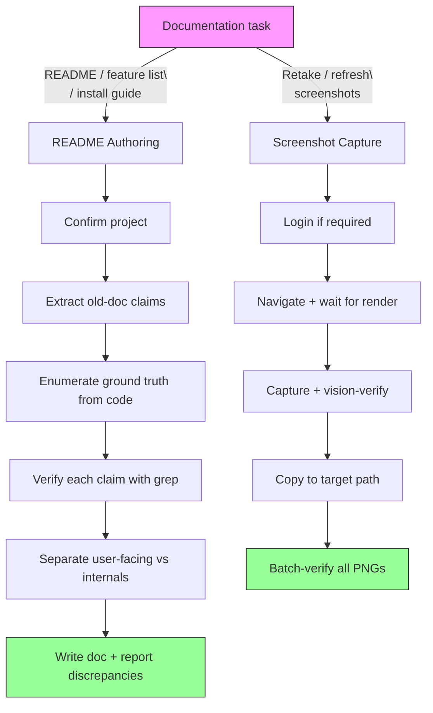

# Elixir Docs

Consolidated reference for writing/updating user-facing documentation
(READMEs, install guides, feature lists) and capturing UI screenshots that
document the app — both grounded in the real codebase.

## Decision DAG



## Part 1 — README Authoring (codebase-verified)

### Core rule

**Every claimed feature must exist in the codebase, and every UI claim must
have real UI (a route/page/component).** No invented features, no aspirational
roadmap items presented as shipped, no marketing claims the code can't back.

### Workflow

1. **Confirm the project first.** Don't assume from stack markers. Check the
   cwd / git remote, or ask.
2. **Read the existing doc** (if any) and extract its claims as a checklist:
   each feature bullet, each env var + default, each endpoint, each "X is
   persisted/audited/exported" statement.
3. **Enumerate ground truth from code, not from the old doc:**
   - Routes/pages: the router file is the page inventory (`router.ex` for
     Phoenix; route definitions for JS; urlconf/blueprints for Python).
   - Each page's purpose: read the module doc / top of each LiveView /
     controller / component — batched reads, 5+ per turn.
   - Config: read the runtime config source for env vars WITH their real
     defaults (`config/runtime.exs` — read the actual
     `System.get_env("VAR", "default")` lines; don't copy defaults from the
     old README).
   - Install/deploy facts: seeds file (default credentials + override env
     vars), Dockerfile (ports, entrypoint, build args), package manifest.
4. **Verify each claim individually with grep** — never carry a claim from
   the old doc into the new one without a code hit. If `Audit.log(...)` is
   only called from one controller, write that scope precisely. Confirm
   endpoints' method + path in the router.
5. **Separate user-facing features from internals.** Proxy internals
   (adapters, estimators, normalizers), ETS/Postgres topology, and worker
   names belong in a short "Platform" section at most.
6. **Write the doc**, then **report discrepancies back explicitly**: which
   old claims were removed/corrected because the code didn't support them,
   and which verified features were added. This report is part of the
   deliverable.

### Pitfalls (all from real sessions)

- **Framework boilerplate comments are not config.** Phoenix's `runtime.exs`
  ships commented-out blocks with placeholder env vars; grep finds them but
  they're inert. Read surrounding lines before listing a var.
- **Orphan modules exist.** A LiveView/controller can exist in `lib/` with no
  route mounting it. The router is the truth for "does this page exist".
- **Doc comments can promise what code doesn't do.** Verify the
  implementation, not the documentation.
- **Scope overstatement is common.** "Admin actions are audited" may mean
  exactly one audited action. Find ALL call sites and write the real scope.
- **Missing moduledoc doesn't mean missing feature.** `@moduledoc false`
  modules still render pages.
- **Don't trust old-doc defaults.** Env var defaults drift. Read each default
  from the config source at write time.
- **Screenshots can outlive pages.** A PNG existing doesn't prove the page
  still exists — cross-check the router.
- **UI language matters.** If the UI strings are hardcoded in a non-English
  language, note it in the README — an English README for a Spanish UI
  surprises users otherwise.

### Output conventions

- English for the README unless told otherwise; note the UI language
  prominently if it differs.
- Env vars as a table: `Var | Default | What it tunes` — required-in-prod
  vars in their own table first.
- Quick start = clone → setup command → run → seeded credentials (with their
  override env vars) → first milestone.
- Keep one hero screenshot; verify the referenced file exists in the repo.
- Compact sections; no verbose architecture narrative.

## Part 2 — UI Screenshot Capture

Systematically capture UI screenshots of a web app and save them to specific
paths (e.g. `docs/screenshots/`). Not exploratory QA — this is retaking a
named set of documentation screenshots.

### Workflow

1. **Login (if required):** navigate → snapshot to find fields → type → click
   submit. **Confirm the login actually landed** — check
   `window.location.pathname` is OFF `/login` before shooting. A click
   returning success does not mean the session cookie was set; capturing right
   after the click often yields a beautiful screenshot *of the login page*.
2. **Set viewport (optional):** `window.moveTo(0,0); window.resizeTo(W,H)`.
   `resizeTo` sets the outer size; the inner viewport is smaller due to
   browser chrome — fine for docs, don't chase exact pixels.
3. **For each screenshot:** navigate → wait 2-3s (4s for graph/canvas-heavy
   pages) → capture + verify in one call with a vision gate (is this the
   right page? correct theme? no login wall? content loaded?) → copy the
   screenshot to its target path immediately.
4. **Verify the batch:** check file sizes and timestamps (fresh, >20KB), then
   visually verify each PNG — no login pages, blank pages, or error pages.

### Pitfalls

- **LiveView/SPA clicks that don't navigate:** the click handler intercepts
  navigation. Extract the real href via JS
  (`Array.from(document.querySelectorAll('a')).filter(a => a.textContent.includes('...')).map(a => a.href)`)
  and navigate directly.
- **Remote browser session dies mid-batch:** timeouts on every call = session
  recycled. Wait ~20s, re-navigate (fresh session, but login cookie gone —
  re-login). Copy each screenshot immediately, never batch the copies at the
  end.
- **Headless Chrome `--screenshot` doesn't accept `--cookie`** (silently
  renders login page) and `--virtual-time-budget` hangs on LiveView
  websockets. Cookie injection via `ctx.addCookies` is the reliable path.
- **Get the session cookie via the real login flow with curl**, not by
  hand-signing one. Hand-signing a Phoenix session cookie fails in multiple
  non-obvious ways. The curl login flow always works:
  ```bash
  CSRF=$(curl -s -c /tmp/jar.txt $BASE/login | grep _csrf_token | grep -oE 'value="[^"]*"' | head -1 | sed 's/value="//;s/"$//')
  curl -s -b /tmp/jar.txt -c /tmp/jar.txt -X POST $BASE/session \
    --data-urlencode "_csrf_token=$CSRF" \
    --data-urlencode "user[username]=admin" --data-urlencode "user[password]=secret" \
    -o /dev/null -w "%{http_code}"   # expect 302
  ```
  Note the form field namespacing (`user[username]`, not bare `username`) —
  read the session controller's pattern match first.
  ⚠️ **CSRF grep must be attribute-order tolerant.** Phoenix renders the
  hidden input as `name="_csrf_token" type="hidden" hidden value="..."` — a
  grep for `name="_csrf_token" value="..."` matches NOTHING and the login
  POST then 403s. Grep the line, then extract value. A 403 on the login POST
  = wrong/empty CSRF token.
- **Password field ref goes stale after typing the username:** typing into
  the first field re-renders the form, invalidating refs. Submit the password
  via JS in one expression:
  ```
  document.querySelector('input[type=password]').value='...'; document.querySelector('form').submit(); 'ok'
  ```
- **Login submit flaky on a LiveView form (dead websocket):** don't loop the
  click. Re-navigate to the login URL (fresh page load reconnects the
  websocket), re-type, click once, verify the path before navigating on.
- **Rolling-window / time-sensitive KPI pages:** seed FRESH data immediately
  before that page's shot (after other captures), shoot the time-sensitive
  page first, and sanity-check the rendered numbers against what you seeded.
- **Reach state by clicking the real UI when reachable** (e.g. an
  impersonation banner) — it exercises the real flow. Restore the state
  afterwards so later screenshots don't inherit it. Icon-only buttons have no
  text — select by attribute (`a[title="..."]`) or id.
- **Stage the UI before shooting** (open collapsed sections, activate tabs,
  scroll into view) via `browser_console`. For state the UI genuinely can't
  reach, DOM-injection staging is legitimate IF: (1) derived UI stays
  consistent (if the staged section says "2 pending", patch the counter that
  would show 2), and (2) you disclose it in your report and never present
  staged state as a live-data capture.
- **Don't commit to git** unless asked. **Don't start/stop servers** — assume
  the app is already running.
- **Retake only what the change affects:** grep the docs for which screenshots
  are referenced, retake just the pages whose UI the feature touched. A
  full-set retake risks clobbering good shots with bad ones.

### Tools

| Tool | Purpose |
|------|---------|
| `browser_navigate` | Go to a URL (also returns a compact snapshot) |
| `browser_snapshot` | Get DOM text snapshot (accessibility tree) with ref IDs |
| `browser_click` / `browser_type` | Click / type by ref |
| `browser_vision` | Screenshot + AI analysis; returns `screenshot_path` |
| `browser_console` | Evaluate JS in page context (extract hrefs, check URL) |
| `vision_analyze` | Verify a saved screenshot shows the intended content |
| `terminal` | `cp` screenshots to target paths, `ls` to verify, `sleep` to wait |

## References

- `references/readme-authoring/` — README verification detail
  (`phoenix-readme-verification.md`: router.ex → moduledocs → runtime.exs →
  seeds/Dockerfile/mix.exs recipe with real greps and caught discrepancies).
- `references/ui-screenshot-capture/` — screenshot detail
  (`liveview-navigation-workarounds.md`: LiveView/SPA navigation workarounds,
  href extraction, sitemap building).
- `references/orig-*.md` — the absorbed originals (readme-authoring,
  ui-screenshot-capture) for full depth.
