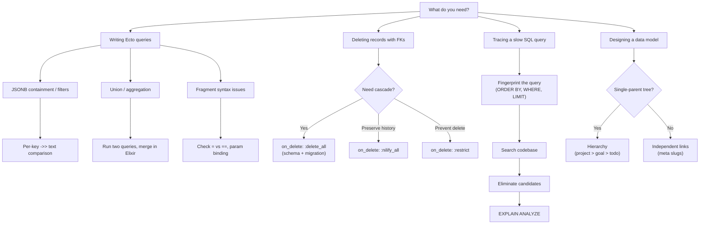

# Elixir Ecto

Practical reference for Ecto/Postgres in Phoenix applications — covering query construction, cascade-delete design, performance tracing, and data-model architecture.

## Decision DAG



---

## 1. Ecto Query Pitfalls

Hard-won traps when writing non-trivial Ecto queries against Postgres.

### JSONB Containment `@>` Silently Fails with Parameters

`fragment("? @> ?::jsonb", p.meta, ^json)` returns `false` through Postgrex because parameterized values don't match the `::jsonb` cast correctly.

**Preferred fix — per-key `->>` text comparison:**

```elixir
# Pushes filter into SQL; works reliably through Postgrex
Enum.reduce(props, query, fn {key, value}, q ->
  text_value = if is_binary(value), do: value, else: Jason.encode!(value)
  where(q, [p], fragment("?->?>? = ?", p.meta, ^to_string(key), ^text_value))
end)
```

**Fallback — post-query Elixir filter** (breaks pagination correctness):

```elixir
pages = Repo.all(query)
Enum.filter(pages, fn page ->
  page_props = get_in(page.meta || %{}, ["props"]) || %{}
  Enum.all?(props, fn {k, v} -> Map.get(page_props, k) == v end)
end)
```

### JSONB String Keys Get Mangled in Fragments

`fragment("?->'props' @> ?", p.meta, ^json)` strips quotes → `meta->props` → column not found. Pass the key as a parameter: `fragment("?->? @> ?", p.meta, "props", ^json)`.

### SQL `=` vs Elixir `==` in Fragments

`fragment("?->>'key' == ?", ...)` is an error — Postgres uses `=` for equality. Always `fragment("?->>'key' = ?", ...)`.

### `union_all` With Plain Variables

`union_all(^q1, ^q2)` fails with misplaced `^`. Robust escape hatch — run two lean queries and merge in Elixir:

```elixir
(Repo.all(outbound_ids) ++ Repo.all(inbound_ids))
|> Enum.frequencies()
|> Enum.sort_by(fn {_id, deg} -> deg end, :desc)
|> Enum.take(limit)
```

### Keyword Lists Must Be Last Argument

`Repo.aggregate(from(r in R, ...), :count)` fails. Bind to variable first: `q = from(...); Repo.aggregate(q, :count)`.

### Nullable JSONB Columns Need Nil Guards

`fragment(...)` on a nullable column crashes on NULL rows. Guard: `not is_nil(p.meta) and fragment(...)`.

### Conditional Filter Composition

Avoid `^list == [] or ...` inside `where:`. Build base query then apply optional filter:

```elixir
q = if types == [], do: q, else: from([r, s] in q, where: s.type not in ^types)
```

### GROUP BY With COALESCE Across Bindings

`select` with `fragment("COALESCE(?, ?)", a.col, b.col)` plus `group_by` fails (column must appear in GROUP BY). Select primary column raw, apply fallback in Elixir after `Repo.all`.

### Mixing `as:` Names With Positional Bindings

Positional bindings resolve by JOIN ORDER, not `as:` name. Either use `as:` names consistently everywhere or full positional order — never mix. Positional lists must enumerate every preceding join.

### Composite `unique_constraint` Reports First Field

`unique_constraint([:ctx_id, :slug])` reports violation on `:ctx_id`. Match constraint type, not field name: `opts[:constraint] == :unique`.

### Timestamp Ties at Second Precision

`utc_datetime` truncates to seconds. Never `Process.sleep` in tests — backdate deterministically:

```elixir
Repo.update!(Ecto.Changeset.change(old, inserted_at: DateTime.add(old.inserted_at, -10, :second)))
```

### `put_change` Silently Skips Decimal Scale Changes

`Ecto.Type.equal?/3` compares decimals numerically. `put_change(cs, :amount, Decimal.round(d, 2))` is a no-op when value equals numerically. Use `force_change/3`.

### JSONB Map Key Round-Trip: Atoms → Strings

`Repo.insert` returns atom keys; the next DB read returns string keys. Templates using dot syntax (`page.title`) crash. Normalize after every DB read:

```elixir
%{summary | top_pages: Enum.map(summary.top_pages || [], fn p ->
  %{slug: Map.get(p, "slug") || Map.get(p, :slug),
    title: Map.get(p, "title") || Map.get(p, :title)}
end)}
```

### Composite Indexes: Match WHERE/GROUP BY/ORDER BY Shape

Single-column indexes don't serve multi-column predicates. Write composite indexes matching the query shape, then verify with EXPLAIN:

```elixir
create index(:pages, [:context_id, :page_type, :archived], name: :pages_ctx_type_archived_idx)
create unique_index(:page_versions, [:page_id, :version], name: :page_versions_page_version_uidx)
```

### Partial Expression Indexes for JSONB `->>` Filters

GIN doesn't serve `meta->>'key' = value`. Create a partial expression index per hot key:

```elixir
create index(:pages, ["((meta ->> 'kanban_status'))"],
  name: :pages_meta_kanban_status_idx,
  where: "meta ->> 'kanban_status' IS NOT NULL",
  concurrently: true)
```

### Probe Before Baking

Before writing tests around a new fragment, run a throwaway `mix run /tmp/probe.exs` that inserts a real row and verifies the query. For zero-residue probes, wrap in an Ecto sandbox owner:

```elixir
:ok = Ecto.Adapters.SQL.Sandbox.mode(Repo, :manual)
owner = Ecto.Adapters.SQL.Sandbox.start_owner!(Repo, shared: false)
# ... assertions ...
Ecto.Adapters.SQL.Sandbox.stop_owner(owner)
```

---

## 2. Cascade Deletes

Three layers of a correct cascade — a robust fix touches all three:

1. **Context function** — delete dependents in `Repo.transaction`, or rely on schema `on_delete`.
2. **Ecto schema** — `on_delete: :delete_all` (or `:nilify_all`) on `has_many`/`has_one`.
3. **Migration FK** — `on_delete: :delete_all` in child's `references(...)` — the ground truth.

Schema-only `on_delete` works for `Repo.delete` but not `Repo.delete_all`, raw SQL, or direct DB operations.

### Decision Table

| Child table type | `on_delete` | When |
|---|---|---|
| Join tables (M:N) | `:delete_all` | Rows have no meaning without both parents |
| Owned children | `:delete_all` | Entirely owned by parent |
| Append-only / audit | `:nilify_all` | Must preserve row for history |
| Referential only | `:restrict` | Force explicit cleanup |

### Workflow

1. Read stack trace → note constraint name.
2. Search codebase for constraint name → find deletion path.
3. Decide delete vs nilify vs restrict.
4. Add regression test (create child, assert parent delete succeeds).
5. Update migration FK.
6. Add `on_delete` to schema association.
7. `mix test && mix precommit`.

### Pitfalls

- **Schema-only `on_delete`** — passes tests, fails production raw deletes.
- **Missing transaction** — orphaned rows if parent delete fails after child delete.
- **Wrong direction** — `on_delete` goes on `has_many`/`has_one`, not `belongs_to`.
- **Partitioned tables** — use raw `execute` SQL for FK changes (not Ecto `references`).
- **Composite PKs break `Repo.get/2`** — use `Repo.get_by/2` with all PK fields.
- **User deletion with NOT NULL FKs** — present tradeoff: hard cascade (loses history) vs soft-delete/anonymize (preserves history) vs ghost-member transfer.
- **Destructive cascades need a confirmation modal** — `data-confirm` is insufficient; use a `<dialog>` modal with explicit deletion list and two-event handler pattern.
- **History tables use `SET NULL`, not `DELETE`** — parent disappears but audit row survives.

---

## 3. Query Tracing

When you have a raw SQL query from observability and need to find its Ecto source.

### Fingerprint the Query

Extract discriminating features before searching:

- **ORDER BY** — most discriminating; search for the exact column set + directions first.
- **WHERE shape** — `= ANY($n)` means Ecto `field in ^list`; `$n` means scalar.
- **LIMIT/OFFSET** — presence or absence eliminates candidates with unconditional limits.
- **Table + selected columns** — full columns with no aggregates suggests `Repo.all(query)`.

### Eliminate Candidates

- Check filter arity/shape (`= ANY` vs scalar `=`).
- Hard `limit` applied unconditionally → eliminated if observed query has no LIMIT.
- Different preload/join shape → eliminated if columns don't match.

### Before Fixing

- Check git history for prior partial fixes — the gap is often the real root cause.
- Quantify: avg execution time × call count. Frequency problem → cache; volume problem → pagination/index.

### Verify With EXPLAIN ANALYZE

- On small dev tables, planner prefers Seq Scan even with perfect indexes. Don't conclude the index is unused.
- Force index visibility: `SET enable_seqscan = off` to see which index the planner prefers at scale.
- Pattern-match `{:ok, %{rows: rows}}` from `Repo.query` in scripts.

### Common Gotchas While Authoring

- `fragment()` + `order_by` with "undefined variable" → split into chained `order_by`.
- `Repo.update_all` needs a `from` query, not `where:` kwargs.
- OFFSET/LIMIT page overlap without unique tiebreaker → add deterministic ORDER tiebreaker.
- Materialized views invisible in Ecto Sandbox — test with real DB.
- `= ANY(?)` vs `IN ?` inside fragments — they differ in NULL handling.

---

## 4. Data Model Design: Hierarchy vs Links

### The Hierarchy Trap

Rigid hierarchies (`project > goal > plan > todo`) with precedence rules create:

- **Opaque precedence** — multiple parent slugs set, only one materializes; silent dashboard bugs.
- **Multiple parents impossible** — a todo belonging to project AND goal must choose one.
- **Complex queries** — resolving precedence requires JOINs or nested conditionals.

### Prefer Independent Links

Each slug materializes its own `part_of` relation in the graph:

```
Todo
  ├── meta.project_slug  →  part_of project
  ├── meta.goal_slug     →  part_of goal
  └── meta.plan_slug     →  part_of plan
```

Benefits: each link independent, sync logic simple, queries filter by `meta->>'field' = ?` directly, new link types trivial to add.

### When Hierarchy Is Correct

Only when domain truly requires single-parent trees: file systems, org charts, biological taxonomies. For knowledge work and task management, independent links win.

### Kanban Design

Prefer a single global kanban with filter dropdowns over per-container boards:

- Cards show at most 2 linked containers, tooltip for the rest.
- Color-code by type.
- Click badge to filter by that link.
- Filters combinable: `project:X AND goal:Y`, `project:X AND no-goal`, `inbox` (no links).

### Metadata Patterns

| Type | Own fields | Optional links |
|---|---|---|
| Todo | kanban_status, priority, due_date | project_slug, goal_slug, plan_slug |
| Project | status, priority, health, dates | — |
| Goal | health, metric, target/current value, due_date | project_slug |
| Plan | horizon, period, status, due_date | project_slug, goal_slug |

### IA Auditing Workflow

1. Read layout module, router, dashboard LiveView, and command palette end-to-end.
2. Cross-check sidebar grouping vs. dashboard grouping (they drift when hand-duplicated).
3. Grep `active_nav:` across all LiveViews — missing values = broken highlights.
4. Verify every nav item has a route AND is reachable from the sidebar.
5. Count kanban-board implementations — if >1, consolidate.
6. Count search surfaces — flag triplication.
7. Report: numbered sections, `file:line` citations, effort/severity table.
