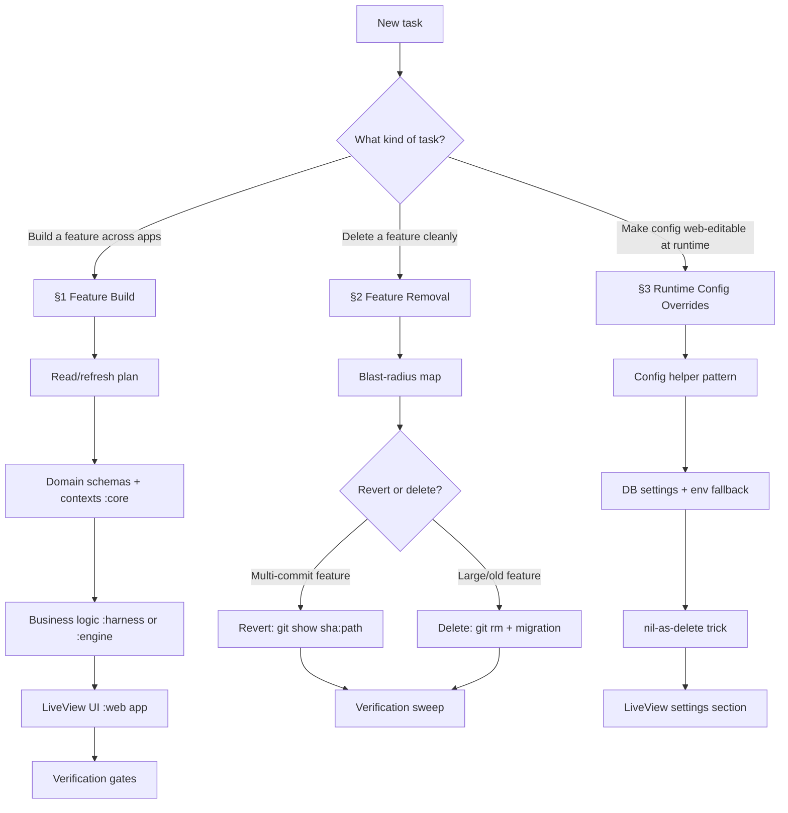

# Elixir Features

## Decision DAG



---

## §1 Building a Feature End-to-End Across an Umbrella

Use this section when a feature touches domain schemas/contexts in one app, business logic in another, and LiveView UI in a web app.

### 1.1 Pre-flight

1. **Read or create a plan** before writing code. If the plan is missing, create one first.
2. **Clean the tree.** Commit pending changes in atomic groups. A dirty tree causes subagent races on the git index.
3. **Verify baseline.** Never dispatch subagents against an unverified baseline:
   ```bash
   mix compile --warnings-as-errors   # must be clean
   mix test                           # must be 100% green
   ```

### 1.2 App Placement Rules

| App | Responsibility |
|-----|---------------|
| `:core` | Domain schemas, contexts, data access. No sibling umbrella dependencies. |
| `:harness` or `:engine` | Business logic, LLM clients, system prompt builders, prompt security. |
| `:web` (or `:admin`) | LiveViews, routes, shared components. Declares `{:core, in_umbrella: true}` in mix.exs. |

**No circular dependencies.** `:core` must never depend on sibling apps. If a data context needs to call business logic, store/update the record in `:core` then drive the call from the app that depends on both.

### 1.3 Shared Config Rules

- All config lives under `config/` at the umbrella root. Do not duplicate endpoint or repo config per app.
- Web apps created with `phx.new.web` have no Ecto repo of their own — set `config :my_app, ecto_repos: []`.
- `import_config "#{config_env()}.exs"` must be at the very bottom of `config/config.exs`.
- Dev port convention: starting at 3000, increment per app.

### 1.4 Subagent Orchestration

When dispatching subagents for parallel phases:

- **Verify function signatures** against the actual codebase before dispatching. Plans often reference functions by names that are *close but wrong*. Run `search_files` before writing.
- **Scopes must be disjoint.** Never assign two subagents to the same file.
- **Prefer `write_file` over `patch`** for large shared files — `patch` can fail silently on large edits.

### 1.5 Verification Gates

After each phase:
```bash
mix compile --warnings-as-errors
mix test --umbrella  # or cd apps/<app> && mix test
```

Before declaring done:
```bash
mix format --check-formatted
mix compile --warnings-as-errors
MIX_ENV=test mix compile --warnings-as-errors
mix test
```

---

## §2 Feature Removal

Use this section when deleting a whole feature cleanly — no orphaned references, no broken suite. Distinct from reverting a single commit.

### 2.1 Blast-Radius Map

Before deleting anything, find ALL pieces:

| Layer | Search for |
|-------|-----------|
| **Backend modules** | `lib/my_app/<feature>/*.ex` — services, GenServers, schemas |
| **OTP supervision** | `application.ex`: children of the feature |
| **Web** | LiveView components, `mount` in layouts, attrs, routes in `router.ex` |
| **Tests** | `test/` mirror of each deleted module |
| **DB** | Tables → new migration `drop_if_exists table(...)` |
| **Docs** | README, SKILL.md, docs LiveView, API reference sections |
| **Assets** | Screenshots, imports in `app.js`/`app.css` |
| **Gettext** | Run `mix gettext.extract && mix gettext.merge priv/gettext` AFTER deleting code |
| **Env vars / config** | Variables exclusive to the feature in `.env` / `config/*.exs` |

**Rule:** before deleting layout attrs, grep that no other component uses the same name.

### 2.2 Revert vs Delete

- **Revert to a prior commit** (feature was recent and linear):
  ```bash
  git show <sha_previo>:<path> > <path>   # per file
  git rm <new-files>                       # remove files added by the feature
  ```
- **Delete forever** (feature stays in history but not in main): `git rm` + manual edits + drop migration.

### 2.3 Subagent Wave Split

Scopes must be DISJOINT by layer:

1. **Backend:** modules + supervision + backend tests
2. **Frontend:** components + layout attrs + web tests
3. **Docs/DB/i18n:** README, gettext, migration, screenshots

Each prompt lists exact files and forbids touching other agents' files. Verify with grep + compile + suite before committing — never trust self-reports alone.

### 2.4 Full Verification Sequence

1. `grep -rn "<FeatureName>\|<feature_name>" lib/ test/` → **zero references.** Scope to feature-specific identifiers, not generic words.
2. `mix compile --warnings-as-errors` clean.
3. `mix test` — compare failures against pre-existing (confirm with `git stash`).
4. Migration: `mix ecto.migrate` in dev AND test; verify table gone in psql.
5. Server smoke: `mix phx.server`, login + curl 200 on main pages.
6. `mix precommit` (if the project has it).

### 2.5 Common Removal Pitfalls

- **Orphaned handlers:** when you remove a tab/panel, `handle_event` clauses for its buttons become dead code. Grep `phx-click="event_name"` in templates; if 0 hits, delete the handlers.
- **Shared attr collision:** a generic attr name (`page_type`) may exist in the layout AND in local components — delete only if the layout is the sole consumer.
- **HEEx compiles at render time:** removing a struct field from the schema but leaving `{record.field}` in a template compiles fine but blows up at render. Compile warnings are NOT sufficient — run the full test suite.
- **Test-only inline schemas:** Phoenix test files may define lightweight inline schemas (`defmodule TestOrg`) that reference the dropped table. Delete them, fix sibling test schemas, fix fixtures and call sites.
- **`_build` cache after dep removal:** after removing a dep, `mix compile` may succeed but `mix run` fails with stale `.app` references. Fix: `mix clean --deps && mix deps.get && mix compile`.
- **Gettext fuzzy matches:** after extract/merge, review new msgids marked `fuzzy` — gettext guesses old translations that don't apply. Fix the `msgstr` and remove the flag.
- **Tests failing pre-existing:** never attribute pre-existing test failures to your removal. Confirm with `git stash` before committing.
- **Removing a dependency:** case-sensitive search matters — `tidewave` misses `Tidewave`. Search both. Full sequence: remove from `mix.exs`, grep both cases, remove references, `mix deps.unlock`, `mix deps.get`, `mix compile --warnings-as-errors`, run tests.
- **Partial feature relocation:** sometimes a "removal" is actually a relocation — the UI moves to a dedicated LiveView while the backend stays. Delete the old UI code, replace with a link to the new location.

---

## §3 DB-Backed Runtime Config Overrides

Use this section when a config value loaded from env vars at boot should be editable at runtime without redeploying.

### 3.1 The Config Helper Pattern

Each configurable value checks the DB first, then falls back to the env-based value:

```elixir
# lib/my_app/config.ex

def chat_model, do: settings_value("model_chat") || get(:chat_model)
def embedding_model, do: settings_value("model_embedding") || get(:embedding_model)

defp settings_value(key) do
  case MyApp.Settings.get(key) do
    nil -> nil
    "" -> nil
    value -> value
  end
rescue
  _ -> nil
end
```

**Why `try/rescue`:** `MyApp.Settings` is plain Ecto with no GenServer. In tests or `mix run` without the repo started, `Settings.get/1` raises. The rescue returns nil, which the `||` treats as "no override, use env default."

### 3.2 The nil-as-Delete Trick

When the user selects "Default" (empty value `""`) in the settings form, normalize to `nil` before saving:

```elixir
# In the save handler:
for key <- @config_keys do
  value = Map.get(params, key, "")
  normalized = if value == "", do: nil, else: value
  Settings.put(key, normalized)
end
```

`Settings.put(key, nil)` stores `%{"value" => nil}` in the JSONB column. `Settings.get/1` returns `nil` via the pattern match, and the Config helper falls back to the env default. **No `delete/1` is needed** unless `get/1` has a `not is_nil(value)` guard.

### 3.3 The LiveView Settings Section

Each config group gets its own `<.form>` with its own `phx-submit` event:

```elixir
# In mount:
available_models =
  case MyApp.Client.models() do
    {:ok, models} -> Enum.map(models, & &1["id"])
    {:error, _} -> []
  end
socket = assign(socket, available_models: available_models)

# In handle_event:
def handle_event("save_models", %{"models" => params}, socket) do
  for key <- @model_keys do
    value = Map.get(params, key, "")
    normalized = if value == "", do: nil, else: value
    Settings.put(key, normalized)
  end
  {:noreply, put_flash(socket, :info, gettext("Models saved"))}
end
```

**Rendering:** fetch `available_models` ONCE in `mount`, not on every render. When the API is unreachable (`available_models == []`), fall back to text inputs instead of selects.

### 3.4 Testing

```elixir
# Config fallback + override (DataCase, DB-backed)
setup do
  original = Application.get_env(:my_app, :inference)
  Application.put_env(:my_app, :inference, chat_model: "EnvDefault")
  on_exit(fn ->
    if original, do: Application.put_env(:my_app, :inference, original),
      else: Application.delete_env(:my_app, :inference)
  end)
end

test "falls back to env default when no Settings override" do
  assert Config.chat_model() == "EnvDefault"
end

test "returns the override when Settings has one" do
  Settings.put("model_chat", "Override")
  assert Config.chat_model() == "Override"
end

test "nil override falls back to env default" do
  Settings.put("model_chat", "Override")
  Settings.put("model_chat", nil)
  assert Config.chat_model() == "EnvDefault"
end
```

### 3.5 Runtime Config Pitfalls

- **Don't re-fetch on every render.** `Client.models()` is an HTTP call. Fetch once in `mount`, assign to socket.
- **`""` vs `nil` in form params.** HTML forms send `""` for empty selects. Normalize before saving.
- **Gettext msgids must be literal strings.** `gettext("Default (%{model})", model: value)` works; dynamic construction does not.
- **SQL sandbox in LiveView tests.** Use `async: false` when settings writes and LiveView reads share a sandbox.
- **Purpose tables with anonymous functions cannot be module attributes.** `@purposes [...]` with `fn -> gettext("...") end` fails to compile. Define as `defp purposes do ... end` instead.
- **`&get(:atom)` is not a valid capture.** Use `fn -> get(:atom) end` instead.
- **`Config` deep-merge silently ignores empty-list overrides.** Elixir's `Config` module deep-merges keyword lists across envs. An empty list `jobs: []` cannot shadow `jobs: [task_a: [...]]`. Guard with `if config_env() != :test do ... end` in `config.exs`.

---

## Cross-Cutting Pitfalls

These apply to any of the three workflows above.

### GenServer Timeout Must Exceed Inner Operation

When a GenServer delegates to a long-running operation with its own timeout, the `GenServer.call` at the call site must be LARGER. Rule: `call_timeout = inner_timeout * 1.5`.

### LiveView `handle_info` Ordering — Specific Before Catch-All

New specific clauses MUST appear before any existing `def handle_info(message, socket)` catch-all. Elixir matches top-to-bottom.

### LiveView Streams: Convert Both Sides or Revert

Converting a list to streams touches both the LiveView (`stream/4`) and the component (`@streams.x` + `phx-update="stream"`). A partial conversion breaks the build — revert entirely and re-attempt atomically.

### `to_form(map)` Without `as:` Produces Flat Field Names

When `handle_event` expects namespaced params (`%{"settings" => params}`), pass `to_form(values, as: :settings)`. Without `as:`, params arrive flat and the pattern match never fires.

### Cross-App Visibility

The web app must declare `{:core, in_umbrella: true}` (and any other needed sibling) in its `mix.exs`, otherwise domain modules are not visible at compile time.

### `distinct(query, [p], p.id)` Conflicts with `order_by`

Use `distinct(query, true)` (full-row DISTINCT) instead. `DISTINCT ON (column)` requires matching the leading `ORDER BY` expression.

### LiveComponent Module Attributes Not in `~H`

In a `LiveComponent`, module attributes are NOT available inside `render/1`'s `~H` sigil. Assign them to the socket in `mount/1` first.

### `raw/1` with Search Excerpts — Stored XSS

PostgreSQL's `ts_headline()` does NOT HTML-escape the source body. Always sanitize before rendering with `raw/1`.

### `--warnings-as-errors` on a Dirty Tree

When the working tree has concurrent changes, warnings from OTHER files cause failure. Diagnose with:
```bash
mix compile --warnings-as-errors 2>&1 | grep "your_file" || echo "NO WARNINGS IN OUR FILES"
```
Fall back to `mix compile` (no flag) to verify your changes, then grep the strict output for your specific files.
