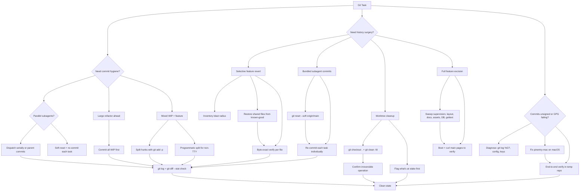

# Elixir Git — Commit Hygiene, History Surgery, and Signing



## When to Use

- Dispatching parallel subagents that commit to the same repo
- Starting a large refactor touching many files
- Reverting a merged feature while preserving unrelated work and salvageable parts
- Commits show unsigned (`N` in `%G?`) or GitHub lacks "Verified" badge
- Cleaning a worktree of all pending changes (tracked + untracked)

---

## 1. Commit Hygiene

### Core Rules

1. **Commit before refactors.** Isolate all WIP so the refactor diff stands alone. Mixed WIP + refactor makes bisection impossible.
2. **Never sweep unrelated WIP into feature commits.** Split hunks with `git add -p` (interactive) or programmatic patch splitting (non-TTY contexts).
3. **Stage explicit paths, never `git add -A` in dirty repos.** Unstaged files from other work get silently bundled.

### Parallel Subagent Dispatch

| Pattern | Risk | When to Use |
|---------|------|-------------|
| Parallel, each commits | High race risk | Avoid |
| Parallel, parent commits after verifying | Low risk | Default for code changes |
| Serial, each commits | Low risk | Independent tasks |
| Serial, parent commits | Lowest risk | High-stakes repos |

**Recovery from racing commits:**
```bash
git reset --soft origin/main   # keeps changes staged, drops bad commits
git add -p <file>              # select hunks for task 1
git commit -m "feat: task 1 description"
git add -p <file>              # select hunks for task 2
git commit -m "fix: task 2 description"
```

**Parent bundling pitfall:** `git add -A <dir>` sweeps pre-existing dirty files into your commit.
```bash
git reset --soft HEAD~1
git restore --staged path/to/not-mine.ex
git commit -m "feat: original message — now only your files"
```

### Splitting Mixed Concerns in the Same File

**Interactive (TTY available):**
```bash
git diff <file> | grep -n "^@@"           # count hunks, map each to a concern
printf 'y\ny\nn\nn\n' | git add -p <file>  # answer per hunk in order
git diff --cached <file> | grep -c <marker>  # verify staged set is pure
```

**Programmatic (no TTY — subagents, CI, execute_code):**
1. Save the full file to `/tmp/<name>.full.ext`.
2. Split the diff at a hunk header whose body contains a unique marker from concern B.
3. Write each half to separate patch files.
4. `git checkout HEAD -- <file>` to revert to baseline.
5. Apply concern-A patch, commit. Apply concern-B patch, commit.

Use programmatic splitting only when concerns are in non-contiguous regions of the file. Interleaved concerns in the same hunk → single commit with a note.

### Verification

```bash
git log --oneline -5          # commits atomic and well-named?
git diff HEAD~1 --stat        # any commit sweep unrelated files?
```

---

## 2. History Surgery

### Selective Feature Revert (Blade, Not Revert)

Do NOT `git revert <merge>` blindly — it creates confusing inverse chains. Do file-level surgery instead.

**Step 1 — Inventory the blast radius:**
```bash
git log --oneline <last-good-commit>..HEAD
git diff <last-good-commit> HEAD --stat
```
Classify every file: **feature-only** (new modules/tests) → `git rm`, **feature-touched shared** (existing modules modified) → restore from last good commit, **unrelated changes** → keep.

**Step 2 — Restore shared files from the known-good commit:**
```bash
git show <last-good>:path/to/file.ex > path/to/file.ex
```

**Step 3 — Verify byte-exact restore per file:**
```bash
git show <last-good>:path/to/file.ex | diff -q - path/to/file.ex && echo "OK"
```
Run this in a loop before compiling. A partially-reverted file is worse than none.

**Step 4 — Check gitignored companions:**
Feature config in `.env`, credentials, generated code. Grep and remove manually:
```bash
grep -n "FEATURE_VAR" .env
sed -i '' '/^FEATURE_VAR=/d' .env
```

**Step 5 — Commit as ONE clean revert:**
One commit for the revert (`revert: remove <feature>`), separate commits for any salvage kept or added on top.

**Step 6 — Scan docs for shared vocabulary:**
A name that predates the feature is NOT collateral. Revert the feature, not the vocabulary.

### Full Feature Excision ("Remove Everything Related to X")

A revert restores files; an excision removes the feature from every layer. Sweep these explicitly:

- **Supervision tree** — `application.ex`: registries, dynamic supervisors, GenServers the feature started. Orphaned entries crash at boot even though compile passes.
- **Layout/root mounts** — Global `<.live_component>` in `layouts.ex`, plus `attr` declarations. Grep `attr_name=` across ALL templates before deleting an attr — same-name attrs passed to local components are different concepts.
- **In-app documentation** — Guide pages, API reference tables, documented endpoints that no longer exist in the router.
- **Static assets** — Screenshots, icons, files under `docs/` or `priv/static` referenced only by the feature.
- **README + external docs** — Feature bullets, screenshot table cells, config tables. Check table row balance after removing cells.
- **DB tables** — `mix ecto.gen.migration drop_<table>` with `drop_if_exists table(:<table>)`. Verify with `\dt <table>*` in psql — test DB may show migration version while table still exists.
- **Gettext catalogs** — `mix gettext.extract && mix gettext.merge priv/gettext` AFTER code deletions. Grep affected msgids for `fuzzy` and fix `msgstr` by hand.
- **Skills/references** — Mark them REMOVED with date/commit; don't leave them teaching ghosts.

**Final verification:** live server boot + curl main pages + any API endpoint. Compile-clean does not prove boot-clean.

### Bundled Subagent Commits

Recovery:
```bash
git reset --soft origin/main
# re-commit each task individually with its own message
```

**Prevention:** Dispatch committing subagents serially, or have subagents report diffs without committing — parent commits after verifying each (compile + tests per wave).

### Worktree Cleanup

When asked to discard all pending changes (tracked + untracked):
```bash
git status --short            # show what's pending
git checkout .                # revert tracked modifications
git clean -nfd                # dry-run: list what would be removed
git clean -fd                 # remove untracked files/dirs
git status --short            # verify clean
```

**Pitfalls:**
- `git checkout .` alone leaves untracked files behind. Run both commands.
- Cleanup is **irreversible**. Flag what's at stake before executing.
- `gpg-agent.conf` and similar protected files: use `printf '\nline\n' >> file` instead of write_file/patch tools.

---

## 3. Commit Signing (GPG/SSH)

### Diagnosis (in order)

1. **Recent commit signature status (per repo):**
   ```bash
   git log --pretty=format:"%h %G? %an %s" -5
   ```
   Codes: `G` = good, `N` = no signature, `U` = good but unknown key, `B` = bad, `X`/`Y` = expired, `R` = revoked, `E` = error.

2. **Git config:** `git config --global --get commit.gpgsign`, `user.signingkey`, `gpg.format`. Also check local config: `git config --local --list | grep -iE "sign|gpg"`.

3. **Secret key exists:** `gpg --list-secret-keys --keyid-format=long`

4. **Test signing directly:**
   ```bash
   echo test | gpg --sign --local-user <KEYID> -o /dev/null
   ```

5. **Public key on GitHub:** `curl -s https://github.com/<user>.gpg` should return a PGP block.

### Common macOS Issue: pinentry TTY Error

`gpg: signing failed: Inappropriate ioctl for device` — pinentry can't prompt for passphrase in headless contexts (agents, CI, background).

**Fix (macOS):**
```bash
brew install pinentry-mac
# Append to ~/.gnupg/gpg-agent.conf:
printf '\npinentry-program /opt/homebrew/bin/pinentry-mac\n' >> ~/.gnupg/gpg-agent.conf
gpgconf --kill gpg-agent && gpgconf --launch gpg-agent
```
Then sign once manually — the macOS popup appears, passphrase is cached (default 10 min TTL). Subsequent signs pass without popup.

### End-to-End Verification (safe, no real repos)

```bash
T=$(mktemp -d) && cd "$T" && git init -q \
  && git config user.name "Test" && git config user.email "test@example.com" \
  && git config commit.gpgsign true && git config user.signingkey <KEYID> \
  && echo test > a.txt && git add a.txt && git commit -q -m "test signing" \
  && git log --pretty=format:%G? -1  # should print G
cd -
rm -rf "$T"
```

### Pitfalls

- **Duplicate GPG on macOS:** MacGPG2 (`/usr/local/MacGPG2`) + Homebrew (`/opt/homebrew`) causes stale-agent warnings. Unify to Homebrew.
- **Restarting gpg-agent clears cache** — popup reappears. Only kill agent when user can re-enter passphrase.
- **Pushed unsigned commits stay unsigned** — don't offer rebase re-sign unless explicitly requested.
- **`gpg-agent.conf` is protected** — use `printf >> file` via terminal, not write_file/patch tools.

---

## Verification Checklist

- [ ] `git status` clean except intended changes
- [ ] Every restored file passes byte-exact `git show | diff -q` check
- [ ] Gitignored companions (`.env`, generated files) cleaned manually
- [ ] `mix compile --warnings-as-errors` passes
- [ ] Full test suite passes; any failures confirmed pre-existing
- [ ] Revert/excision commit is ONE atomic commit; salvage is separate
- [ ] Docs/README scanned for feature vocabulary predating the feature
- [ ] Commits signed (`%G?` = `G`) when signing is configured

---

## References

- `references/orig-git-workflow.md` — Original skill: commit hygiene for parallel subagents
- `references/orig-git-history-surgery.md` — Original skill: selective reverts, untangling, excision
- `references/orig-git-commit-signing.md` — Original skill: GPG/SSH signing diagnosis and fix
- `references/parallel-subagent-recovery.md` — Detailed recovery walkthrough
- `references/split-hunks-guide.md` — `git add -p` interactive splitting guide
