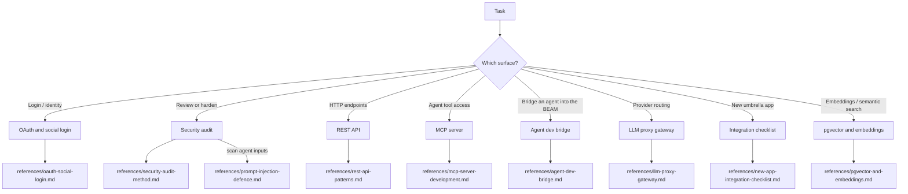

# Elixir Integration

Integration-track patterns for Phoenix/Elixir apps: OAuth & social login, security
auditing, REST APIs, MCP servers, agent↔Elixir dev bridges, and LLM proxy gateways.
All surfaces share one trust model: **never trust the client, verify on the server,
fail closed.**

## Task Routing



## 1. OAuth & social login

- Split pure helper vs controller: URL/token logic in `MyAppWeb.OAuth.Google`
  (no `conn` dependency, unit-testable), session/redirect logic in the controller.
  Gate BOTH the controller branch and the login button behind `configured?/0`.
- The OAuth dance is GET-initiated, so the `/session` CSRF token does NOT cover it.
  Mint `:crypto.strong_rand_bytes(32) |> Base.url_encode64(padding: false)`, store in
  the session, and compare on callback with `Plug.Crypto.secure_compare/2` — never `!=`.
  Delete the stored state on success AND on mismatch.
- Callback routes are PUBLIC and go in the `:browser` scope BEFORE auth-required
  routes. Putting the callback behind an auth plug is a chicken-and-egg bug.
- Derive `authorize` and `exchange` redirect URIs from the same `redirect_uri/0`;
  providers reject mismatches. Allow an env override: when the app serves plain
  HTTP (VPN, no TLS terminator), the override must point at the public HTTPS domain.
- User resolution: find-or-create ONLY for open sign-up. Admin-managed apps use
  find-or-link and return `{:error, :unauthorized}` — auto-provisioning lets anyone
  with a provider account walk in. When hardening, RENAME the resolver so stale call
  sites fail to compile, and replace the "creates a user" test with a rejection test
  asserting `{:error, :unauthorized}` AND `Repo.aggregate(User, :count, :id) == 0`.
- Check `status == "active"` before password verification; keep `Bcrypt.no_user_verify()`
  in the miss branch (timing). Root/bootstrap admin (env email) cannot be suspended,
  demoted, or deleted — enforce server-side.
- Every identity change (login, OAuth callback, impersonation start/stop) calls
  `configure_session(conn, renew: true)` or the pre-login session id survives (fixation).
- Controller pitfalls: `redirect(to:)` rejects full URLs — parse the `referer` header
  with `URI.parse` and pass path+query only. Validate ANY user-controlled value
  (context slug, locale, theme) against real access BEFORE `put_session`.

## 2. Security auditing (read-only)

Method: (1) map the attack surface — router pipelines, plugs, `on_mount` hooks,
controllers, LiveViews, deploy config; (2) check each vulnerability category noting
file, line, severity, fix; (3) verify every finding against the real code before
reporting — a false positive destroys trust in the real ones; (4) prioritized report,
explicit "no files edited".

Highest-value checks:

- **`handle_event` without permission check** — the #1 LiveView hole. Templates hide
  buttons, but a mounted socket fires events directly over the WebSocket. Fix:
  one `attach_hook(:require_admin, :handle_event, ...)` in mount halts EVERY event.
- **IDOR** — client-supplied ids (team, model, record) must be validated against the
  caller's scope. Fail closed: unvalidated id → empty result, never cross-scope data.
- **Fail-open identity defaults** — `nil -> true` / `nil -> :all` on a missing user
  ESCALATES deleted-user sessions. Grep `grep -rn 'nil -> true\|nil -> :all' lib/`.
- **Suspension that never reaches the data plane** — trace what suspend writes, then
  re-check `user.status` in EVERY non-session auth path (API key plug, bearer, WS).
- **Session renewal, rate limiting, mass assignment** — diff controller param filters
  against changeset `cast`; auth plugs are not throttles; check the API pipeline too.

Remediation: one focused change per finding; prefer SQL-level scoping; expect existing
tests to assert the vulnerable behavior — update them to assert the NEW contract, don't
revert the fix. Verify with `mix compile --warnings-as-errors && mix test`.

## 3. REST APIs

- Controllers: `case` on the context result; success `json(conn, %{data: ...})`;
  errors `conn |> put_status(:status) |> json(%{errors: %{detail: msg}})`; changeset
  errors via `Ecto.Changeset.traverse_errors/2`.
- One `/api` scope with `pipe_through [:api, :api_auth]`; the auth plug validates
  `Authorization: Bearer` against a hashed token read from env at runtime.
- Health/status endpoints are PUBLIC: own controller OUTSIDE the API namespace,
  top-level `/health` route, `:api` pipeline only, DB probe `SELECT 1` → 200/503.
- Tests: `ConnCase` + `put_req_header(conn, "authorization", "Bearer ...")` +
  `~p"/api/..."` verified routes. Stub outbound HTTP with `Req.Test` — never real
  network. See `rest-api-patterns.md` for the routing-stub and cross-process-counter
  gotchas.

## 4. MCP servers

- Prefix every tool with the server name (`myapp_search`); agents run many servers
  and unprefixed names collide. A rename is a BREAKING change — no deprecation exists.
- Descriptions are the agent's routing logic: "when to use" AND "when NOT to use".
- Resolve identity → ownership fields (`owner`, `created_by`) in the DOMAIN layer so
  MCP, REST, and web share one resolver; never let clients set `owner`.
- Per-user auth: controller `with` chain (authenticate → validate context access →
  process); admin context map is `:all`, users carry a preloaded list — match both.
  Inject default context at `params["arguments"]["context"]`, NOT `params["context"]`
  — one level up compiles, runs, and silently does nothing.
- Internal agents reuse the SAME tools: expose `tool_schemas/0`, convert to
  function-calling format, dispatch through the `tools/call` envelope via
  `process_message/1` — never call `execute_tool/2` directly (skips validation and
  error wrapping).
- Smoke: schema checks pass while tools crash at runtime. Call every tool over HTTP
  with the server RUNNING (not `mix run`) and classify the result TEXT — plugin
  shims embed eval errors inside successful-looking results. See
  `mcp-server-development.md` and `agent-dev-bridge.md` for the wire contract
  (`Accept: application/json, text/event-stream`, `mcp-session-id` handshake).

## 5. Agent↔Elixir dev bridge

- **Same BEAM = same state.** A bridge living as a Plug inside the app's BEAM sees
  GenServers, ETS, Repo, Logger — it is not an external API client.
- Three connection modes: static (`mix run -e`, ~seconds, empty state, always works),
  remsh (~100ms, full state, needs `--sname`), MCP HTTP over a hex package (~50ms,
  full state, any start method). `mix phx.server` starts as `nonode@nohost` — use
  `iex --sname MyApp -S mix phx.server` when remsh is needed.
- Three tool layers: mix/build tools (CLI, no running app), BEAM runtime tools
  (eval, SQL, processes, ETS), filesystem/git tools (only a plugin outside the BEAM
  can do these).
- Side effects through remsh/MCP HTTP hit the REAL app. Static mode is the safe one.
- Full implementation gotchas (atom-keyed tool args, `%Frame{}` reply contract,
  registry-before-server supervision, JSON payload sanitization) in
  `agent-dev-bridge.md`.

## 6. LLM proxy gateways

- **Hot path discipline:** auth, team limits, routing, budget pre-check, credential
  limits read ETS/atomics ONLY. Postgres writes (request logs, webhooks, rollups) go
  through Oban, async. Never a DB query per request on the hot path.
- Three throttle gates, all must pass: team limits (client-side abuse), credential
  limits (upstream rate limits), per-user concurrency inside shared subscriptions.
- Circuit breaker: one `:gen_statem` per credential, threshold > 1 (5), short
  cooldowns (60s server/timeout, 10s rate-limit). `:auth_error` NEVER trips the
  breaker — it permanently deactivates the credential in the DB. Only one half-open
  probe in flight.
- Fallback: timeouts fall back immediately; fast errors retry the same provider up
  to N times before exclusion (per-provider retry counter). Do NOT exclude the failed
  credential on the first attempt. Streaming: all fallback happens BEFORE
  `send_chunked(200)` — after that, no fallback exists. First-token timeout gates the
  commit.
- **Never stack retries:** if the agent loop owns retries (backoff, classification,
  step timeouts), set the HTTP client's `retry: false` — client×engine retries
  compound exponentially.
- Idempotency: ONE key per client request, generated at the entrypoint, injected at
  the single header-forwarding chokepoint, reused across every retry AND fallback.
- Providers speak dialects: keep the OpenAI/Cohere shapes as lingua franca and
  translate with a data-driven `{encode, decode}` registry resolved from provider
  metadata — never one adapter module per provider. `base_url` must include the full
  API base path; the adapter appends only `/chat/completions`.
- Carry the upstream error MESSAGE end-to-end (breaker state, request logs, admin
  UI), not just the reason atom — "server error" with no message is undebuggable.
- Observability: OTLP/GenAI semantic conventions, OpenRouter-compatible webhook
  format; fallback chains model as multiple spans sharing a `traceId`.
- Access control layers, in order of strength: router `live_session :admin` +
  `on_mount` guard (admin-only pages) → mount-level guard (data-dependent, e.g.
  manager of THIS team) → template `@is_admin` assigns (cosmetic only).

## 7. New-app integration checklist

Any new umbrella app must cover, as separate plan tracks: permissions module +
config registration, MCP server registration, PubSub events, API token scopes, and
router mounting in the host router. Missing the permissions track ships the app
open to any authenticated user for ALL mutations. See
`new-app-integration-checklist.md`.

## VERIFY

```bash
# Everything compiles clean and the suite is green
mix compile --warnings-as-errors && mix test

# OAuth state comparison is timing-safe
grep -rn "secure_compare" lib/ | grep -ci oauth     # >= 1
grep -rn "put_session(:oauth_state" lib/ | wc -l    # >= 1 (round-trip exists)

# Identity changes renew the session id
grep -rn "configure_session(conn, renew: true)" lib/ | wc -l  # one per identity change

# Health endpoint answers without auth (server running)
curl -s -w "\nHTTP %{http_code}\n" http://localhost:4999/health
# expect {"status":"ok",...} and HTTP 200

# MCP wire handshake (server running on :4000)
curl -i -X POST http://localhost:4000/api/mcp \
  -H 'Content-Type: application/json' \
  -H 'Accept: application/json, text/event-stream' \
  -H 'Authorization: Bearer <token>' \
  -d '{"jsonrpc":"2.0","id":1,"method":"initialize","params":{"protocolVersion":"2025-03-26","capabilities":{},"clientInfo":{"name":"probe","version":"0.1"}}}'
# expect HTTP 200 + mcp-session-id response header

# MCP execution smoke: every tool called with valid params; only
# TOOL_OK / PLUGIN_OK_NEEDS_ARGS / PLUGIN_OK_DEP_GATED classifications allowed.

# Gateway retry policy (Bandit mock provider):
#   timeout → immediate fallback (timing assertion)
#   fast 500 → same provider retried, then excluded (hit-count assertion)
#   every attempt carries the SAME idempotency-key UUID
mix test test/my_app_web/proxy --trace

# pgvector wired correctly (custom Postgrex types module)
MIX_ENV=test mix ecto.migrate && mix test
# "type vector can not be handled by the types module Postgrex.DefaultTypes"
# means the types module/config step was skipped.
```

## References

- `references/mcp-server-development.md` — tool naming/schema evolution, identity→
  ownership, per-user context auth, internal-agent bridge, execution smoke tests.
- `references/agent-dev-bridge.md` — same-BEAM principle, connection modes, tool
  catalog layers, server implementation gotchas, wire contract, real-HTTP testing.
- `references/llm-proxy-gateway.md` — hot path, circuit breaker/fallback, retry
  policy, idempotency keys, provider dialects, observability, OTLP, access control.
- `references/oauth-social-login.md` — helper/controller split, state round-trip,
  find-or-create vs find-or-link, multi-user migration, VPN/redirect pitfalls.
- `references/security-audit-method.md` — audit phases, vulnerability categories,
  admin route protection, remediation fix patterns.
- `references/rest-api-patterns.md` — controller/router conventions, public health
  endpoints, token auth, `Req.Test` stubbing, attachment downloads.
- `references/prompt-injection-defence.md` — porting a threat-pattern scanner:
  scopes, Elixir regex pitfalls, codepoint filtering, enforcement points.
- `references/new-app-integration-checklist.md` — the five integration tracks every
  new umbrella app must cover.
- `references/pgvector-and-embeddings.md` — pgvector setup in Ecto, testing with
  stubbed embeddings, Ecto 3.14 schema introspection changes.
