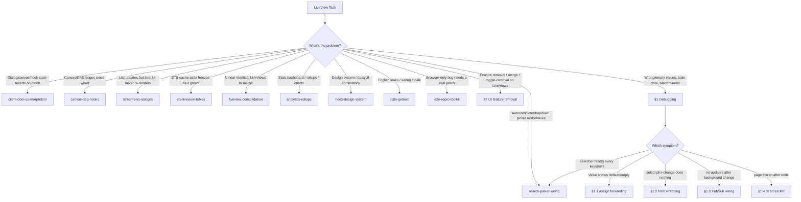

# Elixir LiveView — Category Skill

Consolidated, timeless patterns for Phoenix LiveView work: assign-flow
debugging, streams vs assigns, search-picker wiring, client-DOM vs
morphdom state, ETS-backed tables, design systems, analytics dashboards,
i18n, liveview consolidation, feature removal/merge on the UI surface,
and E2E reproduction of browser-only bugs.

## Decision Flowchart



## 1. Debugging

### 1.1 The two-layer assign boundary (silent-default pitfall)

LiveView has a **two-layer assign boundary** — the root of most
non-crash bugs: socket assigns (set in `mount`/`handle_event`/
`handle_params` via `assign/2`) vs function-component attrs (passed
explicitly in HEEx). Components do NOT inherit socket assigns. When a
component shows a default/empty value, the bug is almost always
**missing attr-forwarding in the render block**, masked by an `attr
:name, :map, default: %{}` declaration. No error, no warning.

Investigate: find where the assign is SET (`assign.*:name`), where it is
READ (`@name`), and whether the read site is inside a component (then
`@` is the attr). Grep for `name=` in attr-passing position — zero
matches = missing forwarding. Fix by ranking blast radius:
self-fetch in the component with explicit-attr override (preferred),
per-caller forwarding (last resort), or a LiveComponent with `update/2`
(only when the layout needs its own events).

### 1.2 Forms

- A bare `<select phx-change>` outside `<.form>` **silently fails** —
  wrap in `<.form for={%{}} phx-change="...">`.
- Forms with `phx-change` must have an `id` attribute.
- `to_form(changeset, as: :danger)` namespaces params — the handler must
  match `%{"danger" => %{"field" => value}}`.
- `:map` Ecto fields crash `Phoenix.HTML.Safe` — convert to JSON string
  for the textarea, decode on submit.
- Password fields: leave empty = keep current key (delete the key from
  attrs before casting).

### 1.3 PubSub event flow

1. Subscribe — `Phoenix.PubSub.subscribe/2` in `mount` (guarded by
   `connected?/1`).
2. Broadcast — the context layer broadcasts with the SAME topic string.
3. Handle — `handle_info/2` must pattern-match the exact tuple shape and
   include a catch-all clause (unmatched messages crash the process).

Rules: reload from DB, don't patch from payload; guard reload by
`live_action`; refresh EVERY list the view renders (including
archived/toggle variants).

### 1.4 The dead-socket dev-loop trap

During long dev sessions with the `code_reloader`, a browser tab can end
up holding a **dead LiveView socket** — fresh HTML still renders after
reload-of-route, but `phx-click`/`phx-change` events go nowhere and the
page looks frozen regardless of your edits. Hard-reload the tab before
concluding the code is broken.

### 1.5 Ad-hoc query verification without the web port

When the dev server holds port 4000, `mix run -e '...'` boots the full
application including the Endpoint and dies with `:eaddrinuse`. Run
one-off Ecto checks against the test DB instead:

```bash
MIX_ENV=test mix run -e '
alias MyApp.Repo
# query logic here
IO.puts("PASS: ...")
'
```

`MIX_ENV=test` skips the Endpoint (test config sets `server: false`),
so no port collision. Pitfall: `System.unique_integer()` uniquifies the
slug but NOT the name — if the schema has a unique constraint on both,
uniquify both fields. Clean up created rows.

### 1.6 Common HEEx pitfalls

- `Float.round/2` on integers crashes: use `2.0` not `2` as precision.
- HEEx comments are `<%!-- ... --%>`; never put `--` inside the body.
- `~p` route sigil is compile-time verified — use plain strings if the
  route doesn't exist yet; `~p` with nil query params crashes — guard.
- `Task.start` + `self()` inside the task sends to the wrong PID —
  capture `lv_pid = self()` before spawning.

## 2. Streams vs Assigns

The one decision rule: `stream` for large (100+) append-only, read-only
lists that only insert/delete; `assign` + `:for` for small (<50) lists
whose items contain interactive sub-panels driven by global assigns —
streams diff at the ITEM level and never re-render an item on a global
assign change (inline forms, toggles, `:if` blocks just don't appear).

Pure show/hide toggles inside stream items: keep them client-side with
`JS.toggle` (initial `style="display: none"`), keyed by a per-item id —
no server round-trip, tests keep `has_element?` access. If state must
persist, keep it ON the item or re-`stream_insert` — never a side
`MapSet` assign. Fuse pending rows into one stream with synthetic
entries (`__pending__: true`); `stream_delete` needs `%{id: ...}`, a raw
string crashes. See `streams-vs-assigns.md`.

## 3. ETS-Backed LiveView Tables

A `Cache.list()` returning the whole ETS table kills performance: full
dumps on mount, every filter, and every row click
(`Enum.find(Cache.list(), ...)`), plus full payloads broadcast over
PubSub. Fix: **two-table design** — a light `rows` table (no payload +
precomputed `last_preview`) for `list_recent(limit, filters)` and
broadcast; a `full` table served only by `get(id)` (`:ets.lookup`); a
shared `purge(id)` keeps both in sync. Guard named-table inserts with
`:ets.whereis` on BOTH tables — the code reloader does not restart the
supervision tree, so a new named table doesn't exist on running nodes;
no-op instead of crashing into partial state. See
`ets-liveview-tables.md`.

## 4. Client-DOM vs morphdom

Element state that exists only in the client DOM (`<dialog open>`,
focus, canvas content) silently reverts on ANY patch: morphdom removes
the client-set attribute, no `close`/`cancel` event fires, and the hook
is morphed in place (never re-mounted). **Fix: hook lifecycle, not
observers** — `beforeUpdate` records pre-patch state; `updated()`
re-asserts from the server's authoritative marker (`data-open`) in the
same tick. MutationObserver FAILS (microtask vs task race re-opens a
user-closed dialog). `phx-update="ignore"` fixes the close but freezes
server-rendered content — only for stateless shells. Tabs + hidden
textarea structured editors live under `phx-update="ignore"` with
per-entity hook ids. See `client-dom-vs-morphdom.md`,
`canvas-dag-hooks.md`.

## 5. Search Picker Wiring

Every live-searcher inside a form needs an explicit `name=` — a
`phx-change` binding serializes ONLY the changed input, keyed by `name`;
unnamed inputs ship empty payloads and the filter resets every
keystroke. Handle BOTH payload shapes with private resolver clauses
(bare `%{"value" => q}` and nested `%{"ns" => %{"field" => q}}`). Never
mix keyup-openers with keyboard closers — releasing Escape fires keyup
after keydown closed it, reopening the dropdown; move the opener to
`phx-focus`. Born-closed default; pick must reflect label + close;
multi-select stays open. After editing ONE instance of a repeated
picker pattern, run the **Sibling Parity Audit** (grep counts across all
variants — a green suite hides a skipped sibling). See
`search-picker-wiring.md`.

## 6. LiveView Consolidation

Merge N near-identical LiveViews into ONE parameterized by the URL.
Route ordering: first-class routes BEFORE the generic wildcard
(`/:slug/:type` swallows anything defined after it). `~p"/#{@slug}"`
with nil crashes at runtime (`cannot convert nil to param`) — mount
fallback + `:if` guard in layouts, both. Phoenix.Component helpers must
be arity 1. `is_nil(assigns[:slug])` dodges a benign narrowing warning.
Role-gated routes: seed `put_session(:is_owner, true)` in tests or they
silently redirect to `/`. After 2 failed patches on the same region,
rewrite the function with write_file. See
`liveview-consolidation.md`.

## 7. UI Feature Removal & Merge

Removing/merging features on the UI surface carries trap classes of its
own:

- **Shared assign**: before removing an assign block, grep `@var` in the
  whole render — a surviving tab may still use it. Keep the load, remove
  only the dead renders.
- **Orphaned helpers**: after templates go, unused private helpers fail
  `--warnings-as-errors`. Sweep transitively (a helper that only the
  removed helpers called dies too) and fix badge spans that call deleted
  helpers.
- **Stale tests**: when `has_element?` asserts target ids gone from
  `lib/`, the tests are orphans — DELETE, don't patch. Also delete
  green-but-dead sibling `refute` asserts on the same id (they pass
  vacuously) plus orphaned fixtures/aliases.
- **Toggle → always-on**: remove button, `:if` gate, handler, mount
  assign, then update tests (click → direct assert). Not a migration, no
  gettext — usually < 30 lines across 2 files.
- **Feature merge**: map blast radius first; absorb handlers/helpers/
  assigns; broadcast real-time notifications via PubSub (subscribe in
  `mount` when `connected?`).
- **Clause ordering**: `handle_info` catch-all must come LAST (a
  specific clause after it is dead code); all `handle_event` clauses
  must be contiguous (splitting with `defp` or extra `@impl true` warns
  "clauses ... should be grouped").
- **`defp` vs external templates**: in inline `~H` sigils, `defp`
  helpers are callable; in external `.html.heex` files only `def` is —
  promote before moving helpers between LiveViews.
- **Module attributes are invisible in templates**: `@per_page` in a
  template raises `KeyError: key :per_page not found` at runtime —
  assign it to the socket.
- After removing an element from a `justify-between` flex row, re-check
  the alignment (`justify-end`); grep `justify-between` after removal.

## 8. Design Systems, Analytics, i18n

- **HEEx design system**: custom CSS layer (`.surface-1..3`, `.lift`,
  typography classes) alongside Tailwind v4 + daisyUI semantic tokens
  (`bg-base-300`, `bg-info/15`, ...) so UI adapts to dark mode. Custom
  classes CANNOT take Tailwind variant prefixes — `hover:surface-3` does
  nothing; use `.lift` or `hover:bg-*`. Watch CSS `%` heights (every
  intermediate box needs a resolvable height). See
  `heex-design-system.md`.
- **Analytics rollups**: pure-query rollup module (Ecto + Postgres
  fragments, post-process in Elixir), TDD per function, empty defaults
  in mount, admin gate in loader AND template. Timezone bucketing: naive
  UTC columns need `AT TIME ZONE 'Etc/UTC'` before converting;
  parametrized GROUP BY must be materialized in a subquery. ETS rolling
  window with caller-process writes; ETS TTL query cache (TTL expiry, NOT
  PubSub invalidation) split into compute-bundle (pure) + apply-bundle
  (DB-free). See `analytics-rollups.md`.
- **i18n/gettext**: msgid = English source, msgstr = rendered text;
  empty msgstr leaks English. Wrap at the single source (model label
  helpers) with extraction markers for dynamic msgids. After every
  `mix gettext.extract --merge`, diff msgstrs — fuzzy merges corrupt
  existing translations; never use patch tools on `.po` files. Test
  assertions must expect translated strings. See `i18n-gettext.md`.

## Testing (LV 1.2+)

- `view.assigns` was removed — assert on `render(view)` HTML or data
  attributes. Use `live(conn, ~p"/path")` after real login + `recycle()`.
- **Selectors are not substrings**: `html =~ ~s(input[name="..."])`
  always FAILS — serialized HTML has no CSS-selector syntax. Use
  `has_element?(view, ~s(selector))`.
- **Sibling parity in tests**: a suite can be 100% green while an entire
  parallel flow (one picker variant vs another) has zero tests and hides
  a hard crash. Mirror a test for every variant you wire.
- Flash asserts are case- and plural-sensitive — copy the exact runtime
  string from source (e.g. `"#{count} providers assigned."` is not
  contained in `"Provider assigned"`).
- `LiveViewTest form/3` validates select values against CURRENTLY
  rendered options — create the fixtures that feed dynamic options
  BEFORE `live/2` mounts, or `render_change` first.
- LiveViewTest cannot see client-only state (`dialog.open`) — only a
  real browser catches those bugs (see `e2e-repro-toolkit.md`).

## VERIFY

Gates before you answer (run from repo root; see the house-rules brief
for the exact commands):

1. File count — `find .riel/build/elixir-liveview -name '*.md' | wc -l`
   → 1 SKILL.md + 5–10 references (11 total).
2. Scrub — search the build dir for every forbidden project/DB name and
   Spanish text listed in the house rules → zero matches.
3. Flowchart — the build SKILL.md contains a `flowchart` code fence.
4. Frontmatter — the build SKILL.md starts with a valid YAML frontmatter
   block (name, description, version, author, license, metadata).
5. Line budgets — SKILL.md 150–350 lines; each reference 60–250 lines.
6. References index — every file in `references/` is listed in the
   SKILL.md `## References` index below.

## References

- `references/ets-liveview-tables.md` — ETS two-table design
  (light rows + full by id), `:ets.whereis` hot-reload guard, purge
  sync, probe verification. Load when a LiveView ETS-cache table freezes
  as it grows.
- `references/client-dom-vs-morphdom.md` — dialog/modal/hook state
  reverting on patches, hook-lifecycle fix, alternatives that fail,
  tabs + hidden-textarea editors. Load when client-DOM state dies on
  patch.
- `references/canvas-dag-hooks.md` — keyed SVG edges, redrawEdges,
  pan/zoom re-assert, CSSTransition-aware rAF redraw, 3D hooks, E2E
  sampling. Load for canvas/DAG/3D surfaces.
- `references/search-picker-wiring.md` — name= rule, both payload
  shapes, escape discipline, Sibling Parity Audit, hook-owned picker
  variant. Load when building or debugging autocomplete/combobox
  pickers.
- `references/liveview-consolidation.md` — one generic LiveView by URL,
  route ordering, ~p nil crash, arity-1 components, role-gated test
  sessions. Load when merging near-identical LiveViews.
- `references/streams-vs-assigns.md` — decision rule, global-assign
  trap, JS.toggle client toggles, pending/in-flight stream fusion. Load
  when list items don't re-render on assign changes.
- `references/heex-design-system.md` — semantic color migration,
  variant-prefix pitfall, typography/surface mapping, %-height, bulk
  extraction. Load for design-system consistency work.
- `references/analytics-rollups.md` — rollup architecture, timezone
  bucketing, ETS TTL cache, chart readability, aggregation pitfalls.
  Load when building stats dashboards.
- `references/e2e-repro-toolkit.md` — playwright-core + fake upstream +
  disposable fixtures, BEAM-node pitfall, scenario matrix. Load when a
  client-state bug needs a real browser + real patch.
- `references/i18n-gettext.md` — sweep order, wrap rules, fuzzy-merge
  corruption, extraction markers, test assertions. Load for i18n sweeps.