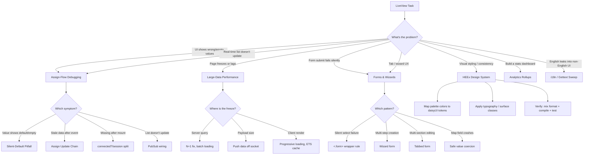

# Elixir LiveView — Category Skill

Consolidated reference for Phoenix LiveView work: debugging assign-flow, choosing streams vs assigns, applying a design system, building forms/wizards, wiring analytics dashboards, optimizing for large datasets, and internationalizing with Gettext.

## Decision Flowchart



## 1. Assign-Flow Debugging

### The Two-Layer Assign Boundary

LiveView has a **two-layer assign boundary** — the root of most non-crash bugs:

1. **Socket assigns** — set in `mount/3`, `handle_event/3`, `handle_params/3` via `assign/2`.
2. **Function-component attrs** — passed explicitly in HEEx via `<.layout attr={@assign}>`. Components do **NOT** inherit socket assigns.

When a function component shows a default/empty value, the bug is almost always **missing attr-forwarding in the render block**, not a data or type problem.

### The Silent-Default Pitfall (most common LiveView UI bug)

```elixir
# layouts.ex — the component declares a default
attr :page_counts, :map, default: %{}
def context_selector(assigns) do
  ~H"""
  {Map.get(@page_counts, ctx.id, 0)}  <%-- shows 0 even when data exists --%>
  """
end
```

```elixir
# some_live.ex — sets the assign but DOESN'T forward it
def render(assigns) do
  ~H"""
  <Layouts.app
    flash={@flash}
    contexts={@contexts}
    <%-- page_counts={@page_counts} IS MISSING --%>
  >
    ...
  </Layouts.app>
  """
end
```

The `default:` masks the missing forwarding. No error, no warning — just 0 or empty map in the UI.

### Investigation Path: "value shows as default/empty"

1. **Find where the assign is SET** — `search_files` for `assign.*:the_assign_name` across `lib/`.
2. **Find where the value is READ** — `search_files` for `@the_assign_name` in `.ex`/`.heex`.
3. **Check the boundary**: if the read site is inside a function component, `@` refers to the **attr**, not the socket assign.
4. **Grep for the forwarding**: `search_files` for `the_assign_name=` (equals sign, in attr-passing position) in the LiveView directory. Zero matches = missing forwarding.
5. **Check the attr declaration**: does it have `default: ...`? That's what masks the bug.

### Fix Options (ranked by blast radius)

1. **Self-fetch in the component with explicit-attr override** (preferred for app-wide assigns):
   ```elixir
   def app(assigns) do
     page_counts = case assigns[:page_counts] do
       m when is_map(m) and map_size(m) > 0 -> m
       _ -> try do MyApp.Metrics.page_counts() rescue _ -> %{} catch _, _ -> %{} end
     end
     assigns = assign(assigns, :page_counts, page_counts)
     ~H""" ... """
   end
   ```
2. **Per-caller attr forwarding** (last resort, touches every LiveView).
3. **LiveComponent with `update/2`** (only when the layout needs its own events).

### Connected vs Disconnected Mount

`mount/3` runs **twice**: once disconnected (HTTP), once connected (WebSocket). Code in `connected?` branches won't exist on first paint.

### Session and Auth Context Flow

```
Router :browser pipeline → plugs → session map → LiveView mount/3
  → assign_to_socket(socket, session) → socket assigns
    → render → <.layout attr={@assign}>
```

- LiveView session keys are **strings** (`session["user_id"]`), not atoms (`session[:user_id]`). The latter always returns `nil`.
- `live_session` must sit inside a `scope` that pipes through `:browser`.

### PubSub Event Flow

When a LiveView doesn't update after a background change:

1. **Subscribe** — `Phoenix.PubSub.subscribe/2` in `mount` (guarded by `connected?/1`).
2. **Broadcast** — context layer calls `PubSub.broadcast/3` with the same topic string.
3. **Handle** — `handle_info/2` must pattern-match the exact event tuple shape and include a **catch-all clause** (unmatched messages crash the process).

**Key rules:**
- Reload from DB, don't patch from payload.
- Guard reload by `live_action` to avoid clobbering unrelated views.
- Refresh **every** list the view renders (including archived/toggle variants).

### Form and Select Traps

A bare `<select phx-change>` outside `<.form>` **silently fails**:

```heex
<%!-- BROKEN --%>
<select phx-change="set-timezone" name="timezone">...</select>

<%!-- FIXED --%>
<.form for={%{}} phx-change="set-timezone">
  <select name="timezone">...</select>
</.form>
```

### Testing (LV 1.2+)

- `view.assigns` was removed — assert on `render(view)` HTML or data attributes.
- Use `live(conn, ~p"/path")` after a real session login + `recycle()`.

### Common HEEx Pitfalls

- **`Float.round/2` on integers crashes**: use `2.0` not `2` as the min with `max/2`.
- **HEEx comments**: `<%!-- ... --%>`. Never put `--` inside the body.
- **`~p` route sigil** is compile-time verified — use plain strings if the route doesn't exist yet.
- **`~p` with nil query params crashes** — guard with `if row.model_id do ... end`.
- **`Task.start` + `self()` inside the task** sends to the wrong PID — capture `lv_pid = self()` before spawning.

## 2. Streams vs Assigns

The one decision rule:

| Use `stream` when… | Use `assign` when… |
|---|---|
| List is large (100+ items), mostly read-only | List is small (<50 items) |
| Items are independent — no global state | Items have interactive sub-panels driven by global assigns |
| You only append/prepend/delete (chat, logs) | You need inline forms, toggles, or conditional sections per item |
| Performance matters (avoid full re-render) | Correctness matters (content must reflect current assigns) |

**Stream traps:**
- Stream items don't inherit global assigns — if a row needs data from the socket, pass it or use `assign` instead.
- `stream_insert` replaces by ID — if you filter items and stream a subset, items outside the filter disappear from the DOM but still exist server-side. Filter with a `visible_items` assign for UI rendering while keeping the full stream for operations.

## 3. HEEx Design System

### Core Concept

Apply a custom CSS layer (`.text-title`, `.surface-2`, `.lift`, etc.) alongside Tailwind v4 + daisyUI semantic colors.

### Typography Mapping

| Element | Class | Replaces |
|---|---|---|
| Page h1 | `.text-title` | `text-2xl font-bold` |
| Section h2 | `.text-heading` | `text-lg font-semibold` |
| Body text | `.text-body` | `text-sm` |
| Captions | `.text-caption` | `text-xs text-base-content/50 uppercase` |
| Display (hero) | `.text-display` | `text-4xl font-extrabold` |

### Surface / Elevation

| Class | Purpose |
|---|---|
| `.surface-1` | Subtle background (base-200) + thin border |
| `.surface-2` | Card surface + subtle shadow |
| `.surface-3` | Elevated card + deeper shadow |
| `.lift` | Hover micro-interaction: translateY + shadow upgrade |

### daisyUI Semantic Color Migration

Replace hardcoded palette classes with daisyUI tokens so colors adapt to light/dark:

| Old | New | Use case |
|---|---|---|
| `bg-gray-100 text-gray-600` | `bg-base-300 text-base-content/70` | Neutral |
| `bg-blue-100 text-blue-700` | `bg-info/15 text-info` | Informational |
| `bg-amber-100 text-amber-700` | `bg-warning/15 text-warning` | Caution |
| `bg-green-100 text-green-700` | `bg-success/15 text-success` | Positive |
| `bg-red-100 text-red-700` | `bg-error/15 text-error` | Destructive |

### CRITICAL PITFALL: Custom CSS Cannot Take Tailwind Variant Prefixes

`hover:surface-3` does **nothing** — custom classes are not Tailwind utilities.

| You want to… | Use |
|---|---|
| Hover-elevate a surface | `.lift` (self-contained `:hover`) |
| Hover-change background | `hover:bg-base-200` (Tailwind utility) |
| Hover-change border | `hover:border-primary/30` (Tailwind utility) |

### Prop-to-Tint Helper

Derive the tinted background from a text-color prop:

```elixir
defp bg_for_color("text-primary"), do: "bg-primary/10"
defp bg_for_color("text-success"), do: "bg-success/10"
defp bg_for_color("text-error"),   do: "bg-error/10"
defp bg_for_color(_),              do: "bg-base-content/10"
```

### Component Redesign Checklist

1. Replace `card bg-base-100 border` → `.surface-2`
2. Add `.lift` for interactive cards
3. Icon: `size-10 rounded-lg bg-{color}/10`
4. Value: `text-2xl font-bold tabular-nums`
5. Label: `.text-caption`

### Verification

```bash
mix format --check-formatted lib/my_app_web/live/<target>.ex
mix compile --warnings-as-errors
mix test test/my_app_web/live/
```

## 4. Forms & Wizards

### Wizard Forms (Step-by-Step Creation)

**Pattern:** One schema, one changeset function per section, one `Edit` LiveView that doubles as wizard + tab editor.

```elixir
# Schema — section-scoped changesets
def name_changeset(item, attrs),  do: cast(item, attrs, [:title]) |> validate_required([:title])
def api_changeset(item, attrs),   do: cast(item, attrs, [:api_url, :api_key]) |> validate_required([:api_url, :api_key])

def section_changeset(item, section, attrs) when section in @sections do
  apply(__MODULE__, :"#{section}_changeset", [item, attrs])
end
```

**LiveView:** Tab switching uses `push_patch`; wizard "Continue" uses `push_navigate`. Default tab falls back to first via `String.to_existing_atom/1`.

**Context functions:** Add a `create_skeleton` (minimal required fields) + per-section `update`:

```elixir
def create_foo_with_name(attrs), do: %Foo{} |> Foo.name_changeset(attrs) |> Repo.insert()
```

### Tabbed Edit (Each Tab Saves Independently)

Same LiveView structure — each tab renders its own `<div :if={@tab == :section}>`. Auto-save on `phx-change`; tab switch saves current tab first.

### Tabbed Form Pitfalls

- Do not reuse the same `id` on the New page vs Edit page — LiveView tests break.
- Password fields: leave empty = keep current key (delete the key from attrs before casting).
- `to_form(changeset, as: :danger)` namespaces params — handler must match `%{"danger" => %{"field" => value}}`.
- `:map` Ecto fields crash `Phoenix.HTML.Safe` — convert to JSON string for textarea, decode on submit.
- Forms with `phx-change` must have an `id` attribute (recovery warning otherwise).

## 5. Analytics Rollups & Dashboards

### Architecture Pattern

1. **Pure-query rollup module** (`MyApp.Metrics.Rollup`) — no GenServer, no new tables. Ecto queries + Postgres fragments, post-process in Elixir.
2. **TDD per function** — test file mirrors the module, fixtures via real contexts + explicit `inserted_at`.
3. **LiveView wiring** — assign empty defaults in `mount/3`, load per `live_action`, respect period filters.
4. **Admin-only gate** — both the loader (returns `[]` for non-admins) and the template.

### Composite Score Pattern (Member/Entity Tiers)

Normalize each metric to 0-100 against max in the set, then weight:

```
score = 0.25 * total_tokens + 0.20 * cost + 0.15 * requests + 0.15 * active_days + ...
```

Terciles: `≥66` → "high", `≥33` → "regular", `<33` → "low". Use `tier_badge_class/1` helper.

### Query Recipes

- **Ranking with tiers** — aggregate per entity (requests, errors via `COUNT(*) FILTER (WHERE status >= 400)`, avg/p95 latency), score in Elixir, tiers from thresholds.
- **Hour-of-day distribution** — `EXTRACT(hour FROM (? AT TIME ZONE 'Etc/UTC') AT TIME ZONE ?)` + zero-fill 0..23 in Elixir.
- **Timezone bucketing** — naive UTC columns need `AT TIME ZONE 'Etc/UTC'` BEFORE converting to target zone. Materialize in subquery for parametrized `GROUP BY`.
- **Busiest buckets** — `date_trunc('hour', inserted_at)` grouped + ordered by count desc.

### ETS Rolling Window (Realtime Sparklines)

- ETS table (`:public, :set, write_concurrency: true`) owned by a GenServer.
- Caller-process `update_counter` — no GenServer bottleneck on hot path.
- Backfill from Postgres on boot. Rotate (delete old keys) every 60s.
- Sparkline as inline SVG with `sparkline_points/1` helper.

### ETS TTL Cache (Dashboard Query Bundles)

Coalesce Postgres queries across N connected LiveViews:

- TTL expiry (5s), not PubSub invalidation.
- `write_concurrency: true`.
- Separate compute (cacheable) from assign (not cacheable) in the refactor.

### UI Conventions

- One chart per card. Long text in compact `<span>` in card header.
- Numbers: compact K/M/B in KPIs with exact in `title` tooltip.
- `Float.round/2` with integers crashes — use `|| 0.0` as default.
- `System.system_time(:minute)` does NOT exist — use `div(System.system_time(:second), 60)`.

## 6. Large-Data Performance

### Diagnosis: Where Is the Freeze?

1. **Server query** — unbounded rows, heavy columns, computing values the client ignores.
2. **Payload** — every assign is serialized to every diff. A big list in `data-*` multiplies DOM size on *every* update.
3. **Client render** — per-node object creation (3D meshes, particles) is the usual culprit once data arrives.

### Fixes That Compound

1. **Kill N+1** — pass preloaded data down instead of re-querying in helpers.
2. **Batch across a result set** — one `list_for_pages(ids)` returning `%{id => data}`, not N individual loads.
3. **Cap what you render** — rank by degree/weight, limit with SQL, report `total_nodes/total_edges` alongside the capped list.
4. **Push degree ranking to SQL** — two `GROUP BY` queries (out-degree + in-degree), not loading all pairs into RAM.
5. **Progressive loading** — mount renders shell with `loading: true`, JS hook fetches JSON over HTTP and pushes payload back to LiveView.
6. **Lite payloads** — ship only renderer fields (`id, slug, label, type, color`), drop `body`, `summary`, `tags`.
7. **Cap edges too** — sort by weight desc, hard `LIMIT`, keep `total_edges` truthful.
8. **Filter PubSub broadcasts** — only reload when the changed item is actually visible in the current view.
9. **Keep data client-side** — hook owns the dataset in `this.fullData`; LV holds only counters + filter state.

### ETS Graph Cache

Read-concurrent ETS table + GenServer for writes only:

```elixir
:ets.new(@graph_table, [:set, :named_table, :public, {:read_concurrency, true}])
```

Cache `nil` results as `:not_found` so repeated misses are cheap.

### Regression Pitfalls (Moving Data Off Socket)

1. Never filter `socket.assigns.nodes` in place — filter from a pristine copy.
2. Check `visible_types` per mode (index vs show) — show mode may need to include the center node's type.
3. `render_hook` tests don't verify the hook element exists — add DOM-shape asserts.
4. Grep for `pushEvent` consumers before stripping payload fields — orphaned handlers will KeyError.

## 7. i18n / Gettext Sweep

### Core Model

- **msgid = English source string** in code: `gettext("Archive")`
- **msgstr = rendered UI text** in default locale: `msgstr "Archivar"`
- Empty msgstr renders the msgid verbatim (English leaks into UI).

### Sweep Order

1. **Wrap UI literals** in `gettext/1` across LiveViews/components.
2. **Re-extract and merge**: `mix gettext.extract --merge` (kill dev server first).
3. **Fill msgstrs** in the default-locale `.po` for every new/empty entry.
4. **Verify visually** — grep misses strings from module attributes, JS, and model helpers.

### Model Label Localization (Biggest Blind Spot)

Wrap labels at the single source (model helper), not at dozens of call sites:

```elixir
def label(type), do: Gettext.gettext(MyAppWeb.Gettext, @types[type].label)
def plural(type), do: Gettext.gettext(MyAppWeb.Gettext, @types[type].plural)
```

Add extraction-marker functions for dynamically-looked-up msgids:

```elixir
defp _extraction_markers do
  [gettext("Todo"), gettext("Concept"), gettext("Todos"), gettext("Concepts")]
end
```

### Fuzzy Merge Corruption

`mix gettext.extract --merge` can fuzzy-match a new msgid to an existing one and stamp the wrong msgstr. After every merge:

```bash
git diff priv/gettext/es/LC_MESSAGES/default.po | grep -E '^[-+]msgstr'
```

Any msgstr that changed without its msgid changing is suspect.

### Fuzzy Audit

```bash
grep -c 'fuzzy' priv/gettext/es/LC_MESSAGES/default.po
```

Fuzzy entries render their (wrong) msgstr at runtime. Grep periodically and clear them all.

### Select Option Labels

Option tuples in model/context modules bypass component-level gettext:

```elixir
# Wrong — value only
{gettext("Backlog"), "backlog"}   # ✓ wraps the label
# But ensure the VALUE stays raw (DB enum)
```

### Test Assertions

The default locale means `assert html =~ "Archive"` fails — the HTML has the translated string. Two robust patterns:

1. **Translate in the test**: `defp t(msgid), do: Gettext.gettext(MyAppWeb.Gettext, msgid)`
2. **Assert structure, not text**: `assert has_element?(view, ~s([data-testid="todo-row-#{todo.slug}"]))`

### Subagent Pitfalls

- Subagents may "translate" an already-translated msgid. Instruct: wrap English literals, never rewrite existing msgids.
- Subagents may skip `mix gettext.extract --merge` + msgstr filling.
- Subagents don't verify visually — always do a visual pass yourself.

### Post-sweep Checklist

1. `awk` empties check → 0 empty msgstrs in default locale.
2. `mix test` green.
3. Visual pass on every swept page.
4. Check `page_title` assigns (separate msgids, easy to miss gender mismatches).

## 8. Common Pitfalls Cross-Reference

| Pitfall | Section | Quick Fix |
|---|---|---|
| `<select>` outside `<.form>` | §4 Forms | Wrap in `<.form for={%{}} phx-change="...">` |
| `hover:surface-3` does nothing | §3 Design System | Use `.lift` or `hover:bg-*` utilities |
| `Float.round/2` on integer | §1 Debugging, §5 Analytics | Use `\|\| 0.0`, not `\|\| 0` |
| HEEx `--` in comment body | §1 Debugging | Use single hyphens only |
| `Task.start` + `self()` wrong PID | §1 Debugging | Capture `lv_pid = self()` before spawning |
| `live_session` outside `:browser` | §1 Debugging | Wrap in `scope` with `pipe_through :browser` |
| `System.system_time(:minute)` | §5 Analytics | Use `div(System.system_time(:second), 60)` |
| String-keyed maps in `:for` | §1 Debugging, §3 Design System | Convert to atom keys: `%{method: m}` |
| `~p` with nil query param | §1 Debugging | Guard with `if row.model_id do` |
| ETS GenServer reads bottleneck | §5 Analytics, §6 Performance | Use `read_concurrency: true` |
| `.po` patch destroys entries | §7 i18n | Never use `patch` tool for `.po` files |
| `try/rescue` misses `:noproc` | §5 Analytics | Use `try/catch` (`catch _, _ -> :ok`) |
| Nested `.surface-2` invisible | §3 Design System | Use `hover:bg-base-200` for nested items |

## Verification Checklist

After any LiveView change:

- [ ] The assign the template reads matches the assign the handler updates
- [ ] `<select>` elements with `phx-change` are wrapped in `<.form>`
- [ ] Stream items don't depend on global assigns (or use `assign` instead)
- [ ] Tests use `render(view)` not `view.assigns` (LV 1.2+)
- [ ] `mix format --check-formatted` passes
- [ ] `mix compile --warnings-as-errors` clean
- [ ] `mix test test/my_app_web/live/` green
