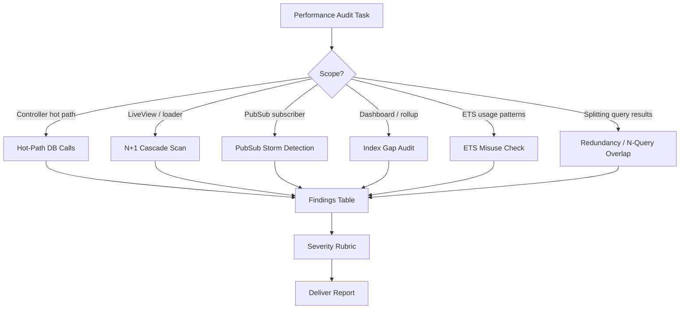

# Elixir Performance Audit

Read-only performance audits of Phoenix/Elixir applications. No file edits,
no commits, no migrations, no `mix` mutations. The audit is evidenced by
reading source code and producing a structured findings table; the user
applies the fixes.

## Decision Routing



---

## The Cardinal Rule: Don't Write

When the audit is read-only:
- No `write_file` for audit files either — deliver the report inline.
- No `patch` to source files, even "obviously correct" fixes.
- No `terminal` commands that mutate state.
- Verify at the end: `git status --porcelain` must be empty.

---

## Severity Rubric

Tuned for Phoenix/Elixir workloads:

| Severity | Definition |
|----------|-----------|
| **critical** | DB call in the hot path of every request (force-preload past an already-preloaded auth plug, per-request `Repo.all` on a growing table). Steady-state DB load scales with request rate. |
| **high** | N+1 triggered by every PubSub message under sustained traffic; unbounded list on a table that grows without bound; missing index for a GROUP BY column on a hot dashboard. |
| **medium** | N+1 in a mount/loader that runs only on navigation; missing cap on a small catalog; redundant context call that preloads the same association twice in one request. |
| **low** | Admin-only cascade; O(N²) in-memory pass on small N; preload gap that doesn't fire today. |
| **informational** | Pattern *not* found (report "not present" so the user knows you looked). |

---

## Step-by-Step Audit Methodology

Execute these in order — categories reinforce each other.

### 1. Map the Query Surface

Find every list-style query and context-level `Repo.all`:

```bash
search_files pattern="def list_" path="lib/<ctx>"
search_files pattern="Repo\.all" path="lib/<ctx>"
```

These are candidates for unbounded-list findings (L-*).

### 2. Map Preloads and Their Consumers

```bash
search_files pattern="preload:" path="lib/<ctx>"
```

Cross-reference with templates in `lib/<app>_web/live/*.ex` and
corresponding `.html.heex` files. If a template accesses
`item.user.email` but the query doesn't preload `:user` — that's a
missing preload (medium unless on hot path).

### 3. Trace the Hot-Path Plug Chain

Before claiming any `Repo.preload` is redundant, trace what the
auth plug already loaded. Most Phoenix auth plugs run
`Repo.preload(member, [:team, :user, :api_key])`. Any downstream
`Repo.preload(member, [:team], force: true)` is redundant and critical.

```bash
grep -rn 'force: true' lib/<app> lib/<app>_web
```

`force: true` on `Repo.preload/3` ignores already-loaded data and
issues a new SELECT every call. On the hot path, this is the
highest-severity finding.

### 4. Read Every LiveView `mount/3`

Look for:
- `Enum.map(items, fn item -> Context.helper(item) end)` — classic N+1 cascade.
- `Budgets.list_all()` or similar "give me everything" calls with no `limit:`.
- `Repo.all(SomeContext)` with no `limit:` and no offset-based pagination.

### 5. Read Every `handle_info` in LiveViews

For each PubSub subscriber, classify the handler:
- Reads ETS only → OK (cheap).
- Reads ETS + runs a DB query → storm candidate.
- Runs `Enum.map` with a context helper → compound storm.

Check for the **unguarded send_after** anti-pattern:
`Process.send_after(self(), :refresh, 200)` without
`if socket.assigns[:*_scheduled]` schedules one timer per message.
At 100 msg/s the mailbox accumulates `:refresh` faster than it can
drain — self-DoS from a single open tab.

### 6. Read Controllers on the Hot Path

- Calls to context helpers that issue `Repo.preload(..., force: true)`.
- Helpers called multiple times per request with the same arguments.
- Lazy-load helpers (`load_from_db`, `ensure_loaded`) that hit Postgres
  on first call per period per key.

### 7. Check Migrations for Indexes on GROUP BY Columns

Read every migration for the hot table and grep for `CREATE INDEX`.
Cross-reference with every `group_by` column from step 5's rollup
queries. Partitioned tables need indexes on the parent; partial
indexes must be added per-partition.

See `references/migration-index-cookbook.md` for the full cookbook.

### 8. Check Partition Lifecycle

A `PARTITION BY RANGE` table without a cron creating daily partitions
ahead of time means every insert falls into the DEFAULT partition —
partition pruning never kicks in.

```bash
grep -rn 'PARTITION OF' config/ lib/ priv/
```

If only the migration creates partitions, that's critical.
See `references/postgres-partition-lifecycle.md` for the full cookbook.

### 9. Check for Known Bug Patterns

- `assigns[:period || "today"]` — atom `:period` is always truthy,
  so the fallback never applies. Grep: `assigns\[:\w+\s*\|\|`.
- `String.to_integer(value)` on user input in `handle_event` — use
  `Integer.parse/1` and pattern match.
- Helpers that drop opts with a `[]` literal (callers expect keyword
  but get ignored).

### 10. Falsify Moduledoc Architecture Claims

Moduledocs state intent, not behavior. Treat every doc claim about
caching, TTLs, async writes, and coalescing as a hypothesis:
grep for the mechanism it named (`:timer`, `handle_info(:sweep`,
`expires_at` on the read path) and report mismatches.

### 11. Confirm Every Finding by Reading the Actual Function

Every reported N+1 must be evidenced by the function body — show
the line, the loop, and the inner call. A finding without a cited
line is noise.

**Ecto preload false positive:** `Repo.preload(struct, :assoc)`
WITHOUT `force: true` is a no-op when the association is already
loaded — Ecto resolves it in memory, zero queries. Before reporting
an N+1, trace whether the outer query already preloaded the
association.

---

## Pattern Quick Reference

### Hot-Path DB Calls (critical)

- `Repo.preload(struct, [...], force: true)` in a controller, router,
  or proxy module.
- A context helper called more than once per request with the same
  argument (each call re-preloads).
- Lazy-load helpers that hit Postgres on first call per period.

### N+1 Cascades (medium → high)

- `Enum.map(list, fn x -> Context.helper(x) end)` where the helper
  re-preloads what the outer query already loaded.
- Per-item aggregate queries in a loop (one `SUM(...)` per id).
- `Enum.map(items, &Manager.status(&1.id))` — one GenServer.call per item.
- Template accesses nested data (`item.user.email`) without the
  corresponding preload.

See `references/n-plus-one-cookbook.md` for concrete fix snippets.

### PubSub Storms (high)

A storm occurs when:
1. A topic is broadcast per-request.
2. Multiple LiveViews subscribe to the same topic.
3. The handler runs a DB query per message.

**Fix priority:**
1. Move to ETS for hot counters (eliminates DB reads entirely).
2. Stream inserts (`stream_insert` into a LiveView stream).
3. Cap/consolidate subscribers.
4. Increase coalescing window as a stopgap.

See `references/pubsub-storm-detection.md` for the full detection recipe.

### Index Gaps (medium–high)

- Rollup GROUP BY columns not covered by any composite index.
- Partitioned tables: `CREATE INDEX CONCURRENTLY` is NOT supported on
  the parent — use plain `CREATE INDEX` or add per-partition.
- Partial indexes (`WHERE status_code >= 400`) are not auto-propagated
  to partitions.

### ETS Misuse Patterns

- **Read-modify-write on a list/map value** — concurrent writers lose
  updates; lost samples are the high-latency outliers. Fix: N keys
  with round-robin `update_counter`, or histogram in `:atomics`.
- **One Oban job per request** for drift correction — debounce with
  an ETS flag (`insert_new`).
- **Full `tab2list` for a tiny aggregate** — use `:ets.select` with a
  match spec, or maintain aggregate counters.
- **ETS table created without `heir`** — table is destroyed on
  GenServer restart, all state lost.
- **Missing `read_concurrency: true`** on hot-read tables.
- **`update_counter` default object after eviction** — silently resets
  accumulated state to zero.
- **Unvalidated dimension keys** — user-controlled headers creating
  unbounded ETS keys.

### Redundancy Audit (N-Query Overlap)

When a caller loads `list_X(tz)` AND `list_Y(tz)` but the second
function internally calls the first — the data is queried and
computed twice. Find by reading the public function body of each
list helper and checking whether it calls another list helper on
the same data.

---

## Output Format

Group findings by category (hot-path → cascades → PubSub → indexes
→ ETS → bugs → other). Present a summary table at the top:

| ID | Severity | File:line | Category |
|----|----------|-----------|----------|

Then full descriptions. End with priority recommendations (1–5)
and the line:

> No files were edited during this audit.

---

## Verification

Before declaring the audit done:

```bash
git status --porcelain
```

The output must be empty. If it isn't, you wrote something — name it,
admit it in the report, and remove the file.

---

## References

Detailed cookbooks for specific audit classes:

- `references/n-plus-one-cookbook.md` — common N+1 shapes and fix snippets.
- `references/pubsub-storm-detection.md` — broadcaster/subscriber storm detection.
- `references/hot-path-checklist.md` — proxy/gateway hot-path audit.
- `references/migration-index-cookbook.md` — composite indexes for partitioned log tables.
- `references/postgres-partition-lifecycle.md` — native Postgres RANGE partition lifecycle.
- `references/streaming-leak-audit.md` — SSE/Finch streaming leak patterns.
- `references/ecto-performance-fix-impl.md` — Ecto implementer notes for fix classes.
