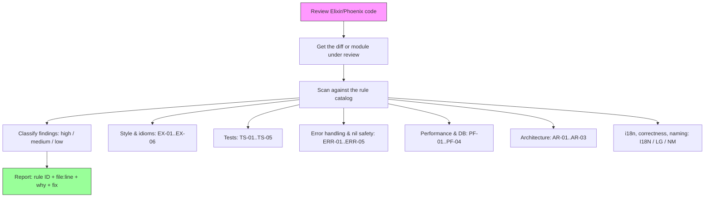

# Elixir Review Rules

A distilled catalog of **code-review rules** for Elixir/Phoenix codebases —
PR review, self-review before commit, pre-commit gates, or reviewing
agent-generated code. Each rule has a severity, a why, an anti-pattern, and
the correct form. The full catalog with code samples lives in
`references/code-review-rules.md`.

## Decision DAG



## When to use

- "Review this PR / this diff / this module"
- Self-review before committing (pre-commit gate)
- Reviewing code generated by agents (subagents, coding CLIs)
- "What's wrong with this Elixir code?" / "Is this idiomatic?"

## Severity legend

- **high** — merge blocker: bugs, leaks, broken contracts, data-loss risk.
- **medium** — should fix: readability, testability, idiomatic Elixir.
- **low** — nit: optional polish, style preference.

## Workflow

1. **Get the code**: the diff, the changed files, or the module under
   review. Never review from memory or a summary — read the actual code.
2. **Scan against the catalog** (below). The full anti-pattern/correct pairs
   are in `references/code-review-rules.md` — open it when a category
   matches.
3. **Classify** each finding by severity.
4. **Report** as: `RULE-ID` (severity) + file:line + one-line why + the fix.
   Only verified findings — never guess, never invent file:line.

## Rule catalog

### Elixir Style / Idioms

| ID | Severity | Rule |
|----|----------|------|
| EX-01 | medium | Prefer pattern matching with multiple clauses over nested `case` |
| EX-02 | low | Use `cond` for multiple mutually exclusive conditions |
| EX-03 | low | Group multiple `assign` calls into a single map |
| EX-04 | medium | Extract logic from `handle_event`/`handle_info` into private functions |
| EX-05 | low | Avoid `\|>` pipe when there is only one transformation |
| EX-06 | medium | Don't duplicate conditions already evaluated in the parent element |

### Tests

| ID | Severity | Rule |
|----|----------|------|
| TS-01 | medium | Use factories (ExMachina) instead of hand-built test data |
| TS-02 | high | Keep ExUnit specs when refactoring existing code |
| TS-03 | low | Add `@spec` to public functions of new modules |
| TS-04 | high | Clean up temporary resources in tests and production code |
| TS-05 | medium | Extract complex logic into testable functions |

### Error Handling / Nil Safety

| ID | Severity | Rule |
|----|----------|------|
| ERR-01 | high | Don't assign to the socket after an `if` check that doesn't early-return |
| ERR-02 | medium | Use `Enum.find` with pattern match instead of conditional list logic |
| ERR-03 | low | Use idiomatic map key access (`map[:key]`) instead of conditionals |
| ERR-04 | high | Handle `Repo.get/2` nil with `with %Schema{} = ...` or `case` |
| ERR-05 | low | Access assigns with `get_in` instead of `&&` chains in HEEx |

### Performance / DB

| ID | Severity | Rule |
|----|----------|------|
| PF-01 | high | Always index foreign keys in migrations |
| PF-02 | high | Order composite index columns for the real queries |
| PF-03 | high | Don't duplicate external database repos |
| PF-04 | medium | Use `Repo.update_all` with an explicit query instead of get + update |

### Architecture / Design

| ID | Severity | Rule |
|----|----------|------|
| AR-01 | high | Don't duplicate repos — move them to their semantically owning app |
| AR-02 | medium | Use typed structs in port callbacks instead of generic maps |
| AR-03 | medium | No hardcoded environment URLs — use runtime configuration |

### Documentation / i18n, Correctness, Naming

| ID | Severity | Rule |
|----|----------|------|
| I18N-01 | medium | Use `gettext` for all user-visible strings in HEEx |
| I18N-02 | low | Group related configs under the same namespace key |
| LG-01 | medium | Don't add insecure SSL configuration as the dev default |
| LG-02 | medium | Implement an expiry strategy in in-memory caches |
| NM-01 | medium | Use consistent canonical values in analytics event attributes |

## The highest-value rules, inline

### ERR-01 — the `if`-check that doesn't stop execution

```elixir
# WRONG: thread can be nil when it reaches assign
thread = EmailTracker.get_thread_with_emails(thread_id)

if thread do
  Logger.debug("Thread found: #{thread.id}")
else
  Logger.error("Thread not found for ID: #{thread_id}")
end

socket |> assign(:selected_thread, thread)
```

```elixir
# RIGHT: nil branch early-returns
case EmailTracker.get_thread_with_emails(thread_id) do
  nil ->
    Logger.error("Thread not found for ID: #{thread_id}")
    {:noreply, socket}

  thread ->
    Logger.debug("Thread found: #{thread.id}")
    {:noreply, assign(socket, :selected_thread, thread)}
end
```

### ERR-04 — `Repo.get` returns nil, never `{:error, changeset}`

```elixir
# WRONG: the {:error, changeset} branch can never execute
case Repo.get(CreditRepair, id) do
  nil -> {:error, :not_found}
  {:error, changeset} -> {:error, changeset}
  credit_repair -> credit_repair |> CreditRepair.changeset(attrs) |> Repo.update()
end
```

```elixir
# RIGHT: with falls through on nil automatically
def update_credit_repair(id, attrs) do
  with %CreditRepair{} = credit_repair <- Repo.get(CreditRepair, id) do
    credit_repair
    |> CreditRepair.changeset(attrs)
    |> Repo.update()
  end
end
```

### PF-01 — every `references/2` gets its index

```elixir
alter table(:context_templates) do
  add(:active, :boolean, default: true)
  add(:workflow_config_id, references(:workflow_configs, on_delete: :nilify_all))
end

create index(:context_templates, [:workflow_config_id])
```

## Automating the rules in CI

The most frequent patterns map to existing tooling — see the full table in
`references/code-review-rules.md`. Summary:

- **Nested case / deep if-else, single-transform pipes** → Credo
  (`CondStatements`, `CyclomaticComplexity`, `PipeChainStart`).
- **Hardcoded user-facing strings** → `mix gettext.extract` + CI check.
- **FK without index** → custom migration linter (every `references/2` needs
  its `create index`).
- **Hardcoded URLs** → custom Credo check matching `https?://` literals.
- **`Repo.get` without nil handling** → Dialyzer / custom linter.

## Pitfalls

- **Convention-dependent rules**: TS-01 (ExMachina) and I18N-01 (gettext)
  assume those libraries are the repo's convention. If the repo under review
  doesn't use them, mark the rule n/a instead of flagging every factory-less
  test.
- **Read the code before citing a rule** — a finding needs a real file:line,
  never a paraphrase of someone else's summary.
- **Don't apply low-severity rules as merge blockers** — keep severity
  honest; nitpicking erodes review trust.
- **The catalog assumes idiomatic LiveView/Phoenix** — adjust for GenServer
  apps, umbrella boundaries (PF-03/AR-01), and repos without gettext.

## References

- `references/code-review-rules.md` — full catalog: every rule with why,
  anti-pattern, and correct form, plus the complete CI automation table.
