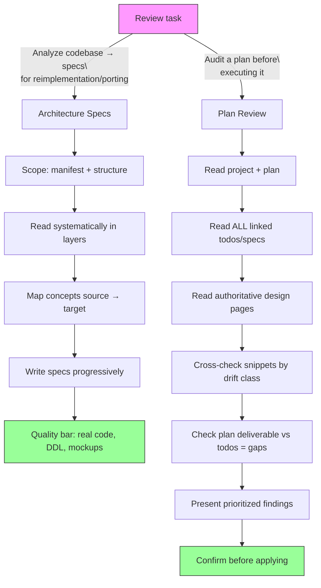

# Elixir Review

Consolidated reference for two review-shaped tasks: **producing
architecture specs** from an existing codebase (for reimplementation or
porting) and **auditing implementation plans** for cross-task consistency
before executing them.

## Decision DAG



## Part 1 — Architecture Specs

Use when the user wants to **analyze an existing codebase/system and produce
architectural specification documents** for reimplementation — typically
porting to a different tech stack, adding a major new dimension (e.g. MCP
integration), or building a clone with modifications.

### When to use

- "Analyze this repo and create specs for a clone in X stack"
- "Create specs for porting this to Elixir/Phoenix"
- "Design the architecture for a version of this that also does Y"
- "Spec out a reimplementation with MCP/agent support"

### Core workflow

```
scope → read systematically → map concepts → write specs progressively
```

1. **Scope** — read the project manifest (mix.exs / package.json / etc.),
   README, and file inventory. Identify: public API surface, entry points,
   layout, dependencies.
2. **Read systematically** (batch 5-8 independent reads per turn, never one
   at a time), in layers:
   - Layer 1 — types & contracts (schemas, config types, public API)
   - Layer 2 — core logic (context modules, domain logic, mutations, storage)
   - Layer 3 — UI / rendering (app shell, router, pages, components)
   - Layer 4 — server / API (routes, WebSocket/realtime, serialization)
   - Layer 5 — design / theming (design system, presets, CSS variables)
3. **Map concepts source → target** — build a mapping table
   (e.g. React Page component → HEEx function component; filesystem → DB
   records; BroadcastChannel → Phoenix PubSub). This table goes in the
   overview spec — it's the single most useful artifact for the reader.
4. **Write specs progressively** in a `specs/` directory, in dependency
   order: overview → data model → rendering → components → integration
   (MCP/export) → routes → roadmap. Adapt the list to the codebase.

### Spec file quality bar

Each spec file should include:

- **Concrete code examples** in the target language (real Elixir/HEEx/SQL,
  not pseudocode).
- **ASCII mockups** for UI components.
- **Tables** for structured comparisons (props, fields, tools).
- **Props/attrs listed explicitly** for each component.
- **Event names** for LiveView/real-time interactions.
- **SQL DDL** for the data model (actual `CREATE TABLE`, not "a table for
  users").

**Bad:** "The system has a canvas component that scales to fit."
**Good:** real `attr`/`slot` declarations + `~H"""` template.

### Key architectural patterns

- **Content as declarative data, not code strings.** When porting from a
  filesystem-embedded content system (JSX/TSX files) to a DB-backed one,
  store content as structured JSONB. A renderer pattern-matches on `type`;
  edit operations become JSONB mutations, not AST surgery.
- **Umbrella for separable concerns.** Prefer an umbrella over a single app:
  a `core` app with pure logic (Ecto + no Phoenix) that all web apps depend
  on; separate web apps that never know about each other. MCP tool
  **implementations** live in core; the MCP **endpoint** lives in the app
  that needs it. Short, clean app names.
- **MCP integration as first-class.** Design the MCP server spec as a full
  API surface — every CRUD operation gets a tool. Include a tool catalog
  table, example usage sequences, PubSub integration, and an auth model.
- **Real-time via PubSub.** When porting from a client-only sync model
  (BroadcastChannel) to server-rendered, replace client-side sync with
  server-mediated PubSub: mutation → broadcast → LiveView handle_info →
  re-render.
- **DESIGN.md as the design-system format.** Use a DESIGN.md file (YAML
  frontmatter tokens + markdown body) over ad-hoc palette/fonts/radius
  columns. Tokens are structured + validated, references
  (`{colors.primary}`) keep single-source, WCAG-checkable, exportable.
- **Widget-first architecture.** When the target uses configurable widgets,
  define a `props_schema` per widget type; the inspector reads it and
  auto-generates editing fields. The schema doubles as validation for MCP
  tool inputs and documentation.
- **Concept reformulation — rewrite, don't patch.** If the user pivots the
  core concept (changing the fundamental unit of construction, removing a
  document type, changing the rendering model), delete the old specs and
  start clean. A field addition or size correction is NOT a pivot — patch in
  place. Recognize replacement pivots (full rewrite) vs additive pivots
  (keep the widget catalog, rewrite data model + rendering).

### Pitfalls

- Reading files one at a time — batch 5-8 per turn.
- Skipping the concept mapping table.
- Writing pseudocode instead of real code.
- Forgetting the phased roadmap.
- Over-specifying trivial parts — focus on architectural decisions, the data
  model, the rendering pipeline, and integration surfaces.
- Ignoring the "why" — explain each architectural decision briefly.
- Assuming all document types share one canvas/page size — add a size field
  from the start if multiple types exist.
- Patching when you should rewrite (concept pivot).

## Part 2 — Implementation Plan Review

Audit a plan (with its linked todos/specs) BEFORE executing it, to catch
inconsistencies between the code snippets each todo carries and against the
authoritative design. Snippets are written independently and drift: the plan
looks perfect until one todo's code contradicts another's or the decisions.

### When to use

- "Review the plan and todos to see if something is missing or could improve"
- Before starting a multi-todo plan where each todo carries code snippets
- After a plan was created by another agent, before approving/executing it

### Guiding principle

The design pages linked to the plan (architecture decisions, security,
performance, feature concepts) are the **source of truth**. Each todo's
snippet is cross-checked against them AND against sibling todos. A todo
snippet NEVER wins over the decision page.

### Flow

1. Read project + plan.
2. Read ALL linked todos.
3. Read authoritative design pages (decisions, security, performance).
4. Cross-check snippets by drift class (below).
5. Check plan deliverable vs todos — a referenced decision with no todo
   implementing it = gap.
6. Check kanban hygiene (one in_progress per person, done only with real
   verification).
7. Present prioritized findings (A: compile/design, B: gaps, C:
   housekeeping). Confirm before applying.

### Snippet drift classes (concrete checklist)

For each snippet, compare against the decision and against siblings:

1. **Hashing/auth libraries** — Argon2 vs Bcrypt vs Comeonin drift.
   Unify on ONE.
2. **Schema field names vs code** — `role` vs `community_role`,
   `verification_token` vs `token`. The schema is the truth.
3. **Status enums conflated** — parent domain status (`active/blocked`) vs
   child resource status (`active/suspended/deleted/maintenance/draft`)
   must NOT be conflated.
4. **ID types** — `binary_id` (UUID string) vs `integer`; `is_integer`
   checks on binary_id fail.
5. **Duplicate artifacts** — the same table/schema/migration created in 2
   different todos (with different schemas).
6. **otp_app / nonexistent apps** — `otp_app` pointing at the umbrella root
   or a nonexistent app instead of the real owning app.
7. **Module namespaces** — mixing `AppWeb.*` with a nonexistent shared
   namespace. Shared plugs live in core (`X.Plugs.*`); each web app has its
   own namespace.
8. **Verification prerequisites** — VERIFY steps depending on something no
   todo creates (e.g. `mix release` without a `releases:` section in
   mix.exs).
9. **Inconsistent thresholds/flags** — rate limits, session limits, TTLs
   differing between todos, and between todo and concept.
10. **Env-sensitive flags** — `secure: true` cookies break localhost dev;
    must be conditional on env.

### Gaps: plan deliverable vs todos

The plan's deliverable lists what it produces. If a decision is REFERENCED
(gotcha, deliverable) but no todo implements it → gap. Classics: telemetry,
email/confirmation/password reset, session limits, `bin/migrate`, prod seeds.
Decide: new todo, or merge into an existing one.

### Pitfalls

- Answering from search excerpts — read full pages first.
- Trusting a todo's snippet over the decision page — snippets drift; the
  decision wins.
- Reconstructing bodies with a footer that isn't part of the body.
- Applying corrections without verifying (re-read each edited page, confirm
  mermaid preserved and content correct).

## References

- `references/architecture-specs/` — worked example (concept mapping table,
  spec inventory, reading order) + Phoenix audit checklist (recurring
  anti-patterns: N+1 in templates, `raw()` XSS, pattern-match crashes on nil
  context, duplicate utility code, missing pagination/caching).
- `references/implementation-plan-review/` — worked plan-review example as a
  concrete checklist of each drift class.
- `references/orig-*.md` — the absorbed originals (architecture-specs,
  implementation-plan-review) for full depth.
