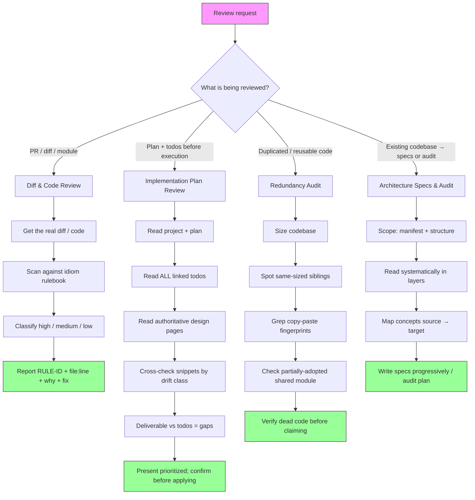

# Elixir Review

Consolidated review category: **diff/code review** against a distilled
Elixir/Phoenix idiom rulebook, **implementation-plan review** before
execution, **redundancy audits**, and **architecture-spec production/audit**
from an existing codebase. Everything is read-only until findings are
confirmed with the requester.

## Decision DAG



## Part 1 — Diff & Code Review

Review Elixir/Phoenix code (PRs, diffs, agent output, self-review before
commit) against the **idiom rulebook** in `references/diff-review-idiom-rules.md`.
Every rule has a severity, a why, an anti-pattern, and the correct form;
rule IDs are stable and citable (`EX-01`, `ERR-04`, ...).

### Workflow

1. **Get the actual code** — the diff, the changed files, the module under
   review. Never review from memory or someone else's summary; a finding
   needs a real `file:line`.
2. **Scan against the rulebook** — style/idioms (EX-01..06), tests
   (TS-01..05), error handling & nil safety (ERR-01..05), performance & DB
   (PF-01..04), architecture (AR-01..03), i18n/correctness/naming
   (I18N, LG, NM).
3. **Classify severity**: high = merge blocker (bugs, leaks, broken
   contracts, data-loss risk); medium = should fix (readability,
   testability, idiomatic Elixir); low = nit.
4. **Report** `RULE-ID (severity) + file:line + one-line why + the fix`.

### Nil-safety rules that block merges (ERR)

- **ERR-01** — An `if` check that doesn't early-return is dead code: the
  nil still flows into the next `assign`. Make the nil branch return
  (`{:noreply, socket}`) so nothing below sees nil.
- **ERR-04** — `Repo.get/2` returns `nil`, NEVER `{:error, changeset}`. A
  `case` with an `{:error, changeset}` branch contains an unreachable
  clause; use `with %Schema{} = record <- Repo.get(...)`.
- LiveView `handle_event` clauses that pattern-match `%{assigns: %{context:
  %{id: id}}}` crash when the assign is nil — loosen the match, extract with
  an explicit nil-handling `case`.

### Case over `{:error, %Ecto.Changeset{}}` inside transactions

In a `with ... else` **inside `Repo.transaction`**, an inner function that
returns `{:error, changeset}` must keep the changeset SHAPE so the `else`
clause can match it:

```elixir
with {:ok, user} <- create_user(attrs),
     {:ok, team} <- create_team(attrs, user) do
  {:ok, %{user: user, team: team}}
else
  {:error, %Ecto.Changeset{} = changeset} -> {:error, changeset}
end
```

A bare `{:error, reason}` else-clause converts a changeset into an opaque
reason and loses validation messages. Keep `{:error, %Ecto.Changeset{}}`
matched explicitly, and make every inner function return that shape when it
fails validation.

### Compile walls

- Run `mix compile --warnings-as-errors` before and after the change — a
  review target that doesn't pass it is not reviewable as complete.
- Group related function clauses together and keep them adjacent; scattered
  clauses of the same function are a readability finding (Credo
  `SingleFunctionToBlockPipe`, `CondStatements`, `CyclomaticComplexity`).

### Concurrency, pagination, sessions

- **N+1** — context functions fetching per-item inside template `:for`
  comprehensions: batch into a single `WHERE ... IN (...)` query returning
  a map, pre-load before render.
- **Deterministic pagination** — `OFFSET` pages drift when rows are
  inserted/deleted mid-paging. Tiebreak on a stable unique key:
  `ORDER BY id` (or `inserted_at, id`) so the page boundary stays
  deterministic.
- **Assigns leakage** — don't assign values into the socket inside an `if`
  that can be skipped; assign once after all branches resolve.
- **Auth row-level scope** — every query that reads user-owned rows must
  scope by the authenticated user's id; a repo shared across callers that
  forgets the scope filter is a data-leak finding.

### i18n coverage

Every user-visible string in HEEx must go through `gettext/1`. Convention
rule: if the repo uses gettext, hardcoded strings are findings
(`mix gettext.extract` + CI check). If the repo has no gettext, mark the
rule n/a — don't flag every literal.

### Automation mapping

| Pattern | Rule | Tool |
|---|---|---|
| Nested `case` / deep if-else | EX-01, EX-02 | Credo `CondStatements`, `CyclomaticComplexity` |
| Single-transform pipe | EX-05 | Credo `PipeChainStart` |
| Hardcoded strings | I18N-01 | `mix gettext.extract` + CI diff |
| FK without index | PF-01 | custom migration linter (every `references/2` must have its `create index`) |
| Hardcoded URLs | AR-03 | custom Credo check matching `https?://` literals |
| `Repo.get` without nil handling | ERR-04 | Dialyzer / custom linter |

### Severity honesty

Don't apply low-severity rules as merge blockers — nitpicking erodes review
trust. Convention-dependent rules (ExMachina factories TS-01, gettext
I18N-01) are n/a when the repo doesn't use them.

## Part 2 — Implementation Plan Review

Audit a plan with its linked todos/specs BEFORE executing. Snippets are
written independently and drift: the plan looks perfect until one todo's
code contradicts another's or the authoritative design pages.

### Guiding principle

The design pages linked to the plan (architecture decisions, security,
performance, feature concepts) are the **source of truth**. Each todo's
snippet is cross-checked against them AND against sibling todos. A todo
snippet NEVER wins over the decision page.

### Flow

1. Read project + plan.
2. Read ALL linked todos (full pages, not search excerpts).
3. Read authoritative design pages.
4. Cross-check snippets by drift class.
5. Check plan deliverable vs todos — a referenced decision with no todo
   implementing it = gap.
6. Check kanban hygiene (one `in_progress` per person; `done` only with
   real verification; new todos in `backlog` when the plan isn't approved).
7. Present prioritized findings (A: compile/design, B: gaps, C:
   housekeeping). Confirm before applying.

### Snippet drift classes

1. **Hashing/auth libraries** — Argon2 vs Bcrypt vs Comeonin; unify on ONE.
2. **Schema field names vs code** — the schema column name wins over the
   shorter name a snippet invents (`role` vs the schema's qualified
   `team_role`); schema is the truth.
3. **Status enums conflated** — parent-domain status (`active/blocked`) vs
   child-resource status (`active/suspended/deleted/maintenance/draft`).
4. **ID types** — `binary_id` (UUID string) vs `integer`; `is_integer`
   checks on binary_id fail.
5. **Duplicate artifacts** — same table/schema/migration created in 2
   todos with different schemas.
6. **otp_app / nonexistent apps** — pointing at the umbrella root or a
   nonexistent app instead of the real owning app.
7. **Module namespaces** — mixing web-app namespaces with a nonexistent
   shared one; shared plugs live in the core app (`Core.Plugs.*`).
8. **Verification prerequisites** — a VERIFY step depending on something no
   todo creates (`mix release` without a `releases:` section).
9. **Inconsistent thresholds/flags** — rate limits, session limits, TTLs
   differing between todos and between todo and concept.
10. **Env-sensitive flags** — `secure: true` cookies break localhost dev;
    must be `secure: config_env() == :prod`.

### Gaps: plan deliverable vs todos

Decision REFERENCED (in deliverable/gotcha) but no todo implements it →
gap. Classics: telemetry, email/confirmation/password reset, session
limits, `bin/migrate`, prod seeds. Decide: new todo, or merge into an
existing one.

## Part 3 — Redundancy Audit

Find duplicated and reusable Elixir/Phoenix code. Read-only; pairs with a
follow-up consolidation plan.

**Why not clone detectors:** `jscpd` has no Elixir parser — against `.ex`
files it reports "No duplicates found" with `Files analyzed: 0`. That's a
false negative, not a clean codebase. Manual pattern-hunting with grep +
diff is the effective method (details in `references/redundancy-audit.md`).

Workflow: size the codebase (same-sized sibling files = candidates) → diff
siblings → grep copy-paste fingerprints (`defp format_errors`,
`traverse_errors`, `get_or_create`, `on_conflict`, try/rescue wrappers) →
check for a **partially-adopted shared module** (the finding is "finish the
adoption", not "invent an abstraction") → verify dead code repo-wide before
claiming it.

Report per finding: What · Where (file:line per copy) · Evidence · Suggestion ·
Impact (high/medium/low + LOC saved). Quick-wins table at the end. Only
verified file:line findings.

## Part 4 — Architecture Specs & Audit

### Specs (reimplementation / porting)

Workflow: `scope → read systematically → map concepts → write specs
progressively` (full method in `references/architecture-spec-audit.md`).

- Read in layers (types/contracts → core logic → UI → server/API →
  design), batching 5-8 independent reads per turn.
- The source→target concept mapping table goes in the overview spec — it's
  the single most useful artifact.
- Write `specs/` in dependency order: overview → data model → rendering →
  components → integration → routes → roadmap.
- Quality bar: real Elixir/HEEx/SQL (not pseudocode), ASCII mockups, SQL
  DDL, explicit props/attrs.
- Replacement pivot = delete specs and rewrite; additive pivot = keep the
  widget catalog, rewrite data model + rendering. Field additions patch in
  place.

### Audit (bug-finding, not porting)

Read systematically → establish baseline (`mix compile --warnings-as-errors
&& mix test` — a failing baseline makes "fix the build" task #1) → categorize
findings → phased plan. Scan everything in
`references/phoenix-audit-checklist.md`: dead/duplicate modules, `raw()`
XSS, pattern-match crashes on nil, N+1, missing pagination, no caching,
missing debounce, unused parameters, inline JS.

**DRY dimension is mandatory** — users expect a DRY/modularization phase
even when they don't ask. Before reporting duplicated functions, check
`my_app_web.ex` auto-imports: a function called in 11 files may be defined
once and auto-imported (that's NOT duplication). Only report duplication
when the same `defp` is *defined* in 2+ files.

## Adversarial review posture

- **Who writes does not self-approve** — the author's plan/code gets the
  same adversarial pass as anyone else's.
- **Blocking criteria** (any = reject/hold): secrets or credentials in
  code/config, debug leftovers (`IO.inspect`, `dbg`, hardcoded test
  creds), migration/structure.sql drift (schema changed but
  `priv/repo/structure.sql` or the migration chain not updated), missing
  module references (code calling modules/fields that don't exist in the
  diff).
- **Validate-and-extend before fixing** — when a buggy function must be
  fixed, first reproduce the bug yourself, then grep the consumers of the
  function (all arities, `lib/` + `test/` + templates) so the fix
  doesn't break callers that depend on current behavior.
- **Read-before-conclude** — never answer from search excerpts; read the
  full page/file first.
- **Blast-radius enumeration** — before proposing a change, enumerate
  every consumer and every test that touches the changed surface; the blast
  radius of a fix is part of the review finding.

## Verify

Gate commands (run from the repo root of the codebase under review — not
this skill's own staging):

```bash
# 1. Review target must compile warning-free
mix compile --warnings-as-errors

# 2. Test suite green (no deleted/renamed specs during refactors)
mix test

# 3. No secrets / debug leftovers in the diff
git diff | grep -nE 'password|secret|api_key|dbg\(|IO\.inspect' || true

# 4. FK indexes present for every references/2 in new migrations
grep -rn 'references(' priv/repo/migrations/ | wc -l
grep -rn 'create index' priv/repo/migrations/ | wc -l

# 5. Redundancy audit sizing
find lib -name '*.ex' | sed 's|/[^/]*$||' | sort | uniq -c | sort -rn
```

Expected: compile and tests exit 0; no secrets/leftovers; every
`references/2` has a matching `create index` (counts equal); directory
distribution reveals same-sized sibling clusters.

## References

- `references/diff-review-idiom-rules.md` — full rulebook (EX/TS/ERR/PF/AR/I18N/LG/NM) with anti-pattern/correct code pairs and the automation table. Load for every diff review.
- `references/adversarial-review-protocol.md` — who-self-approves, blocking criteria, validate-and-extend, blast-radius enumeration. Load when reviewing anything that will be executed.
- `references/plan-review.md` — plan/todo audit method, drift classes with code signatures, gaps, kanban hygiene. Load before executing any multi-todo plan.
- `references/bulk-edit-safety.md` — safe multi-page bulk edits after review fixes: anchor-based edits, exact-match rules, hash verification, mermaid preservation. Load when applying plan corrections at scale.
- `references/architecture-spec-audit.md` — spec production workflow (layers, mapping table, progressive writing, quality bar, pivots) and umbrella guidance. Load for reimplementation/porting requests.
- `references/redundancy-audit.md` — grep+diff duplication hunt, adoption counting, dead-code verification. Load when asked to find reusable/duplicated code.
- `references/phoenix-audit-checklist.md` — recurring Phoenix/LiveView anti-patterns with grep commands and fix shapes. Load when auditing a running app for bugs.
- `references/review-fix-recommendations.md` — how to convert review findings into verifiable fixes: prioritized phases, exact file:line, verification commands. Load when writing the fix plan.