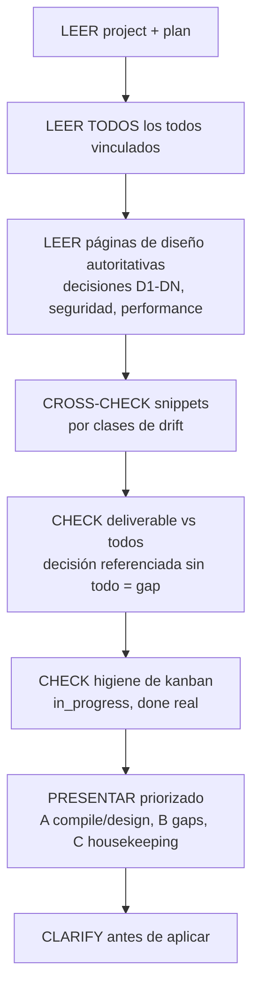

# implementation-plan-review — Auditar planes de implementación antes de ejecutar

Revisa un plan (con sus todos/specs) ANTES de ejecutarlo para cazar inconsistencias entre los snippets de código que cada todo lleva y contra el diseño autoritativo. Los snippets de cada todo se escriben de forma independiente y derivan: el plan se ve perfecto hasta que el código de un todo contradice al de otro o a las decisiones.

## Cuándo usarlo

- "Revisa el plan y todos de X para ver si falta o se puede mejorar algo"
- Antes de arrancar un plan multi-todo donde cada todo lleva snippets de código
- Después de que un plan fue creado por otro agente, antes de aprobarlo/ejecutarlo

## Principio rector

Las páginas de diseño vinculadas al plan (decisiones de arquitectura, seguridad, performance, conceptos de feature) son la **fuente de verdad**. Cada snippet de cada todo se cruza contra ellas Y contra los todos hermanos. El snippet de un todo NUNCA gana sobre la página de decisión.

## Flujo

## Checklist de "snippet drift" (clases concretas)

Para cada snippet, compara contra la decisión y contra los hermanos:

1. **Librerías/APIs de hashing y auth** — Argon2 vs Bcrypt vs Comeonin (los todos derivan en lo mismo). Unificar a UNA.
2. **Nombres de campos schema vs código** — `role` vs `community_role`, `verification_token` vs `token`. El schema es la verdad.
3. **Enums y modelos de status** — NO conflatar status del padre con status del hijo (ej: status del dominio `active/blocked` ≠ status del recurso `active/suspended/deleted/maintenance/draft`).
4. **Tipos de ID** — `binary_id` (UUID string) vs `integer`. Checks `is_integer` sobre binary_id fallan.
5. **Artefactos duplicados** — la misma tabla/schema/migración creada en 2 todos distintos (y con schema diferente).
6. **otp_app / apps inexistentes** — `otp_app` apuntando a la raíz del umbrella o a una app que no existe, en vez de la app real que posee el módulo.
7. **Namespaces de módulos** — mezclar `AppWeb.*` con un namespace compartido inexistente. Plugs compartidos viven en el core (`X.Plugs.*`); cada app web con su namespace.
8. **Prerrequisitos de verificación** — pasos de VERIFY que dependen de algo que ningún todo crea (ej: `mix release` sin sección `releases:` en mix.exs).
9. **Umbrales/flags inconsistentes** — rate limits, límites de sesión, TTLs distintos entre todos, y entre todo y concepto.
10. **Flags sensibles al entorno** — `secure: true` en cookies rompe localhost dev; debe ser condicional al env.

## Gaps: entregable del plan vs todos

El entregable del plan lista lo que se produce. Si una decisión está REFERENCIADA (gotcha, deliverable) pero ningún todo la implementa → gap. Clásicos: telemetría, email/confirmación/password reset, límite de sesiones, `bin/migrate`, seeds prod. Decidir: todo nuevo o fundir en un todo existente.

## Higiene de kanban

- Un `in_progress` a la vez POR PERSONA. Si el plan está "pendiente de aprobación", los todos auto-movidos a in_progress al crearse deben volver a `backlog`.
- `done` solo con verificación real.
- Todos nuevos en `backlog` (no auto-move) cuando el plan aún no se ejecuta.

## Aplicar las correcciones (MyApp)

- **Bodies**: `dran_update_page` pasando SOLO `body` (nunca meta+body — TipTap strippea los mermaid). Reconstruir el body completo con los fixes; el footer `--- Type: ... | Tags: ... | Version: N` que añade get_page NO es parte del body.
- **Crear todos**: `dran_create_todo` — `slug` es OBLIGATORIO (no está en la recipe del skill MyApp). Nuevos en `backlog`.
- **Status**: `dran_update_todo` (merge meta), nunca `dran_update_page` para status.
- **Verificar**: get_page de cada página editada → confirmar mermaid preservado y contenido correcto.

## Pitfalls

- **Responder desde excerpts de search** — leer las páginas completas primero.
- **Confiar en el snippet de un todo sobre la página de decisión** — los snippets derivan; la decisión manda.
- **`dran_list_pages` con `status` + `project_slug` combinados** — el filtro de status puede ignorarse en combinación; verificar con la query sin project_slug.
- **Reconstruir el body incluyendo el footer de get_page** — ensucia el contenido.
- **Editar los bodies de a uno con miedo al tamaño** — los bodies de ~10-15KB pasan bien en un tool call; batch en paralelo está bien.

## Referencias

- `references/MyApp-plan-review-example.md` — ejemplo trabajado: la revisión del plan MyApp (15 inconsistencias + 5 gaps) como checklist concreto de cómo se ve cada clase de drift.
