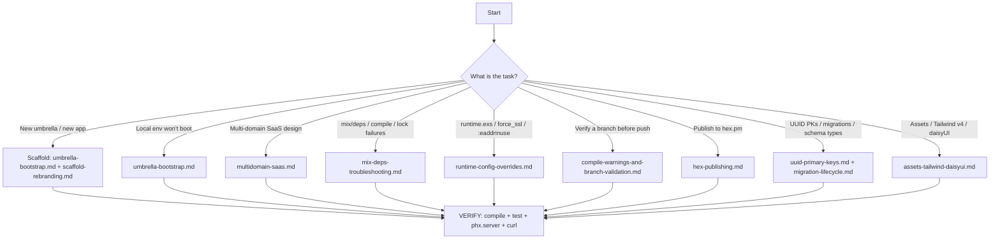

# Elixir Setup

Scaffold + build category: new umbrella/app bootstrap, local environment
setup, multi-domain SaaS architecture, mix/deps troubleshooting, compile
failures, runtime-config overrides, and hex publishing.



## Scaffold: adding apps to an umbrella

Run Phoenix generators from inside `apps/`, NEVER the umbrella root.

```bash
mix archive.install hex phx_new --force            # if phx.new.ecto is missing
mkdir -p apps && cd apps
mix phx.new.ecto core --app core --no-assets --no-html --no-live --no-dashboard --no-mailer
# web app:
printf "Y\n" | mix phx.new.web dashboard --app dashboard
cd ..
mix deps.get
```

Errors that mean "wrong cwd": `The task "phx.new.ecto" could not be found`
(no generator — install it) and `The ecto task can only be run within an
umbrella's apps directory` (run from `apps/`).

### Elixir 1.20 umbrella rules

- **App directory name MUST match the OTP app name** (`apps/my_app_core/`,
  `apps/dashboard/` — never `apps/core/` for `:my_app_core`). Plans and
  subagent briefs must always quote the full directory name; a literal
  reading of `apps/core/` creates a broken tree.
- If a non-Phoenix app starts `{Phoenix.PubSub, name: MyApp.PubSub}` in its
  supervision tree, add `{:phoenix_pubsub, "~> 2.1"}` to its deps — full
  `:phoenix` is NOT needed.
- `@primary_key {:id, :binary_id, autogenerate: true}` — with
  `autogenerate: false`, `Repo.insert` returns `id: nil`
  (`Ecto.NoPrimaryKeyValueError`) because Ecto never reads DB defaults.
- Ecto sandbox pool: `config/test.exs` alone does not apply the Sandbox —
  the app is already started. Set the pool conditionally in
  `Application.start/2` keyed on `Mix.env()` (or start the Repo manually in
  `test_helper.exs`). Otherwise every test fails with
  `cannot invoke sandbox operation with pool DBConnection.ConnectionPool`.
- Missing `ecto_repos` after scaffolding:
  `warning: could not find Ecto repos in any of the apps: [:core]` → add
  `config :core, ecto_repos: [Core.Repo]` to `config/config.exs`.

### Wiring a new web app to the shared core repo

1. Add `{:core, in_umbrella: true}` to the web app's `mix.exs` deps.
2. Declare no local repo: `config :dashboard, ecto_repos: []`; name the PubSub:
   `config :dashboard, Dashboard.PubSub, adapter: Phoenix.PubSub.PG2`.
3. Start the PubSub in `application.ex` children:
   `{Phoenix.PubSub, name: Dashboard.PubSub}`.
4. Re-point tests to the core sandbox in `test_helper.exs`
   (`Ecto.Adapters.SQL.Sandbox.mode(Core.Repo, :manual)`) and use
   `Core.DataCase` in `conn_case.ex`.
5. Remove the Swoosh mailbox forward from the generated router unless Swoosh
   is installed.
6. **Merge the umbrella root config back** — `phx.new.web` OVERWRITES
   `config/runtime.exs` and `config/prod.exs`; re-add the core DB/runtime
   config after scaffolding.
7. Both endpoints need their `secret_key_base` in `config/test.exs`, or
   tests die with `missing secret key base`.

### Tidewave plug placement

Strictly BEFORE `Plug.Parsers`, dev-only:

```elixir
if Mix.env() == :dev do
  plug Tidewave
end

plug Plug.Parsers, parsers: [:urlencoded, :multipart, :json], pass: ["*/*"],
  json_decoder: Phoenix.json_library()
```

After `Plug.Parsers` the body is already parsed and Tidewave raises. If live
reload is used in dev, the code-reloading block goes after the static plug
and BEFORE Tidewave. Modern `phoenix_ecto` names the migration-status plug
`Phoenix.Ecto.CheckRepoStatus` (not `CheckPendingStatus`); if you get an
undefined-module warning, update the name — do not add another dep.

### Scaffold rebrand + favicon

After `mix phx.new`, rebrand FOUR files (logo.svg, home.html.heex,
root.html.heex `<.live_title>` suffix, layouts.ex `app/1` navbar) — recipe in
`references/scaffold-rebranding.md`, which also has the zero-dependency
macOS favicon.ico recipe (`sips` + Python `struct`) and the static-assets
gitignore pattern.

## Local environment (mise + Homebrew PostgreSQL + private Hex)

- **mise loads `.env`; your shell does not.** Never `source .env`; always
  run through `mise x -- <cmd>` or `mise run <task>`. `mise trust` first.
- Pin the exact OTP build in `.mise.toml` (`elixir = "1.20.1-otp-27"` /
  `erlang = "27.0"`); a loose `"1.20"` may resolve to an OTP that breaks on
  your Erlang.
- `.env` secrets: paste as single-line strings (line continuations break
  mise with `malformed value in .env`); never commit `.env`.
- Homebrew Postgres creates a superuser matching the macOS username, not
  `postgres` — `psql postgres -c "SELECT usename FROM pg_user;"` to find it.
- Private Hex orgs: `mix hex.organization auth <org> --key <KEY>` BEFORE
  `mix deps.get`; silent success = exit 0. Diagnosis: `mix hex.organization
  list` empty → not authed; `Failed to fetch record for hexpm:<org>/<pkg>` →
  auth or org membership missing.
- `mix phx.gen.secret` prints NOTHING on success (exit 0) — don't re-run.
- Full bootstrap + verification sequence:
  `references/umbrella-bootstrap.md`.

## Mix & deps troubleshooting

- **Lock outdated in `:prod` only**:
  `lock outdated: the lock is outdated compared to the options in your
  mix.exs`. Git deps pinned by `tag:` carry a SHA in the lock; Mix compares
  SHAs. Fix: pin by `ref:` with the exact lock SHA, commit `mix.exs` +
  `mix.lock` together.
- **Manifest/lock drift**: `mix.exs` says `~> 0.5`, lock resolved `0.6.1`.
  Align `mix.exs` to the resolved version and re-run `mix deps.get`.
- **`mix.lock` invalid data / corrupted**: parallel subagents overwrote it.
  Regenerate sequentially; orchestrator always runs `mix deps.get` itself
  after parallel batches and commits the lock.
- **Compile hangs at 0% CPU**: a `mix phx.server` beam holds `.beam` locks,
  or a zombie compile lingers. `ps aux | grep -E 'mix (compile|phx.server)'`,
  kill, then `mix compile --force --warnings-as-errors`.
- **Never surgically delete `_build/<env>/lib/<app>/priv` subdirs** — priv is
  mirrored (hardlinked/synced) back to source; deleting inside `_build/priv`
  can delete source migrations/assets. Wipe the whole `_build` instead:
  `rm -rf _build && mix deps.get && mix compile`.
- **Piped gates mask exit codes**:
  `mix precommit 2>&1 | tail` reports `tail`'s exit 0. Use
  `mix precommit > log 2>&1; echo "EXIT: $?"` or `set -o pipefail`.
- Subagent-execution pitfalls (timeout ≠ failure, file races, commit
  sweeping, `.env` breaks, lock corruption): `references/mix-deps-troubleshooting.md`.
- Hex publishing (pre-publish checklist, 2FA/device-flow traps, versioning):
  `references/hex-publishing.md`.

## Runtime config overrides

- **`runtime.exs` overrides `test.exs`** → `mix test` dies with `:eaddrinuse`
  on port 4000 (not the test.exs port). Guard listener config
  (`server: true`, `http: [port: ...]`) inside
  `if config_env() == :prod do`. Quick unblock: `PORT=4099 mix test`.
- **`:eaddrinuse` in `mix run -e`** — the app boots the Endpoint. Use
  `MIX_ENV=test mix run -e '...'` (test endpoint binds nowhere) or
  `mix run --no-start -e '...'` with manual `Application.ensure_all_started`
  for postgrex/ecto_sql + `Repo.start_link()`.
- **`force_ssl` is compile-time** — setting it in `runtime.exs` aborts
  release boot with the "different value ... during runtime compared to
  compile time" error. Read `DISABLE_FORCE_SSL` in `config/prod.exs`;
  `PHX_SCHEME=http` at runtime only affects URL generation.
- **Never read secrets into module attributes** — `@attr` is evaluated at
  compile time; a later env change silently leaves stale values. Read at
  runtime or in `runtime.exs` into app env.
- Full recipes: `references/runtime-config-overrides.md`.

## Compile warnings & branch validation in umbrellas

- Pre-existing warnings from other apps break
  `mix compile --warnings-as-errors` for the whole umbrella. Isolate:
  `git diff origin/main..HEAD --name-only` → compile without the flag
  (must be exit 0) → cross-reference warnings against branch files → only
  warnings on modified files count.
- `mix test apps/<app>` swallows the suite summary behind sibling-app
  compile warnings. Separate compile from test:
  `MIX_ENV=test mix compile 2>/dev/null && mix test apps/api 2>/dev/null`
  (then `| tail -3` for the count).
- Detached HEAD after a `git checkout` makes `git diff origin/main..HEAD`
  lie. Check `git rev-parse --abbrev-ref HEAD` (returns `HEAD` when
  detached) before validating: `git checkout <branch>`.
- Full methodology: `references/compile-warnings-and-branch-validation.md`.

## Multi-domain SaaS architecture

- One endpoint serves N hosts; `Host` / `x-forwarded-host` is the tenant
  key. Resolve in a plug, fail CLOSED (`:error` → 404 + halt), cache in ETS
  (~60s TTL, `:public`, `read_concurrency: true`, degrade gracefully,
  never cache unknown keys).
- Layout: `core` depends on nothing; every other app depends on `core`
  only. OTP apps without ports (agents, channels) are legitimate. Name apps
  for the PRODUCT they serve, not the end-user role. Migrate in exactly one
  place.
- Deploy: one container / many ports (4000–4003) mapped by the proxy, or
  per-app `MIX_ENV=prod mix release <app>`; `trusted_proxies` must be set
  for `x-forwarded-host` to be honored.
- Security baked in day 1: fail closed, rate limit auth, session hygiene
  (sliding + 4h max_age, secure/httpOnly/SameSite, tokens never in DOM),
  CSP without `unsafe-inline`, body caps, audit log, `mix_audit` in
  precommit, ETS hot-path caches, N+1 via signature change, circuit
  breakers on external integrations.
- Full principles: `references/multidomain-saas.md`.

## UUID primary keys & migrations

House default: `:binary_id` everywhere (no serial). Repo config sets
`migration_primary_key: [name: :id, type: :binary_id]` +
`migration_timestamps: [type: :utc_datetime_usec]`; every schema carries
`@primary_key {:id, :binary_id, autogenerate: true}` and
`@foreign_key_type :binary_id`. After changing key types, reset BOTH
databases (`mix ecto.reset` + `MIX_ENV=test mix ecto.reset`) or tests fail
with `Postgrex expected an integer ... got <<...>>`.

Never modify committed migrations; verify schema↔migration type alignment
with `psql -tAc "SELECT atttypid::regtype ..."`; when renaming indexes,
drop the OLD name explicitly in `up`. Details and the cargo-cult field
lifecycle in `references/uuid-primary-keys.md` and
`references/migration-lifecycle.md`.

## Assets (Tailwind v4 + daisyUI)

- Tailwind v4 has no `tailwind.config.js` — config lives in `@theme {}` in
  `app.css`; names must be `--{category}-{name}` (`--color-brand-500` →
  `bg-brand-500`).
- daisyUI themes are `@plugin "../vendor/daisyui-theme" { ... }` blocks in
  oklch; keep theme names exactly `dark`/`light`, honor `@custom-variant`
  and `@plugin` blocks.
- To verify CSS when `mix assets.build` fails on unrelated Elixir errors:
  `mix tailwind default` compiles only the CSS.
- Palette, typography scale, elevation, skeleton, and micro-interactions:
  `references/assets-tailwind-daisyui.md`.

## VERIFY

Prove the category works — run from an actual umbrella/app:

```bash
mix deps.get && mix compile --warnings-as-errors   # exit 0, no warnings in YOUR files
mix test                                           # green suite
mix phx.server &                                   # boots without :eaddrinuse
curl -sf http://localhost:4000 | head -20          # 200 home
MIX_ENV=test mix run -e 'IO.puts(Application.get_env(:core, Core.Repo)[:database])'
# → my_app_test (proves test config wins over runtime.exs defaults)
psql postgres -c "SELECT usename FROM pg_user;"    # role exists
hex user whoami && mix hex.organization list       # auth present before publish
```

Expected shapes: `Generated <app> app` / `Finished in ... : N tests, 0
failures`; `curl` returns 200; the env probe prints the test DB name; the
grep-based brand scrub returns nothing under `lib/` (see scaffold-rebranding).

## References

- `references/umbrella-bootstrap.md` — local env: mise/`.env`, Homebrew
  Postgres, private Hex orgs, secrets, bootstrap sequence. Load when a
  fresh clone won't boot or `mix deps.get` fails on unknown packages.
- `references/scaffold-rebranding.md` — the four post-scaffold rebrand
  files, favicon.ico recipe (macOS), gitignore. Load after every
  `mix phx.new`.
- `references/multidomain-saas.md` — umbrella layout, multi-host resolution
  plug, deploy topology, security/perf non-negotiables. Load when designing
  or reviewing a multi-domain platform.
- `references/mix-deps-troubleshooting.md` — masked exits, subagent
  timeouts/races/commit sweeps, `.env` breaks, lock corruption. Load when a
  batch "passed" under suspicious numbers or the build hangs.
- `references/runtime-config-overrides.md` — `runtime.exs` overrides,
  `:eaddrinuse`, compile-time `force_ssl`, DB-driven feature overrides.
  Load for runtime config crashes.
- `references/compile-warnings-and-branch-validation.md` — warning
  isolation against `git diff origin/main..HEAD`, swallowed test output,
  detached HEAD. Load before validating any umbrella branch.
- `references/uuid-primary-keys.md` — `:binary_id` schema/migration pattern,
  both-DB reset trap, schema↔migration alignment, cargo-cult fields. Load
  when adding tables or converting IDs.
- `references/migration-lifecycle.md` — index renames, duplicate names,
  failed-in-prod edits, build-tree hygiene. Load for migration failures.
- `references/assets-tailwind-daisyui.md` — daisyUI theme blocks, oklch
  palette, CSS design system, Tailwind v4 config model. Load for theming or
  missing CSS.
- `references/hex-publishing.md` — package metadata, interactive-prompt
  traps (2FA/device flow), versioning, plug-halt gotcha. Load before any
  `mix hex.publish`.