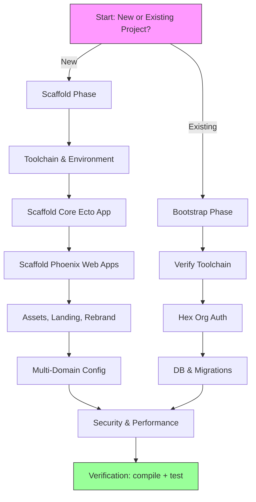

# Elixir Setup

Consolidated reference for bootstrapping, scaffolding, and configuring Elixir/Phoenix umbrella projects — from environment setup through multi-domain SaaS architecture.

## Decision DAG



## Table of Contents

1. [Toolchain & Environment](#toolchain--environment)
2. [Scaffold Phase](#scaffold-phase)
3. [Bootstrap Phase](#bootstrap-phase)
4. [Multi-Domain Architecture](#multi-domain-architecture)
5. [Security & Performance Principles](#security--performance-principles)
6. [UUID Primary Keys](#uuid-primary-keys)
7. [Subagent Execution](#subagent-execution)
8. [Common Pitfalls](#common-pitfalls)
9. [Verification Commands](#verification-commands)

---

## Toolchain & Environment

### mise (the #1 gotcha)

Use [mise](https://mise.jdx.dev/) for Elixir/OTP version pinning and env management. **Never `source .env`** — mise loads `.env` automatically via `_.file`.

```toml
# .mise.toml
[tools]
elixir = "1.20.1-otp-27"
erlang = "27.0"

[env]
_.file = ".env"
```

**Critical rules:**
- Run `mise trust` in the repo root before any mise command
- Always run commands via `mise x -- <cmd>` or `mise run <task>` — bare shell commands miss `.env` values
- `.env` secrets: never commit; strip `@url:` markdown decoration from pasted content
- Paste `.env` secrets as **single-line strings** — line continuations (`\`) break mise

### Homebrew PostgreSQL

```bash
brew services info postgresql
brew services start postgresql
```

Find your local role (Homebrew creates a superuser matching your macOS username, not `postgres`):
```bash
psql postgres -c "SELECT usename FROM pg_user;"
```

Use that username in `.env` with an empty password for dev/test.

### Hex Organization Auth

Search `mix.exs` for `organization: "<org>"` — private packages need auth:
```bash
# One time per machine
mix hex.organization auth <org> --key <READ_ONLY_KEY>

# Verify
mix hex.organization list
```

Fix hex auth **before** `mix deps.get` — it blocks everything downstream.

---

## Scaffold Phase

### Umbrella Layout (Generic Pattern)

```
my_app/
├── core/          ← Pure domain: schemas, contexts, Repo, migrations
├── harness/       ← OTP app (no port): agents, GenServers, queues
├── portal/        ← Port 4000: customer control center
├── products/      ← Port 4001: multi-host product apps
└── api/           ← Port 4002: machine frontier, webhooks
```

**Rule:** `core` depends on nothing; every other app depends on `core` only.

### Short OTP App Names

Use short names, not prefixed:
- `:core`, `:portal`, `:products`
- Directory must match OTP name exactly: `apps/core/`, `apps/portal/`

### Secret Generation

```bash
cp .env.example .env
mix phx.gen.secret | pbcopy   # SECRET_KEY_BASE_PORTAL
mix phx.gen.secret | pbcopy   # SECRET_KEY_BASE_PRODUCTS
```

Paste into `.env`.

### Adding Core Ecto App to Existing Umbrella

```bash
# Install generator if missing
mix archive.install hex phx_new --force

# Run from inside apps/, NOT umbrella root
mkdir -p apps && cd apps
mix phx.new.ecto core --app core --no-assets --no-html --no-live --no-dashboard --no-mailer

# Back in umbrella root
mix deps.get
```

Add to `config/config.exs`:
```elixir
config :core, ecto_repos: [Core.Repo]
config :core, Core.Repo,
  adapter: Ecto.Adapters.Postgres,
  migration_primary_key: [name: :id, type: :binary_id],
  migration_timestamps: [type: :utc_datetime_usec]
```

### Adding Phoenix Web App to Existing Umbrella

```bash
cd apps
printf "Y\n" | mix phx.new.web portal --app portal
cd ..
mix deps.get
```

**Required manual fixes:**
1. Add `{:core, in_umbrella: true}` to web app's `mix.exs` deps
2. Declare no local repo: `config :portal, ecto_repos: []`
3. Start PubSub in `application.ex`: `{Phoenix.PubSub, name: Portal.PubSub}`
4. Re-point tests to `Core.Repo` sandbox in `test_helper.exs`
5. Remove Swoosh forward in router unless Swoosh is installed
6. **Merge umbrella root config** — generator overwrites `config/runtime.exs` and `config/prod.exs`

### Tidewave Integration

Add to web app deps:
```elixir
{:tidewave, "~> 0.6", only: :dev}
```

Mount **before** `Plug.Parsers`:
```elixir
if Mix.env() == :dev do
  plug Tidewave
end

plug Plug.Parsers, ...
```

---

## Bootstrap Phase

### Typical Bootstrap Sequence

```bash
mise trust
mise x -- mix deps.get                    # needs hex org auth first
mise x -- bash -lc 'cd apps/products && npm install --prefix assets'
mise x -- bash -lc 'cd apps/core && mix ecto.create && mix ecto.migrate'
mise x -- bash -lc 'cd apps/portal && mix phx.server'
```

Or `mise run bootstrap` if `.mise.toml` defines it.

### Environment Verification

```bash
elixir --version
erl -eval "erlang:display(erlang:system_info(otp_release)), halt()."  -noshell
node --version
pg_isready
```

---

## Multi-Domain Architecture

Use when serving multiple customer domains on one Elixir/Phoenix codebase — the "one umbrella, many storefronts" pattern.

### Multi-Host Resolution Pattern

One endpoint serves N hosts. The `Host` header (or `x-forwarded-host`) is the tenant key:

```elixir
defmodule MyAppWeb.Plugs.Site do
  import Plug.Conn

  def call(conn, _opts) do
    case Sites.resolve(conn.host) do
      {:ok, site} -> conn |> assign(:site, site) |> assign(:site_host, conn.host)
      :error -> conn |> put_status(:not_found) |> halt()
    end
  end
end
```

Resolution supports two tenant types:
```elixir
def resolve(host) do
  case Repo.get_by(Site, host: host, status: :active) do
    nil ->
      case Repo.get_by(Landing, domain: host, status: :published) do
        nil -> :error
        landing -> {:ok, %{type: :client_landing, landing: landing}}
      end
    site -> {:ok, %{type: :site, site: site}}
  end
end
```

### Deploy Topology

- **One container, many ports** (start): one release boots all apps, each on its port (4000-4003); map domains → ports in the proxy
- **One resource per app** (scale): per-app `mix release`, per-app Coolify resource/domain
- Configure `trusted_proxies` so Phoenix honors `x-forwarded-host`
- Set `force_ssl` per app in `prod.exs`

### Naming Convention

Name apps for the **PRODUCT they serve**, not the role:
- `:products` (not `:members`) — the product is the community, `member` is the user role
- Keep names distinct to avoid ambiguity

---

## Security & Performance Principles

Bake these in from day 1 — they are not optional refactors.

### Fail Closed

```elixir
# nil/error/unknown → denied, never the reverse
case Sites.resolve(conn.host) do
  {:ok, site} -> assign(conn, :site, site)
  :error -> put_status(conn, :not_found) |> halt()  # Closed by default
end
```

- Mass assignment: whitelist allowed fields on update
- Search resolves fail closed
- Deleted/missing user → NOT admin

### Rate Limiting

```elixir
# Login POST per IP: ETS fixed-window, 10/min
# Counter cleared on successful login
```

- API keys: rate limit per token hash
- Invalid/missing keys never cached long — else table becomes brute-force growth vector

### Session Hygiene

- Sliding expiration (`renew: true`) + 4h max_age
- Session cookie: secure + httpOnly + SameSite lax
- API tokens never reach the DOM: prefix-only + `push_event` copy
- Mask credential names for non-admins
- Filter sensitive params from Phoenix logs

### Hot Path Optimization

```elixir
# ETS auth cache: token → identity + limits, 60s TTL
# Postgres untouched on authenticated hot-path hits
```

- Batch queries: one `WHERE id IN (^ids) GROUP BY id` → map, lookup in memory
- Accumulate as iodata (list of binaries), not `binary <> acc` (O(n²))
- Composite indexes: `(foreign_key, inserted_at DESC)`
- `compress: true` on endpoint — big JSON responses compress 5-10x

### ETS Cache Graceful Degradation

```elixir
# Named ETS tables of NEW GenServers do NOT exist on already-running nodes
# Code touching them must survive absence
case :ets.whereis(:cache_table) do
  :undefined -> nil  # Graceful fallback
  _ref ->
    rescue ArgumentError -> nil  # Table deleted during hot reload
end
```

- Cache = optimization, NEVER a hard dependency
- `:public` + `read_concurrency: true`
- Invalidate on key rotation/revocation
- Never cache invalid/missing keys

### Circuit Breakers

Every external integration (APIs, WhatsApp, LLM providers):
- States: closed → open (N consecutive failures) → half-open (probe)
- Kill stream task on first-token timeout (prevent fd leak)

### N+1 Prevention

```elixir
# Change helper SIGNATURE to receive data, not struct
# Wrong: def render_item(conn, item), do: item.assoc.name
# Right: def render_item(conn, item, assocs), do: assocs[item.id].name

# Pass preloaded data to avoid extra queries
```

- `maybe_preload` with `Ecto.assoc_loaded?/1` in shared helpers
- Search excerpt in main query select (kills N+1 ts_headline)

---

## UUID Primary Keys

Use `:binary_id` (UUID) for all tables, not `:bigserial` integers.

### Repo Config

```elixir
config :core, Core.Repo,
  adapter: Ecto.Adapters.Postgres,
  migration_primary_key: [name: :id, type: :binary_id],
  migration_timestamps: [type: :utc_datetime_usec]
```

### Schema Pattern

Every schema gets these module attributes:
```elixir
defmodule MyApp.Core.User do
  use Ecto.Schema
  import Ecto.Changeset

  @primary_key {:id, :binary_id, autogenerate: true}
  @foreign_key_type :binary_id

  schema "users" do
    field :email, :string
    has_many :posts, MyApp.Core.Post
  end
end
```

### Migration Pattern

```elixir
# With migration_primary_key set, plain create table works
create table(:users) do
  add :email, :string, null: false
end

# Foreign keys specify type explicitly
create table(:posts, primary_key: false) do
  add :id, :binary_id, primary_key: true
  add :user_id, references(:users, type: :binary_id, on_delete: :delete_all), null: false
end
```

### Critical: Reset Both Databases

After changing primary key types:
```bash
mix ecto.reset              # dev DB
MIX_ENV=test mix ecto.reset # test DB ← THIS IS THE FIX
```

---

## Subagent Execution

When delegating umbrella setup to background agents:

### Sequential Dependencies

1. **Core must finish first** — shared infra (Repo, config) before apps that depend on it
2. **Parallel batches for disjoint file sets** — `portal` and `products` can run in parallel
3. **Re-read after parallel batches** — concurrent edits to `*web.ex` or `endpoint.ex` can corrupt files
4. **Run `mix deps.get` yourself** after parallel batches — subagents corrupt `mix.lock`
5. **Fix root causes yourself** — when a subagent leaves non-compiling, read error and patch directly

### Migration Ordering

When multiple subagents create migrations:
```bash
ls apps/core/priv/repo/migrations | sort
```
Verify dependency order (e.g., `sites` tables before `members`). Rename files if needed.

### Common Subagent Errors

| Error | Fix |
|-------|-----|
| `PhoenixHTMLHelpers.Form.__using__/1 is undefined` | Import, don't use: `import PhoenixHTMLHelpers.Form` |
| `conflicting embed_templates/1 import` | Remove `import Phoenix.Template, only: [embed_templates: 1]` — `use Phoenix.Component` already provides it |
| `<.live_title>` undefined | Add `use Phoenix.Component` to `*Web.html/0` |
| `secret_key_base missing in tests` | Add both endpoint configs in `config/test.exs` |
| `mix.lock contains invalid data` | Run `mix deps.get` sequentially, commit before next batch |

---

## Common Pitfalls

### Phoenix 1.8 Specifics

- **HTTP adapter not bundled**: add `{:bandit, "~> 1.0"}` or `{:plug_cowboy, "~> 2.0"}`; set `adapter: Bandit.PhoenixAdapter` in endpoint config
- **`server: true` in prod**: both endpoints must set this in `config/runtime.exs`
- **`import_config` at end**: must be at bottom of `config/config.exs` or test env loads dev DB
- **LiveView sessions read-only**: use controllers for writes, `put_session/3` in plug, read in `mount/3`
- **`render_slot(@inner_block)`**: correct API for slots, not `@inner_block.()`

### Umbrella Structure

- **One port per domain** is wrong mental model — ports belong to endpoints; domains map to ports via proxy
- **`core` must never depend on web apps** — bidirectional deps defeat the purpose
- **Schemas in foundation plan stay schema-free** — add features in later plans on stable base

### Ecto Patterns

- **JSONB array columns**: need `{:array, :map}` in BOTH schema AND migration; verify with `psql -tAc`
- **NEVER modify committed migrations** — always create new ALTER migration
- **`runtime.exs` leaking to all environments**: endpoint config must be inside `if config_env() == :prod do` block

### Tidewave Placement

```elixir
# Correct: before Plug.Parsers
if Mix.env() == :dev do
  plug Tidewave
end
plug Plug.Parsers, ...

# Wrong: after parsers — raises because body already parsed
```

### Subagent Races

- Two agents editing same `*Web.ex` produces mangled macros
- Always `read_file` and run `mix compile --warnings-as-errors` after parallel batches
- Write files cleanly with `write_file` if corruption detected

### .env Secrets

- Never commit `.env` (gitignored by convention)
- Paste as single-line strings — line continuations break mise
- `mix phx.gen.secret` prints nothing on success (exit 0) — don't re-run

---

## Verification Commands

```bash
# After every batch of tasks:
mix compile --warnings-as-errors
mix test

# Dev server:
mix phx.server

# Database status:
brew services info postgresql

# Test DB loads test config:
MIX_ENV=test mix run -e 'IO.puts(Application.get_env(:core, Core.Repo)[:database])'

# ETS cache table existence (guard for graceful degradation):
iex> :ets.whereis(:cache_table)
```

### Full Bootstrap Verification

```bash
mise trust
mise x -- mix deps.get
mise x -- mix compile --warnings-as-errors
mise x -- mix test
mise x -- bash -lc 'cd apps/core && mix ecto.create'
MIX_ENV=test mise x -- bash -lc 'cd apps/core && mix ecto.create'
mise x -- bash -lc 'cd apps/portal && mix phx.server &'
sleep 3 && curl -s http://localhost:4000 | head -20
```

---

## References

### Detail References (in this skill's `references/` directory)

- **`references/phoenix-umbrella-project-setup/`** — step-by-step recipes for adding core Ecto and Phoenix web apps to existing umbrellas
- **`references/phoenix-multidomain-saas/security-performance-principles.md`** — full distilled lessons from production security audits
- **`references/phoenix-umbrella-project-setup/subagent-pitfall-fixes.md`** — concrete error patterns and exact fixes
- **`references/phoenix-umbrella-project-setup/uuid-primary-keys.md`** — complete UUID primary key pattern with pitfall warnings
- **`references/phoenix-umbrella-project-setup/brew-postgres-env.md`** — Homebrew PostgreSQL, mise env, and secrets cheat sheet

### Scaffolded Files Checklist

After `mix phx.new`, rebrand four files:
1. `priv/static/images/logo.svg` — replace Phoenix bird with custom logo
2. `lib/*_web/controllers/page_html/home.html.heex` — replace demo with real landing
3. `lib/*_web/components/layouts/root.html.heex` — fix `<.live_title>` suffix
4. `lib/*_web/components/layouts.ex` — replace Phoenix links with app CTAs

### Favicon (macOS)

```bash
sips -s format png priv/static/favicon.svg --out /tmp/favicon_64.png
# Then use Python struct to build multi-resolution .ico (see references/favicon-generation.md)
```

### Static Assets Gitignore

```
/apps/*/assets/node_modules/
/apps/*/priv/static/assets/
```

---

*Generated: 2026-08-17 | Consolidated from phoenix-umbrella-project-setup, elixir-umbrella-bootstrap, phoenix-multidomain-saas*
