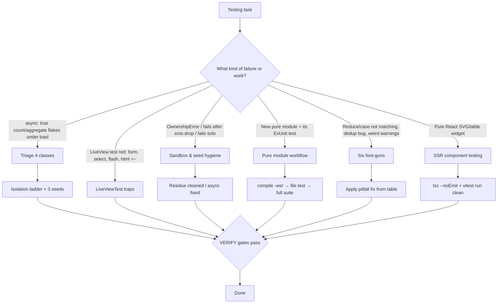

# elixir-testing

Consolidated testing rules for Elixir/Phoenix apps (pure-function modules, ExUnit
foot-guns, flaky `async: true` isolation, LiveViewTest traps, Ecto sandbox/seed
hygiene) and headless pure-React widget testing via `renderToStaticMarkup`.

## Routing



## Pure Elixir module + ExUnit

1. **Discover conventions first**: read 1–2 sibling modules + their tests; match
   their description language and fixture style. Every test module takes
   `use ExUnit.Case, async: true` (exceptions in the sandbox section only).
2. **Skeleton**: `@moduledoc` → `@spec` → body. Always define a wrong-type
   clause so edge inputs return a default instead of crashing:

```elixir
@spec transform(input) :: output
def transform(input) when is_list(input), do: # ...
def transform(_), do: []   # required wrong-type clause
```

3. **Verify in this order** (a new unused-fn warning surfaces on the second
   compile, not the first):

```bash
mix compile --warnings-as-errors   # unused aliases, unused private fns
mix test test/<path>/<file>_test.exs --seed 0
mix test                            # full suite — no regressions
```

4. **Edge-case matrix** for any list-in/list-out pure function, in order:
   empty→empty · all-non-matching→identity · target-in-the-middle (order) ·
   consecutive duplicates→one survives · non-consecutive duplicates→both
   survive · exact boundary N and N+1 · nil/missing key→no crash ·
   non-string content→untouched. Assert the **output value**, never just
   "doesn't crash".
5. **Ad-hoc probes**: `mix run --no-start -e '...'` boots without the
   supervision tree. Traps: `function_exported?/3` is false for lazily loaded
   modules (`Code.ensure_loaded/1` first); inline `MIX_ENV=test mix run` env can
   be silently dropped (`export MIX_ENV=test` first); DB probes run OUTSIDE the
   sandbox — clean up FK-safe (children before parents), prefer get-or-create
   so reruns are idempotent.

## The six foot-guns

| # | Symptom | Mechanism | Fix |
|---|---------|-----------|-----|
| 1 | Dedup never matches a pair | Pin on tuple 2nd elem compares against the whole tuple | Compare whole tuples: `key == last` after `match?({:tool, _}, key)` |
| 2 | First element silently dropped | `nil` sentinel collides with `{:tag, nil}` payload | Sentinel `:none` + `is_binary` content guard |
| 3 | Non-string content collapsed | `Enum.uniq_by` maps nil/missing/list content to one key | Hand-rolled reduce; keep non-string messages unconditionally |
| 4 | Output reversed/duplicated | Reducer bug blamed on the `Enum.reverse` pair | Trace the reducer first; never add a third reverse |
| 5 | Compile error on guard | `when type in disabled` — guard `in` needs a literal list | Move membership to the body with `if` |
| 6 | `String.trim(nil)` crash | `Map.get/3` default only fires on ABSENT keys | Pattern match `when is_binary(c) and c != ""`, or `\|\|` for non-boolean fields |
| 7 | `BadMapError` in stream chain | Helper returns `{:cont, acc}` inside the callback | Only the `stream_while` callback wraps; helpers return plain acc |

Full mechanisms and code: load `references/functional-purity-patterns.md`.

## Flaky async isolation

**Classify BEFORE fixing** — the fixes are completely different:

1. **Classic async count flake**: fails only under parallel load, green solo,
   clean DB → isolation ladder below.
2. **Committed residue in the test DB**: same delta on every seed AND fails
   solo → delete stale rows once; give exact-count tests a fresh per-test
   context. (See `references/sandbox-and-seed-dependency.md`.)
3. **Zombie tasks / async-pool races**: `DBConnection.OwnershipError` ("mode
   reverts to :manual") or `client #PID exited`; failing test MIGRATES across
   files per seed → force `schedule_async: false` in `test_helper.exs`, flip
   DB-touching async modules to `async: false`.
4. **Zero-vector NaN sort trap** (pgvector): a zero embedding sorts last, so the
   asserted row falls out of a `LIMIT` window → fresh scoping context, not a
   weaker assertion.

**Fast discriminators**: failing file alone (class 2 fails alone) · 3 seeds,
compare failing test NAMES (same set = residue/NaN; migrating set = class 3) ·
`grep -c "Task #PID" run.log` (>0 = zombies, even in green runs). `--trace`
green vs parallel red proves nothing — `--trace` forces `max_cases 1`.

**Isolation ladder** (top first):

1. Scope with an existing parameter — pass the fixture's `team.id` instead of
   `nil`; copy the pattern from already-passing tests in the same file.
2. Org-wide path test → do NOT scope it; flip exact-count to inclusion
   (`assert total >= 2`) or anchor on the fixture's unique row only.
3. Empty-list test with no scoping param → far-future `:from`
   (`~U[2099-01-01 00:00:00Z]`) so no concurrent row lands in the window.
4. Never `async: false` to pass a count flake; never change production code to
   satisfy a test. The one legitimate exception is pool-level ownership races
   (class 3).

Full ladder, worked before/after diffs: `references/flaky-test-isolation.md`.

## LiveViewTest traps

- **`form/3` validates select values against the CURRENTLY rendered options.**
  Submitting a value the select doesn't offer raises
  `ArgumentError: value for select ... must be one of [...]`. Create the
  fixtures that feed the options BEFORE `live/2` mounts the view; if options
  are dynamic, `render_change/2` the controlling select first, then submit.
- **UUID-typed refute targets must be castable.** `refute
  query_using_binary_id("other-team")` dies with `Ecto.Query.CastError` — the
  `where` still casts before finding zero rows. Use `Ecto.UUID.generate()` for
  negative-case ids.
- **`html =~ value` collides with form chrome.** If the string also renders
  inside a `<select>`/`<option>`, `refute html =~ ...` can never pass. Anchor
  on a row-only string or `has_element?(view, "#id-scoped")`.
- **Assert presence with `has_element?/2,3`, not `html =~ selector`** — a CSS
  selector string like `input[name="..."]` never appears literally in HTML.
- **Copy flash text EXACTLY** — case and plural sensitive; `"1 update."` does
  not contain `"updates"`.
- **Org-wide empty states** can't be deterministic while async tests insert →
  drive the page's search box to a no-match term, or invert to a positive
  assertion on the fixture's own item.
- **Global list/delete/order asserts** → membership by unique id
  (`Enum.any?`), `refute Enum.any?` for deletes, scope ordering to the
  fixture's id.
- **Named singleton Registries/ETS leak across test FILES** (VM-wide): leaked
  non-UUID keys crash a later file's Ecto sweep with
  `Ecto.Query.CastError ... cannot be dumped to type :binary_id`. Fix in the
  LEAKING file: register `Ecto.UUID.generate()` keys so leaked entries stay
  castable and match no row.

Full symptom→fix recipes: `references/liveviewtest-pitfalls.md` and
`references/registry-singleton-leak.md`.

## Sandbox & seed hygiene

- Rows committed outside the sandbox (ad-hoc `MIX_ENV=test mix run -e`,
  debug iex sessions, seeds) persist forever and make empty-instance tests
  fail — environmental, not broken tests. Clean via
  `MIX_ENV=test mix ecto.drop && MIX_ENV=test mix ecto.create && MIX_ENV=test mix ecto.migrate`,
  then re-run.
- A wiped test DB reds dozens of unrelated tests when setup code looks up
  shared fixtures **without a create-fallback**:
  `MyApp.Content.get_context_by_slug("personal") || elem(MyApp.Content.create_context(%{...}), 1)`.
- App-spawned `Task.Supervisor` tasks that touch the DB outlive the test and
  tear down the shared sandbox connection → set `schedule_async: false`
  suite-wide in `test_helper.exs`; grep every per-test `Application.put_env`
  block for the same key.
- `async: true` DataCase/ConnCase modules race sync shared-mode windows — the
  sandbox docs themselves say shared-mode tests must not be async. DB-touching
  → `async: false`; imports-only → `use ExUnit.Case, async: true`.

Recipes and hunt commands: `references/sandbox-and-seed-dependency.md`.

## SSR React component testing (the non-Elixir slice)

For **pure React components** (SVG charts, tables, data widgets — inline
styles, no DOM APIs): test with `renderToStaticMarkup` from `react-dom/server`
and assert on the HTML string. Zero new dependencies; works in vitest's `node`
environment. Not for interactive components, `useEffect`/refs, or snapshotting
large trees.

```tsx
import { describe, expect, it } from 'vitest';
import { renderToStaticMarkup } from 'react-dom/server';
import { MyChart } from './my-chart';

it('renders one bar per datum', () => {
  const html = renderToStaticMarkup(<MyChart data={[{ label: 'A', value: 10 }]} />);
  expect((html.match(/<rect[ >]/g) || []).length).toBe(1);
});
```

- Always `import { describe, expect, it } from 'vitest'` — repos without
  `vitest/globals` in tsconfig types error with TS2593 otherwise.
- Inline styles serialize as `property:value` (no spaces, no quotes);
  `opacity: 0.5` → `opacity:0.5`; `rgba(0, 0, 255, 0.15)` keeps its spaces.
  Run once and read the actual `Received:` output before writing numeric
  asserts.
- SVG presentation attributes serialize as `attr="value"` — `fill-opacity="0.3"`,
  never `fill-opacity:0.3`. JSX attribute vs `style={{}}` take different forms.
- Count elements with `/<th[ >]/g` — `/<th/g` also matches `<thead>`.
- Assert design-token NAMES (`var(--my-org-accent)`), not resolved hex.
- React `key` props are stripped from output; assert observable side effects.
- Gradient `<defs>` substring traps: `/<line\b/g` (not `'<line'`),
  `>100%<` (not `'%'`), width-qualified regex for cell-level styles.
- Typecheck gate: `npx tsc --noEmit 2>&1 | grep -c "<your files>"` → 0 new
  errors. Fixture dirs outside tsconfig `include` silently pass `tsc -p` —
  typecheck the file explicitly with inline flags.

Full recipes: `references/ssr-component-testing.md`,
`references/ssr-fixtures-and-variants.md`.

## VERIFY

```bash
# Elixir work (run from the project root)
mix compile --warnings-as-errors          # exit 0, zero output
mix test test/<touched_file>_test.exs --seed 0   # green alone
mix test --seed 1 && mix test --seed 12345 && mix test --seed 99999
#   → flaky-work acceptance: all green every run, all tests still async: true
grep -c "Task #PID" full_run.log           # expect 0 (no zombie tasks)
mix test                                    # full suite, no new regressions

# React/SSR work (run from the widget package root)
npx tsc --noEmit 2>&1 | grep -c "<your-new-files>"   # expect 0
npx vitest run                                        # exit 0

# Skill-integrity gates (run from the elixir-skills repo root)
# The four gates are defined in .riel/briefs/HOUSE.md — run them verbatim
# from there; do NOT inline the brand-scan regex here (it self-hits).
find .riel/build/elixir-testing -name '*.md' | wc -l    # SKILL.md + 5–10 references
grep -c 'flowchart' .riel/build/elixir-testing/SKILL.md # ≥ 1
head -12 .riel/build/elixir-testing/SKILL.md            # frontmatter visible
```

## References

| File | Load when |
|------|-----------|
| `references/flaky-test-isolation.md` | async tests flake on counts/aggregates; need the triage classes, isolation ladder, and worked before/after scoping diffs |
| `references/sandbox-and-seed-dependency.md` | `DBConnection.OwnershipError`, failures after `ecto.drop`, fails-when-solo residue, or zombie-task hunts |
| `references/liveviewtest-pitfalls.md` | LiveView tests red on `form/3`, selects, `html =~`, flash text, empty states, or list/delete/order asserts |
| `references/registry-singleton-leak.md` | `Ecto.Query.CastError ... :binary_id` in a LiveView test whose mount sweeps a shared Registry/ETS |
| `references/functional-purity-patterns.md` | writing a pure module + test, or a reduce/case/pin/sentinel bug you can't explain |
| `references/confirming-flakes-before-commit.md` | the suite went red on a test unrelated to your diff; prove what's yours vs pre-existing |
| `references/ssr-component-testing.md` | testing pure-React widgets via `renderToStaticMarkup`; serialization and assertion pitfalls |
| `references/ssr-fixtures-and-variants.md` | adding `variant` props, fixture/showcase files, structural-widget assertions, pnpm wave execution |
