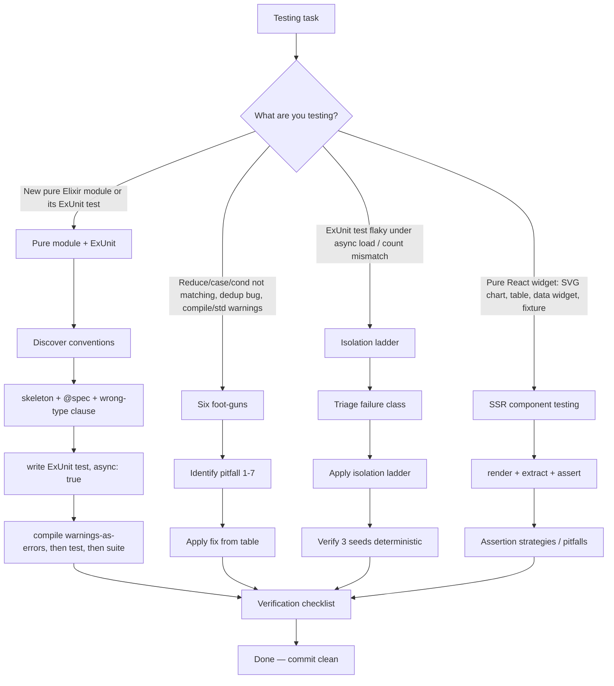

# elixir-testing

Consolidated testing reference for Elixir/Phoenix apps (pure-function conventions,
ExUnit foot-guns, flaky async-test isolation) and headless React widget testing
(SSR via `renderToStaticMarkup`). These are the two halves of testing a modern
umbrella stack: an Elixir backend and a React/TypeScript widget layer.

## Decision routing



## When to use / when not to

**Use** for any testing work on the Elixir backend or the pure-React widget layer:

| Task | Section |
|------|---------|
| Add a pure-data module (`lib/<app>/...`) + its ExUnit test | [Pure module](#pure-elixir-module--exunit) |
| Reduce/case/cond silently not matching, dedup bugs, `String.trim(nil)`, useful but confusing warnings | [Six foot-guns](#the-six-foot-guns-pitfalls) |
| `async: true` tests that intermittently fail on counts/aggregates | [Isolation ladder](#flaky-async-test-isolation) |
| A pure React SVG chart / table / data widget, or an e2e fixture/showcase file | [SSR component testing](#ssr-react-component-testing) |

**Do not** use for:

- GenServer / Process / supervision work → LiveView/realtime or dev-bridge skills.
- Mix build failures (lock mismatch, dep resolution) → `elixir-mix-build` / `elixir-build-troubleshooting`.
- Credo / Dialyzer / Sobelow sweeps → lint/tooling skills.
- LiveView template / form work → Phoenix umbrella skills.
- Testing React **interactivity**, `useEffect`, or DOM refs → `@testing-library/react` + jsdom, not SSR.

---

## Pure Elixir module + ExUnit

### Workflow

1. **Discover conventions.** Read `AGENTS.md` (project guideline block) and 1–2 sibling
   modules + their tests to match style. For Phoenix confirm `core_components.ex` exports
   `.input`/`.icon` and `mix.exs` uses Req (not HTTPoison/Tesla).

2. **Write the skeleton** — `@moduledoc`, `@spec`, then body. Always define a
   wrong-type clause so edge cases don't crash:

```elixir
defmodule MyApp.Domain.Thing do
  @moduledoc "One-paragraph purpose. State spec-relevant decisions (units, returns)."

  @type input :: [map()]
  @type output :: [map()]

  @doc "Short behavior summary."
  @spec transform(input) :: output
  def transform(input) when is_list(input), do: # ...

  def transform(_), do: []   # required wrong-type clause
end
```

3. **Write the test** matching the repo's description language, `async: true`:

```elixir
defmodule MyApp.Domain.ThingTest do
  use ExUnit.Case, async: true
  alias MyApp.Domain.Thing

  describe "transform/1" do
    test "empty list returns empty list" do
      assert Thing.transform([]) == []
    end
  end
end
```

4. **Verify in this order** (order matters — a new unused-fn warning surfaces on the
   second compile, not the first):

```bash
mix compile --warnings-as-errors   # catches unused aliases, unused private fns
mix test test/<app>/<dir>/<file>_test.exs --seed 0
mix test                           # full suite — no regressions
```

5. **Ad-hoc probe** with `mix run --no-start -e '...'` (boots only your module, not
   the app/supervision tree). Traps in probes:
   - `function_exported?/3` is `false` for lazy-loaded modules → `Code.ensure_loaded/1` first.
   - `MIX_ENV=test mix run` inline may be silently dropped → `export MIX_ENV=test` in a prior command.
   - DB probes run OUTSIDE a sandbox transaction → clean up FK-safe (children before
     parents), prefer get-or-create so reruns are idempotent.

### Edge-case test matrix

Every pure-function module with list-in/list-out wants these, in order:

| # | Test | Why |
|---|------|-----|
| 1 | empty list → empty list | guards the `when is_list` clause |
| 2 | all non-matching → identity | proves the no-op baseline |
| 3 | mixed input with the transform target in the middle | proves order preservation |
| 4 | two consecutive duplicate targets → one survives | proves the dedup core |
| 5 | two **non**-consecutive identical targets → both survive | proves "consecutive" semantics |
| 6 | boundary case (exactly N chars, exactly N+1) | proves the threshold is inclusive |
| 7 | nil content / missing key → no crash | guards `Map.get` access |
| 8 | non-string content (list of parts) → untouched | guards the `is_binary` branch |

Assert the **output shape/value**, not just "doesn't crash" — for nil/missing-key
cases the expected output is often "input unchanged."

---

## The Six Foot-Guns (pitfalls)

### 1. Pin on a tuple doesn't compare tuple elements
`case key do {:tool, ^last_dedup_key} -> ...` binds the *second* element to
`last_dedup_key` and compares it against the whole `{:tool, "foo"}` — never equal to
the string `"foo"`. Compare whole tuples:
```elixir
cond do
  match?({:tool, _}, key) and key == last_dedup_key -> {acc, last_dedup_key}
  true -> {[msg | acc], key}
end
```

### 2. `nil` sentinel collides with a `{:tag, nil}` payload
Initializing an accumulator sentinel as `nil`, then `key == last` drops the first
`{:tool, nil}` message. Use an atom that payload shapes can't produce:
```elixir
Enum.reduce(messages, {[], :none}, &reduce_message/2)
```
If only *binary* content should dedupe, add a content guard: `defp dedup_key(%{"content" => c}) when is_binary(c), do: {:tool, c}; defp dedup_key(_), do: :keep`.

### 3. `Enum.uniq_by` collapses non-string content
Two messages with missing/nil/list `content` all map to the same key and one gets
dropped. Dedupe only against string content; keep non-string messages unconditionally
(hand-rolled `Enum.reduce` matching on `is_binary(content)`).

### 4. Reverse-then-rebuild order bugs blame the wrong thing
`Enum.reverse |> reduce |> elem(0) |> Enum.reverse` is fine **if** the reducer is
correct. When output is reversed or duplicated, the bug is in the reducer, not the
reverses. Trace the reducer first; don't add a third reverse.

### 5. Guard `in` with a variable won't compile
`defp f(..., disabled) when type in disabled` → compile error: a guard `in` needs a
compile-time list/range. Move membership to the body with `if`. Keep literal guards
(`nil`, `""`) — those are fine.

### 6. `Map.get(map, key, default)` returns `nil` when the key EXISTS with a nil value
The default only fires on **absent** keys. For "nil-or-empty → use default," pattern
match with a guard instead:
```elixir
case Inference.chat(payload) do
  {:ok, %{"content" => c}} when is_binary(c) and c != "" -> String.trim(c)
  _ -> fallback_value()
end
```
or `content = message["content"] || ""` (`||` also catches `false` — only use for non-boolean fields).

### 7. Helper returns `{:cont, acc}` but the chain expects a plain `acc`
The `{:cont, acc}`/`{:halt, acc}` protocol belongs ONLY at the `stream_while`
callback boundary. Helpers called *inside* the callback must return plain values —
if any clause wraps in a tuple, the next chain step gets a non-map (`BadMapError`).
Audit every `defp` called from a stream callback.

### Standard dedup-with-state pattern
Keep the first of N consecutive identical elements, preserve order:
```elixir
def dedup_consecutive(messages, key_fn) do
  {reversed, _} =
    Enum.reduce(messages, {[], :none}, fn msg, {acc, last} ->
      key = key_fn.(msg)
      cond do
        match?({:tool, _}, key) and key == last -> {acc, last}
        true -> {[msg | acc], key}
      end
    end)
  Enum.reverse(reversed)
end
```

| Symptom | Likely pitfall | Fix |
|---------|----------------|-----|
| Dedup silently drops first element | #2 nil sentinel | `:none` sentinel + content guard |
| Dedup never matches any pair | #1 pin on tuple 2nd elem | match whole tuple `key == last` |
| Non-string content collapsed | #3 `Enum.uniq_by` over nil | dedup against string content only |
| Output reversed | #4 buggy reducer | trace reducer, not reverses |
| `unused def` on 2nd compile | leftover private helper | delete helper, recompile |
| Compile error guard `in` variable | #5 | move check to `if` in body |
| `String.trim(nil)` / wrong default | #6 `Map.get` nil-value | pattern match with `is_binary` guard |
| `BadMapError` in stream callback | #7 helper wraps tuple | helpers return plain `acc` |

### Anti-patterns
- Don't write a test that only asserts "doesn't crash" for nil/missing — assert the output.
- Don't add `@spec` and forget the wrong-type clause — the non-list call crashes.
- Don't skip `mix compile --warnings-as-errors` between edits — the unused-fn warning only appears on the second compile.
- Don't `String.length/1` strings that may exceed tens of thousands of chars — use `byte_size/1`.
- Don't log inside a pure function — split pure transform + thin impure wrapper.

---

## Flaky async test isolation

### Triage first: four look-alike failure classes
The fix differs completely per class, so classify BEFORE the ladder:

1. **Classic async count flake** (ladder below): fails only under parallel load, green when the file runs alone, clean DB.
2. **Committed residue in the test DB**: fails with the SAME delta on every seed AND fails alone. Stale rows committed outside the sandbox pollute a shared fixture context. Fix: delete the stale rows once, then give exact-count tests a fresh per-test context.
3. **Zombie background tasks / async-pool races**: `DBConnection.OwnershipError` (mode reverts to `:manual`) or `client #PID exited`; the failing test MIGRATES across files per seed. App-spawned `Task.Supervisor` tasks outlive the test and tear down the shared sandbox connection. Fix: force `schedule_async: false` in `test_helper.exs` + audit async DB-case modules; flip DB-touching modules to `async: false` (documented sandbox fix for shared mode).
4. **Zero-vector NaN sort trap** (pgvector): a zero embedding gives cosine distance `NaN`, and Postgres sorts `NaN` last. If the shared transaction carries ≥`LIMIT` rows, the asserted row sorts out of the window. Deterministic per seed, green solo. Fix: fresh scoping context per test, not a weaker assertion.

**Fast discriminators:** run the failing file alone (class 2 fails alone). Run the full suite with 3 different seeds and compare failing test *names* (same set = residue/NaN; migrating set = class 3). `grep -c "Task #PID" run.log` (>0 = zombies, even in green runs). Note `--trace` green vs parallel red is NOT proof of a race — `--trace` forces `max_cases 1`, changing module scheduling order.

### The isolation ladder (top first; fall only when blocked)

1. **Scope with an existing parameter.** Production aggregate/rollup functions almost always accept a scoping id (`team_id`, `user_id`, `model_id`, ...). Fixtures create unique parent rows per test; pass the scoped id instead of `nil`. Before editing, copy from already-passing tests in the same file that isolate.
2. **Org-wide path tests.** If a test SPECIFICALLY exercises the nil/org-wide behavior, don't scope it — flip **exact-count** to **inclusion** asserts: `assert total >= 2`, or anchor on the fixture's unique row and assert its aggregate only.
3. **Empty-list tests with no scoping param.** Functions taking only keyword opts are always org-wide; a fresh fixture doesn't help. Use a far-future `:from` (`~U[2099-01-01 00:00:00Z]`) so no concurrent test's rows can land in the window. Exact-empty asserts are the sneakiest failures — green solo, red under load.
4. **Never** `async: false` just to pass a count flake, and **never** change production code to satisfy a test (test-only work). The one legitimate exception is pool-level ownership races (triage class 3) — the sandbox docs themselves say shared mode tests should not be async.

### Workflow
1. Read the failing file; copy the house scoping pattern from already-passing tests.
2. Classify each failing test: global-aggregate (scope it), org-wide-path (inclusion assert), or empty-list (scope or future `:from`).
3. Check the production function's actual signature before assuming scoping exists (`def f(opts \\\\ [])` has no param; `def f(team_id, opts)` does).
4. Apply the ladder; keep every test `async: true`.
5. Verify determinism: `mix test test/path/file.exs --seed 1`, `--seed 12345`, `--seed 99999` — all green every run.

### Pitfalls
- Don't delete org-wide tests when they flake — adapt with inclusion asserts; that behavior is worth keeping covered.
- `assert results == []` with a wide `:from` is a time bomb in async suites.
- The same test can appear multiple times in a file with different shapes — fix each occurrence.
- Don't weaken assertions to hide a flake; the fix is isolation/scoping, not a weaker assert.
- A shared helper like `hours_ago/1` relative to `DateTime.utc_now()` keeps window tests stable across wall-clock time — preserve it.
- **LiveView `html =~ value` collides with form chrome.** If the string is also inside a `<select>`/`<option>`, a `refute html =~ ...` can never pass. Anchor on a row-only string or `has_element?` on an id-scoped element.
- **Org-wide LiveView empty states** can't be deterministic while async tests insert — drive the page's search box to a no-match term, or invert to a positive assertion on the fixture's own item.
- **Global list/delete/order asserts** → membership/`Enum.any?` by id, `refute Enum.any?` for deletes, scope ordering to the fixture's unique id.
- **Named singleton Registries/ETS leak across test FILES, not just tests.** A `Registry` with a fixed name started by one file is VM-wide shared; entries it registers never get cleaned up and can poison a different file that later sweeps it. Symptom: `Ecto.Query.CastError ... cannot be dumped to type :binary_id` in a test whose mount calls a registry sweep — leaked ids are non-UUID strings. **Fix in the leaking file (test-only):** use real domain-shaped ids (`Ecto.UUID.generate()`) for anything registered into a shared named singleton; leaked entries then stay castable and just match no row (harmless).

---

## SSR React component testing

For **pure React components** — SVG charts, styled HTML tables, data widgets — that use
only inline styles and no DOM APIs, test with `renderToStaticMarkup` from
`react-dom/server` and assert on the HTML string. **Zero new dependencies**: no
`@testing-library/react`, no jsdom/happy-dom, works in vitest's `node` environment.

**Don't use for** interactive components (clicks/state), `useEffect`/refs needing a real
DOM, or large page-tree snapshots (use `toMatchSnapshot`).

### Core pattern — render, extract, assert
```tsx
import { describe, expect, it } from 'vitest';
import { renderToStaticMarkup } from 'react-dom/server';
import { MyChart } from './my-chart';

describe('MyChart', () => {
  it('renders the correct number of bars', () => {
    const html = renderToStaticMarkup(
      <MyChart data={[{ label: 'A', value: 10 }, { label: 'B', value: 20 }]} />
    );
    expect((html.match(/<rect/g) || []).length).toBe(2);
  });
});
```

### Always import from 'vitest'
Repos without `vitest/globals` in tsconfig types error on unimported `describe`/`it`/`expect` (TS2593). Always `import { describe, expect, it } from 'vitest';` explicitly.

### Assertion strategies
- **Element counting:** count by tag — bars are `<rect>`, rows `<tr>`. For donuts filter arc segments: `/<circle[^>]*stroke-dasharray=/g` (excludes the track circle).
- **Attribute extraction:** regex capture groups, e.g. `[...html.matchAll(/<rect[^>]*x="([^"]+)"/g)]`.
- **Content presence:** `expect(html).toContain('>10<')`, negation via `.not.toContain`.
- **Inline-style colors:** React inline styles serialize as `property:value` (no spaces, no quotes): `style={{ background: 'var(--accent)' }}` → `background:var(--accent)`.
- **`data-*` attributes (preferred for variant tests):** add `data-variant`/`data-size` to the root element and assert `data-variant="warning"`. Prefer for *which variant was chosen*; use style asserts for *what the variant produced*.
- **Geometric:** `expect(dash).toBeCloseTo(2 * Math.PI * radius, 1)`.

### Key pitfalls
1. **Inline styles ≠ CSS.** `opacity: 0.5` → `opacity:0.5`, NOT `opacity:.5`. Run once and read actual output before writing numeric asserts.
2. **Count tag-vs-prefix collisions.** `/<th/g` matches `<thead>`; use `/<th[ >]/g`. Same for `tr`, `td`, `circle`.
3. **SVG presentation attributes are `attr="value"`, not `property:value`.** `<circle fillOpacity={0.3} />` → `fill-opacity="0.3"` (quoted, with `=`), whereas `style={{ opacity: 0.3 }}` → `opacity:0.3`. JSX attribute vs inline style take different forms — assert accordingly.
4. **Assert on token names, not resolved colors.** `renderToStaticMarkup` does not resolve `var(--accent)`; match the literal token.
5. **Design tokens** (`var(...)`) keep widgets themeable; assert the token name, not a hardcoded hex.
6. **React `key` props are stripped** from SSR output. Assert on observable side effects (dividers, sibling counts, fill colors), never on key values.
7. **Substring false negatives after adding gradient `<defs>`:** `<linearGradient` contains `<line` → use `/ <line\b/g` for absence-of-needle tests, not `.not.toContain('<line')`. And `offset="100%"` contains `%` → test percentage-labels as `>100%<` (text nodes), not `.not.toContain('%')`.
8. **Broad negation can false-fail when a wrapper surface matches.** Cell-level `border-radius` removal vs an elevated container still holding `border-radius` → use a width-qualified regex (`/width:200px[^"]*border-radius:/`), not `.not.toContain(broad)`.
9. **`import * as React` only when you reference `React.`; `import type * as React` fails if you use `React.`** as a value (`React.Fragment`) — TS1361. When in doubt, use non-type `import * as React`.
10. **CSS grid / rgba / color-mix keep internal spaces.** `gridTemplateColumns: 'repeat(3, 1fr)'` → `grid-template-columns:repeat(3, 1fr)` (space after comma); `rgba(0, 0, 255, 0.15)` and `color-mix(in srgb, var(--x) 60%, transparent)` serialize exactly as written. Always verify against output.
11. **SVG `<text>` model props:** `textTransform`, `letterSpacing`, `fontWeight` are NOT valid SVG presentation attributes (TS2322) — pass via `style`. `fontSize`, `fill`, `textAnchor`, `dominantBaseline` ARE valid JSX props.
12. **Guard division by zero** in charts: `total || 1` to avoid `NaN`.
13. **Add `role="img"` + `aria-label`** to SVG charts for accessibility.
14. **HTML-entity double-encoding:** a component rendering `Q&A` outputs `Q&amp;A`; if the test string also contains `&amp;`, React encodes it again → `Q&amp;amp;A`. Don't assert on text with HTML entities.

### Typecheck gate
```bash
npx tsc --noEmit 2>&1 | grep -E "(my-file)\."    # expect no output
npx tsc --noEmit 2>&1 | grep -c "my-new-files"   # vs pre-existing count — you added 0
```
For fixture/showcase dirs, `tsc -p tsconfig.json` silently passes if the dir isn't in the tsconfig `include` array — typecheck the file explicitly with inline flags.

### Subagent-created test files — predictable failures
When dispatching subagents (waves) to write component + test files, budget for:
1. **Missing vitest imports** → `tsc --noEmit | grep "Cannot find name 'describe'"`; add explicit imports.
2. **Wrong CSS serialization assumptions** in assertions → run tests, read `Received:` output, fix.
3. **Naive element-counting regex** (`/<th/g` vs `/<th[ >]/g`).
4. **Biome `noArrayIndexKey`** → use stable data-derived keys. `// biome-ignore` inside `.map()` callbacks is treated as a JS comment and does NOT suppress — put overrides in `biome.json` instead.
5. **`useValidAriaRole`** on a prop named `role` → `// biome-ignore` on the test-file line.
6. **`noNonNullAssertion`** (`match![1]`) → guard with a ternary `match ? match[1] : ''`.
7. **Duplicate shared-file creation** by disjoint scopes → merge after the wave.
8. **Physical asset files not renamed** when code references change → `grep` renamed refs and `mv` the actual `.png`/`.webp`.

**Efficient fix flow:** dispatch → wait → `tsc --noEmit` (fix all import/type errors in one batch) → `vitest run` (fix all assertion errors in one batch) → `biome check --write` → fix remaining lint manually → commit. For widget libraries, prefer `biome.json` overrides (`noArrayIndexKey`, `noSvgWithoutTitle` off for the widget dir) over dozens of per-file ignores.

---

## Verification checklist
- [ ] `mix compile --warnings-as-errors` passes with zero output
- [ ] New test file passes alone (`--seed 0`), then full suite shows no new regressions
- [ ] No `defp` helper left behind after a refactor (dead code → unused-fn warning)
- [ ] Every described behavior has ≥1 passing test; nil/missing asserts verify *output*, not just "no crash"
- [ ] Flaky tests: same 3 seeds green, all still `async: true`, production code untouched
- [ ] React: explicit vitest imports; counts via `[ >]` regex; style asserts verified against real output; token names not hex; no asserts on React `key`; SVG has `role="img"`/`aria-label`
- [ ] `npx tsc --noEmit` shows 0 new errors from your files